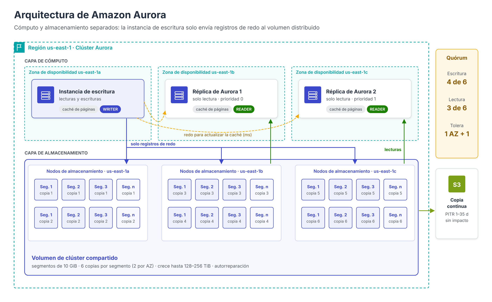
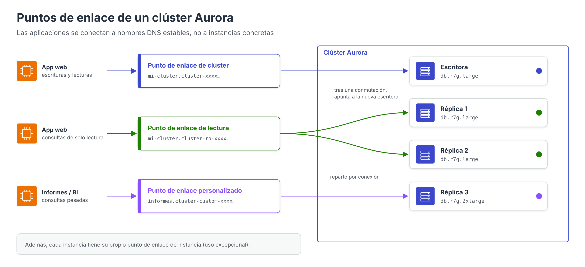

# Amazon Aurora: arquitectura

**Amazon Aurora** es un motor de base de datos relacional desarrollado por AWS, compatible con **MySQL** y **PostgreSQL**, que forma parte de la familia Amazon RDS. Su característica distintiva no es el lenguaje ni la interfaz, que son los de los motores originales, sino su **arquitectura**: Aurora separa el cómputo del almacenamiento y sustituye el disco local de cada servidor por un **sistema de almacenamiento distribuido** diseñado específicamente para la nube.

Esta decisión de diseño, descrita por los ingenieros de AWS en la conferencia SIGMOD 2017, es la que explica la mayoría de sus propiedades: durabilidad, conmutación por error rápida, réplicas con un retraso mínimo, copias de seguridad sin impacto en el rendimiento y crecimiento automático del almacenamiento.

---

## El problema de la arquitectura tradicional

En una base de datos relacional convencional, como MySQL o PostgreSQL sobre RDS, cada escritura genera varias operaciones de entrada/salida sobre el disco: el registro de transacciones (*redo log* o WAL), las páginas de datos modificadas, el registro binario para la replicación, la escritura doble (*double-write*) para evitar páginas corruptas, etc. Si además la instancia es Multi-AZ, todas estas escrituras se replican de forma síncrona a la *standby*.

En la nube, el cuello de botella no suele estar en la CPU ni en el disco, sino en la **red**: cada escritura atraviesa la red varias veces y la latencia se acumula.

**La idea central de Aurora es que «el registro es la base de datos»** (*the log is the database*): la instancia de base de datos solo envía a la capa de almacenamiento los **registros de *redo***, y es el propio almacenamiento distribuido el que, de forma asíncrona y en segundo plano, aplica esos registros para materializar las páginas de datos. Esto reduce drásticamente el volumen de E/S por red.

---

## Separación entre cómputo y almacenamiento

Un **clúster de Aurora** se compone de dos capas independientes:

| Capa | Componentes | Función |
| --- | --- | --- |
| **Cómputo** | 1 **instancia de escritura** (*writer*, primaria) y hasta **15 réplicas de Aurora** (*readers*) | Ejecutan el motor SQL: análisis de consultas, planificación, transacciones, caché de páginas (*buffer pool*) |
| **Almacenamiento** | **Volumen de clúster** compartido, distribuido en tres zonas de disponibilidad | Persiste los datos, aplica los registros de *redo*, se replica y se repara automáticamente |

Todas las instancias del clúster leen **el mismo volumen**. En consecuencia:

- Añadir una réplica **no copia datos**: la nueva instancia se conecta al volumen existente y empieza a servir lecturas en pocos minutos.
- Eliminar instancias **no borra datos**: los datos solo desaparecen al eliminar el clúster completo.
- El número de copias de los datos **no depende del número de instancias**: incluso un clúster con una sola instancia mantiene sus datos replicados en tres zonas.

---

## El volumen de clúster

El volumen de clúster es un almacenamiento virtual respaldado por discos SSD con estas características:

- **Seis copias en tres zonas de disponibilidad**: el volumen se divide en **segmentos de 10 GiB**, y cada segmento se replica seis veces, dos en cada zona de disponibilidad. Cada grupo de seis copias de un segmento se denomina **grupo de protección**.
- **Escrituras y lecturas por quórum**: una escritura se confirma cuando **4 de las 6 copias** la han persistido; la recuperación de un segmento requiere **3 de 6** copias.
- **Tolerancia a fallos «AZ+1»**: el diseño permite perder una zona de disponibilidad completa sin perder la capacidad de escribir, y una zona más una copia adicional sin perder datos.
- **Autorreparación**: los bloques y discos se comprueban de forma continua. Un segmento dañado se reconstruye a partir de las demás copias; al ser segmentos pequeños, la reparación se completa en minutos.
- **Crecimiento automático**: el volumen crece a medida que se insertan datos, hasta **128 TiB** o **256 TiB** según la versión del motor, y **se reduce** cuando se eliminan tablas o datos en las versiones que lo admiten. Solo se paga por el espacio realmente utilizado.
- **Archivos temporales**: las ordenaciones grandes o la creación de índices utilizan almacenamiento local de la instancia, no el volumen compartido.

### Quórum de escritura y de lectura

La elección de 4/6 y 3/6 no es arbitraria. Para que el sistema sea coherente, cualquier conjunto de lectura debe solaparse con cualquier conjunto de escritura (3 + 4 > 6), y dos escrituras no pueden ignorarse mutuamente (4 + 4 > 6). Con dos copias por zona, la pérdida de una zona completa deja **4 copias**, suficientes para seguir escribiendo.

| Situación | Copias disponibles | ¿Escritura? | ¿Datos íntegros? |
| --- | --- | --- | --- |
| Funcionamiento normal | 6 | Sí | Sí |
| Fallo de un disco | 5 | Sí | Sí |
| Caída de una zona de disponibilidad | 4 | Sí | Sí |
| Caída de una zona + un disco adicional | 3 | No, hasta reparar | Sí (puede reconstruirse) |

---

## Instancias y réplicas de Aurora

### Instancia de escritura

Es la única instancia que acepta operaciones de escritura (las variantes distribuidas Aurora PostgreSQL Limitless Database y Aurora DSQL, descritas en el apartado de despliegue, siguen un modelo distinto). Envía los registros de *redo* a las seis copias del segmento afectado y confirma la transacción al alcanzar el quórum.

### Réplicas de Aurora

Las réplicas leen del mismo volumen, por lo que **no necesitan reproducir las escrituras**: la instancia de escritura les envía los registros de *redo* únicamente para que actualicen las páginas que tienen en su caché. El retraso de réplica (*replica lag*) suele ser de **milisegundos**, frente a los segundos o minutos que puede alcanzar la replicación asíncrona de un motor convencional.

Cada réplica tiene asignado un **nivel de prioridad** (*promotion tier*, de 0 a 15) que determina el orden en el que se promociona en caso de fallo de la instancia de escritura.

### Conmutación por error

Cuando la instancia de escritura falla, Aurora **promociona automáticamente una réplica** (la de mayor prioridad y, en caso de empate, la de mayor tamaño). Como la réplica ya tiene acceso a todos los datos, la conmutación suele completarse en **menos de 30 segundos**. Si el clúster no tiene réplicas, Aurora intenta crear una nueva instancia, lo que lleva más tiempo.

Además, la **recuperación tras un reinicio** es muy rápida (normalmente menos de 60 segundos), porque no es necesario reproducir el registro de transacciones al arrancar: la capa de almacenamiento ya aplica los registros de *redo* de forma continua.

---

## Puntos de enlace de un clúster

Aurora proporciona varios nombres DNS que abstraen a las aplicaciones de las instancias concretas:

| Punto de enlace | Formato | Apunta a | Uso |
| --- | --- | --- | --- |
| **De clúster** (escritura) | `mi-cluster.cluster-xxxx.us-east-1.rds.amazonaws.com` | La instancia de escritura actual | Todas las escrituras; tras una conmutación por error apunta automáticamente a la nueva primaria |
| **De lectura** (*reader*) | `mi-cluster.cluster-ro-xxxx.us-east-1.rds.amazonaws.com` | Las réplicas, con reparto de conexiones | Consultas de solo lectura |
| **Personalizado** (*custom*) | `mi-grupo.cluster-custom-xxxx…` | Un subconjunto de instancias elegido por el administrador | Separar cargas, por ejemplo informes en instancias más grandes |
| **De instancia** | `mi-instancia.xxxx.us-east-1.rds.amazonaws.com` | Una instancia concreta | Diagnóstico o ajustes muy específicos |

!!! note "Buena práctica"
    Las aplicaciones deben conectarse siempre a los **puntos de enlace de clúster y de lectura**, nunca a los de instancia, para beneficiarse de la conmutación por error automática. El reparto que realiza el punto de enlace de lectura se produce **por conexión**, no por consulta.

---

## Copias de seguridad, restauración y clonado

- **Copias continuas**: Aurora envía de forma continua e incremental los datos del volumen a Amazon S3, **sin afectar al rendimiento** ni requerir ventana de copia. Permiten restaurar el clúster a cualquier segundo del periodo de retención (de 1 a 35 días).
- **Instantáneas manuales**: se conservan hasta que se eliminan y pueden copiarse a otras regiones o compartirse con otras cuentas.
- **Clonado rápido** (*fast cloning*): crea un clúster nuevo que comparte inicialmente las páginas del original mediante **copia en escritura** (*copy-on-write*). El clon se crea en minutos, independientemente del tamaño de la base de datos, y solo consume espacio adicional por las páginas que se modifican. Es muy útil para crear entornos de pruebas a partir de datos de producción.
- **Backtrack** (solo Aurora MySQL): permite «rebobinar» el clúster a un momento anterior **sin restaurar** una copia, por ejemplo para deshacer un `DELETE` sin `WHERE`. Debe activarse al crear el clúster.

---

## Modelos de facturación del almacenamiento

| Configuración | Qué se factura | Recomendado cuando |
| --- | --- | --- |
| **Aurora Standard** | Instancias + almacenamiento + **E/S** (por millón de peticiones) | El gasto en E/S es inferior al 25 % del total |
| **Aurora I/O-Optimized** | Instancias + almacenamiento (más caros), **sin coste por E/S** | El gasto en E/S supera el 25 % del total |

Puede pasarse de Standard a I/O-Optimized una vez cada 30 días, y en sentido contrario en cualquier momento.

---

## Comparativa arquitectónica con RDS Multi-AZ

| Aspecto | RDS for MySQL Multi-AZ | Aurora MySQL |
| --- | --- | --- |
| Almacenamiento | Un volumen EBS por instancia | Volumen compartido, 6 copias en 3 AZ |
| Datos replicados | Bloques completos del volumen | Solo registros de *redo* |
| Instancias que leen | Solo la primaria | Primaria + hasta 15 réplicas |
| Retraso de las réplicas de lectura | Segundos o más (replicación asíncrona) | Milisegundos |
| Conmutación por error | 1–2 minutos | Normalmente < 30 segundos |
| Copia de seguridad | Instantánea EBS (breve impacto de E/S en Single-AZ) | Continua, sin impacto |
| Crecimiento del almacenamiento | Aprovisionado / autoescalado | Automático, pago por uso |

---

## Referencias

- Verbitski, A., Gupta, A., Saha, D., Brahmadesam, M., Gupta, K., Mittal, R., Krishnamurthy, S., Maurice, S., Kharatishvili, T., Bao, X. (2017). *Amazon Aurora: Design Considerations for High Throughput Cloud-Native Relational Databases*. ACM SIGMOD 2017 — [Amazon Science](https://www.amazon.science/publications/amazon-aurora-design-considerations-for-high-throughput-cloud-native-relational-databases)
- AWS. *What is Amazon Aurora?* — [Guía del usuario de Aurora](https://docs.aws.amazon.com/AmazonRDS/latest/AuroraUserGuide/CHAP_AuroraOverview.html)
- AWS. *Amazon Aurora storage* — [Almacenamiento de Aurora](https://docs.aws.amazon.com/AmazonRDS/latest/AuroraUserGuide/Aurora.Overview.StorageReliability.html)
- AWS Database Blog. *Amazon Aurora under the hood: quorums and correlated failure* — [Artículo](https://aws.amazon.com/blogs/database/amazon-aurora-under-the-hood-quorum-and-correlated-failure)
- AWS. *Amazon Aurora MySQL/PostgreSQL database clusters now support up to 256 TiB of storage volume* (07/2025) — [Anuncio](https://aws.amazon.com/about-aws/whats-new/2025/07/amazon-aurora-mysql-database-clusters-256-tib-storage-volume)
- AWS. *High availability for Amazon Aurora* — [Alta disponibilidad](https://docs.aws.amazon.com/AmazonRDS/latest/AuroraUserGuide/Concepts.AuroraHighAvailability.html)
- AWS. *Amazon Aurora FAQ: availability and durability* — [Preguntas frecuentes](https://docs.aws.amazon.com/rds/latest/auroraextendedcontent/aurora-faq-availability-and-durability.html)
- AWS. *Amazon Aurora endpoint connections* — [Puntos de enlace](https://docs.aws.amazon.com/AmazonRDS/latest/AuroraUserGuide/Aurora.Overview.Endpoints.html)
- AWS. *Cloning a volume for an Amazon Aurora DB cluster* — [Clonado](https://docs.aws.amazon.com/AmazonRDS/latest/AuroraUserGuide/Aurora.Managing.Clone.html)
- AWS. *Backtracking an Aurora DB cluster* — [Backtrack](https://docs.aws.amazon.com/AmazonRDS/latest/AuroraUserGuide/AuroraMySQL.Managing.Backtrack.html)
