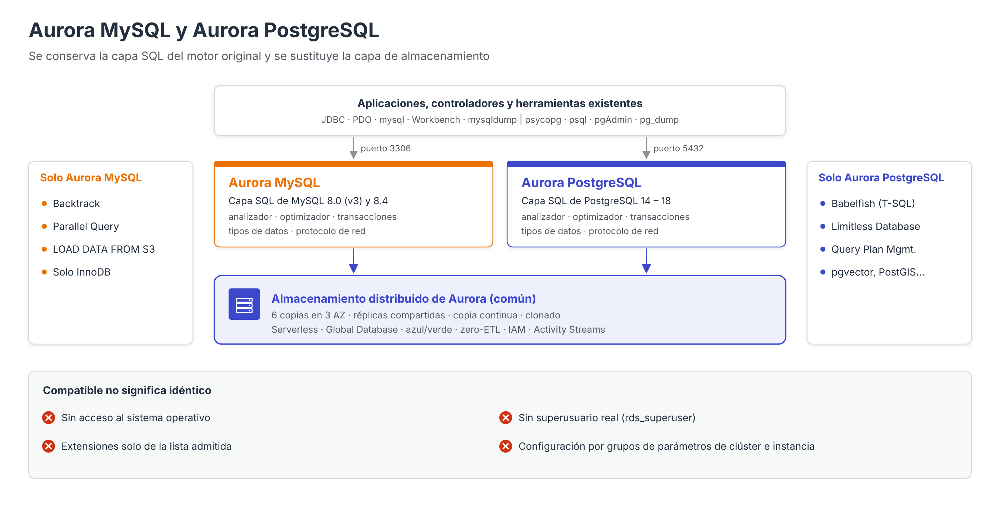

# Aurora MySQL y Aurora PostgreSQL



Aurora no es un motor con lenguaje propio: se presenta en dos **ediciones compatibles** con los dos motores de código abierto más extendidos. En ambos casos AWS conserva la capa SQL del motor original (analizador, optimizador, gestión de transacciones, tipos de datos, protocolo de red) y **sustituye la capa de almacenamiento** por el volumen de clúster distribuido descrito en el apartado anterior.

---

## Qué significa «compatible»

Que Aurora sea compatible con MySQL o PostgreSQL significa que:

- Utiliza el **mismo protocolo de red** y el mismo puerto predeterminado (3306 para MySQL, 5432 para PostgreSQL), de modo que las aplicaciones se conectan con los **mismos controladores** (JDBC, PDO, `mysqlclient`, `psycopg`…).
- Acepta el **mismo dialecto SQL**, los mismos tipos de datos y las mismas funciones de la versión de la que deriva.
- Funciona con las **mismas herramientas** de administración: cliente `mysql`, MySQL Workbench, `mysqldump`, `psql`, pgAdmin, `pg_dump`, etc.
- Permite migrar aplicaciones existentes **con cambios mínimos o nulos** en el código.

No obstante, compatibilidad **no es identidad**. Al tratarse de un servicio gestionado con un almacenamiento distinto, existen diferencias que el administrador debe conocer:

| Aspecto | Motor autogestionado | Aurora |
| --- | --- | --- |
| Acceso al sistema operativo y a los ficheros de datos | Sí | No |
| Superusuario real (`SUPER` en MySQL, `superuser` en PostgreSQL) | Sí | No; se sustituye por roles gestionados (`rds_superuser_role`, `rds_superuser`) |
| Motores de almacenamiento de MySQL | InnoDB, MyISAM, MEMORY… | Solo **InnoDB** para tablas persistentes |
| Extensiones de PostgreSQL | Cualquiera que se compile e instale | Solo las de la **lista de extensiones admitidas** |
| Configuración del motor | `my.cnf`, `postgresql.conf` | Grupos de parámetros de **clúster** y de **instancia** |
| Replicación | Configurada por el administrador | Réplicas de Aurora sobre almacenamiento compartido (el *binlog* de MySQL es opcional) |

---

## Versiones disponibles

### Aurora MySQL

| Versión de Aurora MySQL | Compatible con | Situación (noviembre de 2026) |
| --- | --- | --- |
| Aurora MySQL 2 (`2.x`) | MySQL 5.7 | Fuera del soporte estándar; solo disponible con **RDS Extended Support** (de pago) |
| Aurora MySQL 3 (`3.x`) | MySQL 8.0 | Versión principal más utilizada; por ejemplo, la 3.10 es compatible con MySQL 8.0.42 |
| **Aurora MySQL 8.4** | MySQL 8.4 LTS | Disponible desde **mayo de 2026**; adopta una **numeración alineada** con la versión de MySQL (Aurora MySQL 8.4.7 ↔ MySQL 8.4.7) |

Aurora MySQL 8.4 incorpora además valores predeterminados más seguros en los clústeres nuevos: **TLS obligatorio** (solo TLS 1.2 y 1.3) y el complemento de autenticación `caching_sha2_password` para las cuentas nuevas.

### Aurora PostgreSQL

Aurora PostgreSQL sigue la numeración de PostgreSQL. A finales de 2026 admite las versiones principales **14, 15, 16, 17 y 18**; la versión 18 se incorporó en junio de 2026. AWS publica periódicamente versiones secundarias para todas ellas.

!!! note "Ciclo de vida de las versiones"
    Cada versión principal tiene una fecha de fin de soporte estándar. Llegada esa fecha, el clúster se actualiza automáticamente o pasa a **RDS Extended Support**, con coste adicional. Planificar las actualizaciones de versión principal (por ejemplo, con implementaciones azul/verde) forma parte de las tareas de mantenimiento del administrador.

---

## Funcionalidades específicas de cada edición

Además de las funcionalidades comunes de Aurora (almacenamiento distribuido, réplicas, clonado, Aurora Serverless, Global Database, implementaciones azul/verde, integración *zero-ETL* con Amazon Redshift, autenticación IAM o Database Activity Streams), cada edición ofrece capacidades propias:

| Funcionalidad | Aurora MySQL | Aurora PostgreSQL | Descripción |
| --- | --- | --- | --- |
| **Backtrack** | ✔ | — | Rebobina el clúster a un instante anterior sin restaurar una copia |
| **Parallel Query** | ✔ | — | Delega parte del procesamiento de consultas analíticas en la capa de almacenamiento |
| **Reenvío de escrituras local** | ✔ | ✔ | Las réplicas reenvían escrituras a la instancia primaria |
| **Babelfish** | — | ✔ | Permite que aplicaciones de **SQL Server** se conecten mediante el protocolo TDS y T-SQL |
| **Limitless Database** | — | ✔ | Escalado horizontal automático de escrituras mediante particionado (*sharding*) |
| **Query Plan Management** | — | ✔ | Estabiliza los planes de ejecución para evitar regresiones de rendimiento |
| **Optimized Reads** | ✔ | ✔ | Usa el almacenamiento NVMe local de ciertas instancias como caché y para objetos temporales |
| **Integración con S3** | `LOAD DATA FROM S3`, `SELECT … INTO OUTFILE S3` | Extensión `aws_s3` | Importación y exportación de datos desde y hacia S3 |
| **Integración con Lambda** | Procedimientos y funciones nativas | Extensión `aws_lambda` | Invocar funciones Lambda desde la base de datos |
| **Extensiones destacadas** | — | `pgvector`, `PostGIS`, `pgAudit`, `pg_stat_statements`… | Búsqueda vectorial, datos geográficos, auditoría, estadísticas |

---

## Diferencias de administración

### Grupos de parámetros en Aurora

En Aurora existen **dos niveles** de grupos de parámetros:

- **Grupo de parámetros de clúster** (*DB cluster parameter group*): parámetros que afectan a todo el clúster, como el juego de caracteres, la zona horaria, `binlog_format`, `require_secure_transport` (MySQL) o `rds.force_ssl` (PostgreSQL).
- **Grupo de parámetros de instancia** (*DB parameter group*): parámetros propios de cada instancia, como los relacionados con la memoria o las conexiones.

### Usuario maestro y privilegios

| | Aurora MySQL | Aurora PostgreSQL |
| --- | --- | --- |
| Rol del usuario maestro | `rds_superuser_role` (versión 3 y posteriores) | Miembro de `rds_superuser` |
| Puede crear usuarios y conceder privilegios | Sí | Sí |
| Puede instalar extensiones | — | Sí, de la lista admitida |
| Puede acceder al sistema de ficheros | No | No |

### Conexión a cada edición

```bash
# Aurora MySQL (punto de enlace de clúster)
mysql -h mi-cluster.cluster-xxxx.us-east-1.rds.amazonaws.com -P 3306 -u admin -p \
      --ssl-mode=VERIFY_IDENTITY --ssl-ca=global-bundle.pem

# Aurora PostgreSQL (punto de enlace de clúster)
psql "host=mi-cluster.cluster-xxxx.us-east-1.rds.amazonaws.com port=5432 \
      dbname=tienda user=postgres sslmode=verify-full sslrootcert=global-bundle.pem"
```

---

## Migración hacia Aurora

| Origen | Método habitual |
| --- | --- |
| RDS for MySQL | Crear una **réplica de lectura de Aurora** a partir de la instancia y promocionarla, o restaurar una instantánea como clúster Aurora |
| RDS for PostgreSQL | Réplica de lectura de Aurora o restauración de instantánea |
| MySQL autogestionado | Copia física con **Percona XtraBackup** cargada desde S3, `mysqldump` o AWS DMS |
| PostgreSQL autogestionado | `pg_dump`/`pg_restore`, replicación lógica o AWS DMS |
| SQL Server | AWS DMS + **Babelfish for Aurora PostgreSQL** |
| Oracle y otros motores | AWS Schema Conversion Tool / DMS Schema Conversion + AWS DMS |

---

## Criterios de elección entre ambas ediciones

| Criterio | Aurora MySQL | Aurora PostgreSQL |
| --- | --- | --- |
| Aplicación existente | Desarrollada para MySQL o MariaDB (por ejemplo, la aplicación PHP de la práctica) | Desarrollada para PostgreSQL, o procedente de SQL Server (Babelfish) u Oracle |
| Tipo de carga | Transaccional web de alta concurrencia | Transaccional con consultas complejas, datos geográficos o vectoriales |
| Funcionalidad avanzada del lenguaje | Más limitada | Tipos de datos ricos, extensiones, funciones de ventana avanzadas |
| Escalado horizontal de escrituras | No (salvo varias bases de datos) | Limitless Database |

En la práctica evaluable se utiliza RDS for MySQL. Migrar esa aplicación a **Aurora MySQL** no requeriría cambios en el código: bastaría con sustituir el punto de enlace de la instancia por el punto de enlace de clúster.

---

## Referencias

- AWS. *Working with Amazon Aurora MySQL* — [Aurora MySQL](https://docs.aws.amazon.com/AmazonRDS/latest/AuroraUserGuide/Aurora.AuroraMySQL.html)
- AWS. *Working with Amazon Aurora PostgreSQL* — [Aurora PostgreSQL](https://docs.aws.amazon.com/AmazonRDS/latest/AuroraUserGuide/Aurora.AuroraPostgreSQL.html)
- AWS. *Amazon Aurora MySQL 8.4 is now generally available* (21/05/2026) — [Anuncio](https://aws.amazon.com/about-aws/whats-new/2026/05/amazon-aurora-mysql/8-4/)
- AWS. *Aurora MySQL version 3 compatible with MySQL 8.0* — [Aurora MySQL 3](https://docs.aws.amazon.com/AmazonRDS/latest/AuroraUserGuide/AuroraMySQL.MySQL80.html)
- AWS. *Amazon Aurora now supports PostgreSQL major version 18* (06/2026) — [Anuncio](https://aws.amazon.com/about-aws/whats-new/2026/06/amazon-aurora-postgresql-major-version-18)
- AWS. *Amazon Aurora now supports PostgreSQL 18.4, 17.10, 16.14, 15.18, and 14.23* (08/2026) — [Anuncio](https://aws.amazon.com/about-aws/whats-new/2026/08/amazon-aurora-postgresql-18-4-17-10-16-14-15-18-14-23/)
- AWS. *Using Amazon RDS Extended Support* — [Extended Support](https://docs.aws.amazon.com/AmazonRDS/latest/AuroraUserGuide/extended-support.html)
- AWS. *Working with parameter groups* — [Grupos de parámetros de Aurora](https://docs.aws.amazon.com/AmazonRDS/latest/AuroraUserGuide/USER_WorkingWithParamGroups.html)
- AWS. *Working with Babelfish for Aurora PostgreSQL* — [Babelfish](https://docs.aws.amazon.com/AmazonRDS/latest/AuroraUserGuide/babelfish.html)
- AWS. *Working with parallel query for Amazon Aurora MySQL* — [Parallel Query](https://docs.aws.amazon.com/AmazonRDS/latest/AuroraUserGuide/aurora-mysql-parallel-query.html)
- AWS. *Extension versions for Amazon Aurora PostgreSQL* — [Extensiones admitidas](https://docs.aws.amazon.com/AmazonRDS/latest/AuroraPostgreSQLReleaseNotes/AuroraPostgreSQL.Extensions.html)
- AWS. *Migrating data to an Amazon Aurora MySQL DB cluster* — [Migración a Aurora MySQL](https://docs.aws.amazon.com/AmazonRDS/latest/AuroraUserGuide/AuroraMySQL.Migrating.html)
