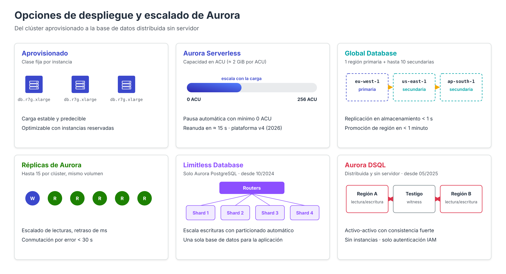

# Aurora: opciones de despliegue y escalado

Sobre la arquitectura común descrita en los apartados anteriores, AWS ofrece varias **modalidades de despliegue** de Aurora que responden a necesidades distintas: cargas variables o intermitentes, presencia en varias regiones, escalado horizontal de escrituras o bases de datos distribuidas sin servidor. Conocerlas permite elegir la opción adecuada en lugar de sobredimensionar una instancia.

---

## Instancias aprovisionadas

Es la modalidad clásica: el administrador elige una **clase de instancia** (`db.r7g.large`, `db.r8g.xlarge`, etc.) para la instancia de escritura y para cada réplica. La capacidad es fija y se modifica cambiando la clase, lo que implica un breve reinicio o una conmutación por error.

Es adecuada para cargas **estables y predecibles**, en las que permite optimizar el coste con instancias reservadas.

---

## Aurora Serverless

**Aurora Serverless** (denominado **Aurora Serverless v2** hasta 2026) ajusta automáticamente la capacidad de cómputo de cada instancia en función de la carga, sin interrumpir las conexiones.

- La capacidad se mide en **unidades de capacidad de Aurora (ACU)**. Cada ACU equivale aproximadamente a **2 GiB de memoria**, con la CPU y la red correspondientes.
- Cada instancia escala entre un **mínimo** y un **máximo** de ACU configurables, desde **0 hasta 256 ACU**, en incrementos de 0,5 ACU.
- Con un mínimo de **0 ACU**, la instancia se **pausa automáticamente** tras un periodo de inactividad configurable (de 5 minutos a 24 horas). Mientras está pausada solo se factura el almacenamiento; la reanudación tarda hasta unos **15 segundos** tras la primera conexión.
- Un mismo clúster puede **combinar instancias aprovisionadas y sin servidor**; por ejemplo, una instancia de escritura aprovisionada y réplicas sin servidor que absorben picos de lectura.
- Admite las mismas funcionalidades que las instancias aprovisionadas: réplicas, Multi-AZ, Global Database, RDS Proxy, autenticación IAM, etc.
- En abril de 2026 AWS presentó la **versión de plataforma 4**, con hasta un 30 % más de rendimiento y un algoritmo de escalado mejorado. Los clústeres nuevos la utilizan automáticamente.

| Caso de uso | Configuración orientativa |
| --- | --- |
| Entornos de desarrollo y pruebas | Mínimo 0 ACU (pausa automática) |
| Aplicaciones con picos impredecibles | Mínimo ajustado a la carga base, máximo holgado |
| SaaS con muchas bases de datos poco activas | Mínimo bajo, cada cliente en su propio clúster |
| Carga constante y elevada | Mejor instancias aprovisionadas |

---

## Aurora Global Database

**Aurora Global Database** extiende un clúster a **varias regiones de AWS**:

- Un clúster **primario** en una región, que acepta lecturas y escrituras, y hasta **10 clústeres secundarios** en otras regiones, de solo lectura, con hasta 16 instancias cada uno.
- La replicación se realiza **en la capa de almacenamiento**, mediante infraestructura dedicada, con una latencia típica **inferior a un segundo** y sin consumir recursos de las instancias del clúster primario.
- **Lecturas locales de baja latencia** para usuarios de todo el mundo.
- **Recuperación ante desastres**: un clúster secundario puede promocionarse a primario en **menos de un minuto**. Existen dos operaciones:
    - **Conmutación planificada** (*switchover*): sin pérdida de datos, para cambios de región programados.
    - **Conmutación por error** (*failover*): ante la caída de la región primaria, con una posible pérdida mínima de los datos aún no replicados.
- **Reenvío de escrituras** (*write forwarding*): permite que las aplicaciones de una región secundaria envíen escrituras, que el clúster reenvía de forma transparente al primario.
- El **punto de enlace de escritura global** apunta siempre al clúster primario, incluso tras una conmutación, lo que evita reconfigurar las aplicaciones.

---

## Aurora PostgreSQL Limitless Database

En un clúster Aurora convencional, todas las escrituras las realiza **una única instancia**. Cuando la carga de escritura o el volumen de datos superan lo que puede atender la mayor clase de instancia, es necesario repartir los datos entre varios servidores (*sharding*), algo que tradicionalmente debía implementar la propia aplicación.

**Aurora PostgreSQL Limitless Database**, disponible desde octubre de 2024, realiza ese particionado **de forma automática y transparente**:

- El clúster incorpora un **grupo de fragmentos** (*DB shard group*) formado por **routers**, que reciben las conexiones y distribuyen las consultas, y **fragmentos** (*shards*), que almacenan cada uno una parte de los datos.
- Las tablas pueden ser **fragmentadas** (*sharded*), repartidas según una clave de fragmentación; **de referencia** (*reference*), replicadas íntegramente en todos los fragmentos para evitar uniones distribuidas; o **estándar**, que residen en un único fragmento.
- La aplicación ve **una única base de datos PostgreSQL** con un único punto de enlace, y las transacciones distribuidas mantienen la consistencia.
- La capacidad de cómputo es **sin servidor** y escala automáticamente.

!!! note "Analogía con DynamoDB"
    La **clave de fragmentación** de Limitless desempeña un papel análogo a la **clave de partición** de DynamoDB: determina en qué fragmento reside cada fila y debe elegirse con alta cardinalidad y acceso uniforme para evitar fragmentos calientes.

---

## Amazon Aurora DSQL

**Amazon Aurora DSQL**, disponible de forma general desde **mayo de 2025**, es una base de datos relacional **distribuida y sin servidor**, compatible con PostgreSQL, diseñada para aplicaciones que necesitan disponibilidad prácticamente continua y escritura activa en varias regiones:

- **Sin instancias ni infraestructura** que administrar: no se elige clase, ni se configuran réplicas, ni hay ventanas de mantenimiento. Escala automáticamente lecturas, escrituras, cómputo y almacenamiento (hasta **256 TiB** por clúster).
- **Activo-activo multirregión**: dos clústeres enlazados en regiones distintas, más una **región testigo** (*witness*), aceptan lecturas y escrituras con **consistencia fuerte**. El acuerdo de nivel de servicio es del 99,99 % en una región y del 99,999 % en multirregión.
- **Control de concurrencia optimista**: las transacciones no bloquean filas; los conflictos se detectan al confirmar, y la aplicación debe estar preparada para **reintentar** las transacciones rechazadas.
- **Autenticación exclusivamente mediante IAM**: no existen contraseñas de base de datos; los clientes generan tokens temporales firmados.
- **Compatibilidad parcial con PostgreSQL**: admite el protocolo, los controladores y gran parte del SQL de PostgreSQL, pero no todas sus funcionalidades. Antes de migrar una aplicación es necesario revisar la lista de características admitidas.

Desde el punto de vista de la red, Aurora DSQL se asemeja más a DynamoDB que a RDS: es un servicio con **puntos de enlace públicos** al que también se puede acceder de forma privada mediante **AWS PrivateLink**.

---

## Guía de elección

| Necesidad | Opción recomendada |
| --- | --- |
| Carga transaccional estable | Aurora con instancias aprovisionadas |
| Carga variable, entornos de pruebas, muchas bases de datos pequeñas | Aurora Serverless |
| Escalar lecturas | Réplicas de Aurora (aprovisionadas o sin servidor) |
| Lecturas globales de baja latencia y recuperación entre regiones | Aurora Global Database |
| Superar la capacidad de escritura de una sola instancia en PostgreSQL | Aurora PostgreSQL Limitless Database |
| Escritura activa en varias regiones con consistencia fuerte y sin infraestructura | Amazon Aurora DSQL |
| Clave-valor a cualquier escala, sin modelo relacional | Amazon DynamoDB |

---

## Referencias

- AWS. *Using Aurora Serverless v2* — [Aurora Serverless](https://docs.aws.amazon.com/AmazonRDS/latest/AuroraUserGuide/aurora-serverless-v2.html)
- AWS Database Blog. *Introducing scaling to 0 capacity with Amazon Aurora Serverless v2* (20/11/2024) — [Artículo](https://aws.amazon.com/blogs/database/introducing-scaling-to-0-capacity-with-amazon-aurora-serverless-v2)
- AWS. *Amazon Aurora serverless: Up to 30% better performance, smarter scaling, and still scales to zero* (21/04/2026) — [Anuncio](https://aws.amazon.com/about-aws/whats-new/2026/04/aurora-serverless-smarter-scaling/)
- AWS. *Using Amazon Aurora Global Database* — [Global Database](https://docs.aws.amazon.com/AmazonRDS/latest/AuroraUserGuide/aurora-global-database.html)
- AWS. *Using switchover or failover in an Amazon Aurora global database* — [Conmutación en Global Database](https://docs.aws.amazon.com/AmazonRDS/latest/AuroraUserGuide/aurora-global-database-disaster-recovery.html)
- AWS. *Amazon Aurora PostgreSQL Limitless Database is now generally available* (31/10/2024) — [Anuncio](https://aws.amazon.com/about-aws/whats-new/2024/10/amazon-aurora-postgresql-limitless-database-generally-available)
- AWS. *Aurora PostgreSQL Limitless Database architecture* — [Arquitectura de Limitless](https://docs.aws.amazon.com/AmazonRDS/latest/AuroraUserGuide/limitless-architecture.html)
- AWS. *Amazon Aurora DSQL is now generally available* (05/2025) — [Anuncio](https://aws.amazon.com/about-aws/whats-new/2025/05/amazon-aurora-dsql-generally-available)
- AWS. *Aurora DSQL and PostgreSQL* — [Compatibilidad de Aurora DSQL](https://docs.aws.amazon.com/aurora-dsql/latest/userguide/working-with.html)
- AWS. *Amazon Aurora DSQL FAQs* — [Preguntas frecuentes de DSQL](https://aws.amazon.com/rds/aurora/dsql/faqs/)
