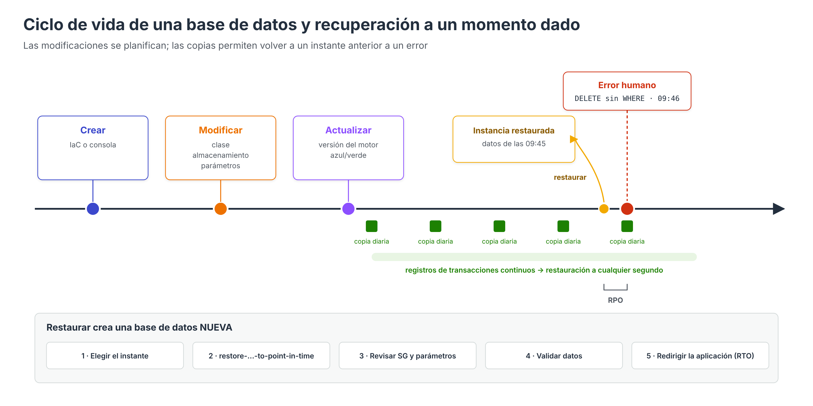

# Ciclo de vida: modificaciones, copias y recuperación



Una base de datos no se configura una única vez. A lo largo de su vida es necesario **ampliar su capacidad**, **ajustar su configuración**, **actualizar el motor** y, llegado el caso, **recuperar los datos** tras un error. Este apartado describe cómo se realizan estos cambios en RDS, Aurora y DynamoDB, qué impacto tienen sobre el servicio y cómo planificar las copias de seguridad para poder recuperar la información **en el tiempo y la forma** que exige la organización.

---

## 1. Modificación de una instancia RDS

Casi todos los parámetros elegidos al crear una instancia pueden modificarse después desde **Modificar** en la consola, con `aws rds modify-db-instance` o actualizando la plantilla de IaC.

### Aplicar inmediatamente o en la ventana de mantenimiento

Al modificar una instancia se elige cuándo aplicar el cambio:

| Opción | Comportamiento | Cuándo usarla |
| --- | --- | --- |
| **Aplicar durante la próxima ventana de mantenimiento** (predeterminada) | El cambio queda **pendiente** y se aplica en la ventana semanal configurada | Cambios que provocan interrupción en producción |
| **Aplicar inmediatamente** (`--apply-immediately`) | El cambio comienza al momento, junto con cualquier otro cambio pendiente | Urgencias o entornos sin usuarios |

Los cambios pendientes pueden consultarse en la pestaña *Mantenimiento y copias de seguridad* o con:

```bash
aws rds describe-db-instances --db-instance-identifier tienda-db-server \
  --query "DBInstances[0].PendingModifiedValues"
```

### Impacto de los cambios más habituales

| Cambio | ¿Interrupción? | Observaciones |
| --- | --- | --- |
| **Clase de instancia** (cómputo y memoria) | **Sí** | Single-AZ: reinicio de varios minutos. Multi-AZ: se modifica primero la *standby* y se conmuta; la interrupción se reduce a la conmutación |
| **Ampliar el almacenamiento** | No | La instancia entra en estado *storage-optimization*. **No se puede reducir** el almacenamiento asignado |
| **Tipo de almacenamiento, IOPS o rendimiento (gp3, io2)** | Normalmente no | Igual que la ampliación, con optimización posterior |
| **Activar Multi-AZ** | No | Se crea la *standby* a partir de una instantánea; puede afectar al rendimiento durante el proceso |
| **Periodo de retención de copias** | No (salvo pasar de 0 a un valor positivo o viceversa) | Pasar a 0 desactiva las copias automáticas y **elimina** las existentes |
| **Grupo de seguridad, etiquetas, protección contra eliminación** | No | Efecto inmediato |
| **Cambiar el grupo de parámetros** | **Requiere reinicio** | La instancia queda en estado `pending-reboot` |
| **Actualizar versión secundaria del motor** | **Sí** (breve) | Puede ser automática en la ventana de mantenimiento |
| **Actualizar versión principal** | **Sí** | Manual; recomendable con implementaciones azul/verde |

### Restricciones del almacenamiento

- El almacenamiento asignado **solo puede aumentarse**. Para reducirlo hay que crear una instancia nueva y migrar los datos.
- Tras una modificación del almacenamiento, no puede realizarse otra hasta que finalice la optimización y hayan transcurrido **al menos seis horas**.
- El **autoescalado del almacenamiento** (*Storage autoscaling*), activado indicando un **umbral máximo** de almacenamiento, amplía el volumen automáticamente cuando:
    - el espacio libre es igual o inferior al **10 %** del asignado,
    - la situación se mantiene al menos **5 minutos**, y
    - no se han producido más de cuatro modificaciones en las últimas 24 horas.

    El incremento es el mayor entre 10 GiB, el 10 % del almacenamiento asignado o el crecimiento previsto para las siguientes horas.

### Parámetros estáticos y dinámicos

Los parámetros del motor se modifican en un **grupo de parámetros personalizado** (el grupo predeterminado no admite cambios):

| Tipo | Ejemplo (MySQL) | Aplicación |
| --- | --- | --- |
| **Dinámico** | `long_query_time`, `max_connections`, `slow_query_log` | Inmediata, sin reinicio |
| **Estático** | `innodb_log_file_size`, `performance_schema` | En el siguiente **reinicio** |

```bash
aws rds create-db-parameter-group --db-parameter-group-name tienda-mysql84 \
  --db-parameter-group-family mysql8.4 --description "Parametros de la tienda"

aws rds modify-db-parameter-group --db-parameter-group-name tienda-mysql84 \
  --parameters "ParameterName=long_query_time,ParameterValue=1,ApplyMethod=immediate"

aws rds modify-db-instance --db-instance-identifier tienda-db-server \
  --db-parameter-group-name tienda-mysql84 --apply-immediately

aws rds reboot-db-instance --db-instance-identifier tienda-db-server   # para aplicar la asociación
```

### Actualizaciones del motor

- **Versiones secundarias** (por ejemplo, 8.4.5 → 8.4.6): incluyen correcciones de errores y seguridad. Con la opción *Actualización automática de versiones secundarias* se aplican en la ventana de mantenimiento.
- **Versiones principales** (por ejemplo, MySQL 8.0 → 8.4): pueden incluir cambios incompatibles. Se recomienda:
    1. Probar la aplicación en una copia (restauración de instantánea o clon de Aurora).
    2. Usar una **implementación azul/verde**: RDS crea un entorno verde sincronizado mediante replicación, se actualiza y se prueba, y la **conmutación** se realiza normalmente en menos de un minuto, con posibilidad de volver atrás antes de conmutar.
- Las versiones que alcanzan su fin de soporte estándar pasan a **RDS Extended Support**, con coste adicional, o se actualizan automáticamente.

### Detener e iniciar

Una instancia RDS puede **detenerse** para ahorrar el coste de cómputo (el almacenamiento y las copias se siguen facturando). AWS la **vuelve a iniciar automáticamente a los 7 días** para aplicar el mantenimiento pendiente. Es útil en entornos de desarrollo y en los laboratorios.

---

## 2. Modificaciones en Aurora

| Cambio | Cómo se realiza |
| --- | --- |
| Escalar las lecturas | Añadir o eliminar **réplicas de Aurora**; no copian datos y están disponibles en minutos |
| Cambiar la clase de la instancia de escritura | Cambiar primero la clase de una réplica y **conmutar** (`failover-db-cluster`) hacia ella para minimizar la interrupción |
| Ajustar Aurora Serverless | Modificar la capacidad mínima y máxima en ACU; se aplica sin interrupción |
| Almacenamiento | No se gestiona: crece y decrece automáticamente |
| Probar cambios | Crear un **clon** del clúster en minutos y aplicar en él el cambio |
| Pasar a I/O-Optimized | Cambio de configuración del clúster, sin interrupción en la mayoría de instancias |

---

## 3. Modificaciones en DynamoDB

| Cambio | Observaciones |
| --- | --- |
| Cambiar el **modo de capacidad** | De aprovisionado a bajo demanda hasta 4 veces cada 24 horas; a la inversa, en cualquier momento |
| Ajustar **RCU/WCU** o el autoescalado | Sin interrupción; las reducciones tienen un límite diario |
| Fijar el **rendimiento máximo** bajo demanda | Sin interrupción |
| **Añadir un GSI** | Se crea en línea: DynamoDB rellena el índice (*backfilling*) sin bloquear la tabla |
| Cambiar la **clase de tabla** (Standard ↔ Standard-IA) | Sin interrupción; con un límite de cambios en un periodo de tiempo |
| Activar **TTL**, **Streams**, **PITR** o la **protección contra eliminación** | Sin interrupción |
| Cambiar la **clave primaria** o añadir un **LSI** | **No es posible**: requiere crear una tabla nueva y migrar los datos |

---

## 4. Copias de seguridad y recuperación

### Objetivos de recuperación

Antes de configurar las copias, la organización debe fijar dos objetivos para cada sistema:

| Objetivo | Pregunta | Ejemplo |
| --- | --- | --- |
| **RPO** (*Recovery Point Objective*) | ¿Cuántos datos podemos permitirnos perder? | «Como máximo, los últimos 5 minutos» |
| **RTO** (*Recovery Time Objective*) | ¿Cuánto tiempo podemos estar sin servicio? | «Como máximo, 1 hora» |

Estos objetivos determinan qué mecanismos son necesarios:

| Mecanismo | RPO típico | RTO típico | Protege frente a |
| --- | --- | --- | --- |
| Multi-AZ | 0 | 1–2 minutos | Fallo de una instancia o una zona |
| Aurora (réplicas) | 0 | < 30 segundos | Fallo de una instancia o una zona |
| Restauración a un momento dado (PITR) | ≈ 5 minutos | Minutos a horas (según el tamaño) | Errores humanos, corrupción lógica |
| Instantánea manual | Desde la última instantánea | Minutos a horas | Errores, cambios arriesgados |
| Copia en otra región | Desde la última copia | Horas | Desastre regional |
| Réplica entre regiones / Global Database | Segundos | Minutos | Desastre regional |

!!! warning "La alta disponibilidad no es una copia de seguridad"
    Multi-AZ y las réplicas replican **también los errores**: un `DELETE` sin `WHERE` se propaga a la *standby* en milisegundos. Solo las copias de seguridad y la restauración a un momento dado protegen frente a errores humanos.

### Tipos de copia en RDS y Aurora

| Tipo | Creación | Retención | Observaciones |
| --- | --- | --- | --- |
| **Copias automáticas** | Diarias en la ventana de copia + registros de transacciones | 1 a 35 días (0 las desactiva) | Permiten la **restauración a un momento dado**; se eliminan al borrar la instancia, salvo que se indique conservarlas |
| **Instantáneas manuales** | Bajo demanda (`create-db-snapshot`) | Hasta que se eliminan | Sobreviven a la eliminación de la instancia; pueden copiarse a otra región o compartirse con otra cuenta |
| **Instantánea final** | Al eliminar la instancia | Hasta que se elimina | Se recomienda crearla siempre |
| **AWS Backup** | Según un **plan de copias** | Según las reglas del plan | Centraliza la política de copias de varios servicios y cuentas |
| **Exportación de instantáneas a S3** | Bajo demanda | Según S3 | Formato Parquet para análisis, no para restaurar |

### Restaurar no sobrescribe: crea una base de datos nueva

Cualquier restauración en RDS, Aurora o DynamoDB **crea un recurso nuevo** con otro identificador y otro punto de enlace. La base de datos original no se modifica. El procedimiento habitual es:

1. **Identificar el momento** al que se quiere volver (por ejemplo, el instante anterior al borrado erróneo) y comprobar el **último momento restaurable**.
2. **Restaurar** en una instancia nueva:

    ```bash
    aws rds restore-db-instance-to-point-in-time \
      --source-db-instance-identifier tienda-db-server \
      --target-db-instance-identifier tienda-db-restaurada \
      --restore-time 2026-11-10T09:45:00Z \
      --db-subnet-group-name tienda-subredes \
      --vpc-security-group-ids sg-0ccc \
      --no-publicly-accessible
    ```

3. **Revisar la configuración** de la instancia restaurada: grupo de seguridad, grupo de parámetros, opciones de supervisión y etiquetas, que no siempre se heredan.
4. **Validar los datos** restaurados.
5. **Redirigir la aplicación**: cambiar el punto de enlace en la configuración, o bien renombrar la instancia original y asignar su identificador a la restaurada para conservar el mismo nombre DNS.
6. **Eliminar** la instancia que ya no se necesite, tras crear una instantánea final.

En ocasiones no es necesario sustituir la base de datos completa: basta con restaurarla aparte y **copiar solo las filas perdidas** a la base de datos de producción.

### Copias en DynamoDB

- **PITR**: restauración a cualquier segundo del periodo configurado (1 a 35 días) en una **tabla nueva**.
- **Copias bajo demanda** y **AWS Backup**.
- Al restaurar **no se recuperan** algunos ajustes, como las políticas de autoescalado, las alarmas de CloudWatch, las etiquetas, la configuración de Streams o el TTL, que deben volver a configurarse.

```bash
aws dynamodb restore-table-to-point-in-time \
  --source-table-name Productos \
  --target-table-name Productos-restaurada \
  --restore-date-time 2026-11-10T09:45:00Z
```

### Planes de AWS Backup

Un **plan de copias** de AWS Backup define de forma centralizada:

- **Frecuencia** (cada hora, diaria, semanal…) y **ventana** de ejecución.
- **Retención** y, en su caso, transición a almacenamiento en frío.
- **Copias automáticas a otra región o a otra cuenta**, como protección frente a desastres o frente al compromiso de la cuenta principal.
- **Asignación de recursos** por etiquetas: por ejemplo, todas las bases de datos con `copia = diaria`.
- **Almacenes bloqueados** (*Vault Lock*), que impiden eliminar las copias antes de tiempo incluso a los administradores.

### Probar la recuperación

Una copia que nunca se ha restaurado **no garantiza** que se pueda recuperar. Las organizaciones deben **ensayar periódicamente** la restauración y medir el tiempo real empleado, para comprobar que se cumple el RTO. AWS Backup incluye la funcionalidad de **pruebas de restauración** (*restore testing*), que automatiza estas comprobaciones.

---

## Referencias

- AWS. *Modifying an Amazon RDS DB instance* — [Modificación de instancias](https://docs.aws.amazon.com/AmazonRDS/latest/UserGuide/Overview.DBInstance.Modifying.html)
- AWS. *Settings for DB instances* (impacto de cada cambio) — [Ajustes y tiempo de inactividad](https://docs.aws.amazon.com/AmazonRDS/latest/UserGuide/USER_ModifyInstance.Settings.html)
- AWS. *Increasing DB instance storage capacity* — [Ampliación del almacenamiento](https://docs.aws.amazon.com/AmazonRDS/latest/UserGuide/USER_PIOPS.ModifyingExisting.html)
- AWS. *Managing capacity automatically with Amazon RDS storage autoscaling* — [Autoescalado del almacenamiento](https://docs.aws.amazon.com/AmazonRDS/latest/UserGuide/USER_PIOPS.Autoscaling.html)
- AWS. *Working with parameter groups* — [Grupos de parámetros](https://docs.aws.amazon.com/AmazonRDS/latest/UserGuide/USER_WorkingWithParamGroups.html)
- AWS. *Upgrading a DB instance engine version* — [Actualizaciones del motor](https://docs.aws.amazon.com/AmazonRDS/latest/UserGuide/USER_UpgradeDBInstance.Upgrading.html)
- AWS. *Using Amazon RDS Blue/Green Deployments for database updates* — [Implementaciones azul/verde](https://docs.aws.amazon.com/AmazonRDS/latest/UserGuide/blue-green-deployments.html)
- AWS. *Stopping an Amazon RDS DB instance temporarily* — [Detener una instancia](https://docs.aws.amazon.com/AmazonRDS/latest/UserGuide/USER_StopInstance.html)
- AWS. *Backing up, restoring, and exporting data* — [Copias de seguridad en RDS](https://docs.aws.amazon.com/AmazonRDS/latest/UserGuide/CHAP_CommonTasks.BackupRestore.html)
- AWS. *Restoring a DB instance to a specified time* — [Restauración a un momento dado](https://docs.aws.amazon.com/AmazonRDS/latest/UserGuide/USER_PIT.html)
- AWS. *Backup and restore for DynamoDB* — [Copias en DynamoDB](https://docs.aws.amazon.com/amazondynamodb/latest/developerguide/Backup-and-Restore.html)
- AWS. *What is AWS Backup?* — [AWS Backup](https://docs.aws.amazon.com/aws-backup/latest/devguide/whatisbackup.html)
- AWS. *Restore testing* — [Pruebas de restauración](https://docs.aws.amazon.com/aws-backup/latest/devguide/restore-testing.html)
- AWS. *Disaster recovery of workloads on AWS* (whitepaper: RPO y RTO) — [Recuperación ante desastres](https://docs.aws.amazon.com/whitepapers/latest/disaster-recovery-workloads-on-aws/disaster-recovery-workloads-on-aws.html)
