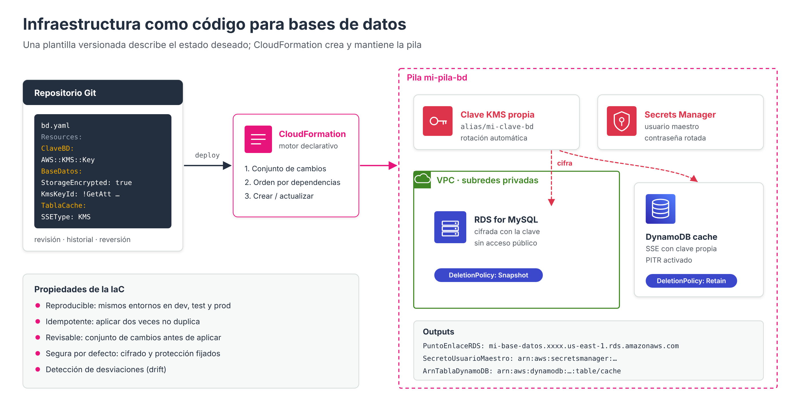

# Infraestructura como código para bases de datos



Hasta ahora, las bases de datos de este módulo se han creado desde la **consola** o mediante comandos de la **AWS CLI**. Ambos métodos son útiles para aprender y para tareas puntuales, pero presentan inconvenientes cuando se trata de entornos reales: los pasos de la consola no quedan documentados, es fácil olvidar una opción (el cifrado, las copias de seguridad, la protección contra eliminación) y resulta difícil reproducir exactamente el mismo entorno en desarrollo, pruebas y producción.

La **infraestructura como código** (*Infrastructure as Code*, IaC) resuelve estos problemas describiendo la infraestructura en **ficheros de texto** que se versionan, se revisan y se aplican de forma automática.

!!! warning "Alcance de este apartado"
    La infraestructura como código se presenta aquí **a nivel informativo**, para disponer de un ejemplo de pila de despliegue de bases de datos con una clave de cifrado propia. El manejo y la evaluación de la IaC se abordan con mayor profundidad en el módulo **Despliegue de servicios administrados en la nube**.

---

## Formas de administrar los recursos en AWS

| Herramienta | Tipo | Ventajas | Inconvenientes |
| --- | --- | --- | --- |
| **Consola web** | Gráfica, manual | Intuitiva, ideal para aprender y explorar | No es reproducible ni auditable paso a paso |
| **AWS CLI** | Línea de comandos, imperativa | Automatizable en *scripts*, rápida | Hay que programar el orden y controlar los errores; repetir un *script* puede crear duplicados |
| **SDK / API** | Programática, imperativa | Integración en aplicaciones (boto3, AWS SDK para PHP…) | Mismos problemas que la CLI para gestionar infraestructura |
| **IaC** | Declarativa | Reproducible, versionable, revisable, idempotente | Requiere aprender el lenguaje de la herramienta |

### Enfoque imperativo frente a declarativo

- En el enfoque **imperativo** (CLI, SDK) se indican **los pasos**: «crea una clave», «crea un grupo de subredes», «crea una instancia con esta clave».
- En el enfoque **declarativo** (IaC) se describe **el estado final deseado**: «quiero una clave, un grupo de subredes y una instancia cifrada con esa clave». La herramienta calcula qué debe crear, modificar o eliminar para alcanzar ese estado y en qué orden.

### Propiedades de la infraestructura como código

- **Reproducibilidad**: la misma plantilla crea entornos idénticos en distintas cuentas o regiones.
- **Idempotencia**: aplicar dos veces la misma plantilla no crea recursos duplicados; si el estado ya coincide, no se hace nada.
- **Control de versiones**: la plantilla se guarda en Git, de modo que cada cambio queda registrado con su autor y su motivo, y puede revertirse.
- **Revisión previa**: antes de aplicar un cambio se puede ver qué recursos se van a modificar (conjuntos de cambios en CloudFormation, `terraform plan` en Terraform).
- **Detección de desviaciones** (*drift*): permite descubrir cambios realizados a mano fuera de la plantilla.
- **Seguridad por defecto**: el cifrado, la protección contra eliminación o el acceso público desactivado quedan fijados en la plantilla y no dependen de que alguien recuerde marcar una casilla.

### Herramientas principales

| Herramienta | Proveedor | Lenguaje | Observaciones |
| --- | --- | --- | --- |
| **AWS CloudFormation** | AWS | YAML o JSON | Servicio nativo, sin coste adicional, gestiona el estado de forma automática |
| **AWS CDK** | AWS | TypeScript, Python, Java… | Genera plantillas de CloudFormation a partir de código de programación |
| **Terraform / OpenTofu** | HashiCorp / Linux Foundation | HCL | Multiproveedor; guarda el estado en un fichero que debe protegerse |
| **Pulumi** | Pulumi | Lenguajes de programación | Multiproveedor |

En este apartado se utiliza **CloudFormation**, por ser el servicio nativo de AWS y estar disponible en el Learner Lab, y se muestra el equivalente en **Terraform**.

---

## Conceptos de AWS CloudFormation

| Concepto | Descripción |
| --- | --- |
| **Plantilla** (*template*) | Fichero YAML o JSON que describe los recursos |
| **Pila** (*stack*) | Conjunto de recursos creados a partir de una plantilla; se crean, actualizan y eliminan juntos |
| **Parámetros** | Valores que se indican al desplegar (subredes, clase de instancia…), para reutilizar la plantilla |
| **Recursos** | Los elementos que se crean (`AWS::KMS::Key`, `AWS::RDS::DBInstance`, `AWS::DynamoDB::Table`…) |
| **Salidas** (*outputs*) | Valores que se muestran al terminar, como el punto de enlace de la base de datos |
| **Funciones intrínsecas** | `!Ref` (referencia a un parámetro o recurso), `!GetAtt` (atributo de un recurso), `!Sub` (sustitución de texto) |
| **Conjunto de cambios** (*change set*) | Vista previa de lo que hará una actualización antes de aplicarla |
| **`DeletionPolicy` / `UpdateReplacePolicy`** | Qué hacer con el recurso si se elimina la pila o si un cambio obliga a sustituirlo: `Delete`, `Retain` o `Snapshot` |

!!! warning "Cambios que sustituyen recursos"
    Algunas propiedades no pueden modificarse sobre un recurso existente: cambiarlas obliga a CloudFormation a **crear un recurso nuevo y eliminar el antiguo**. En una base de datos esto significa **perder los datos** si no se ha previsto. Ejemplos: el motor de la instancia, la clave de cifrado del almacenamiento o la clave primaria de una tabla DynamoDB. Por eso las bases de datos deben declararse siempre con `DeletionPolicy: Snapshot` (RDS) o `Retain` (DynamoDB) y revisarse los conjuntos de cambios antes de aplicarlos.

---

## Claves de cifrado específicas con AWS KMS

En los apartados anteriores se indicó que RDS, Aurora y DynamoDB pueden cifrarse con una **clave administrada por AWS** o con una **clave administrada por el cliente**. Crear una clave específica para las bases de datos de una aplicación aporta:

- **Control de acceso propio** mediante la **política de la clave**: qué identidades pueden usarla y administrarla.
- **Rotación automática** configurable del material criptográfico.
- **Revocación**: deshabilitar la clave deja inaccesibles los datos cifrados con ella.
- **Compartición** de instantáneas cifradas con otras cuentas, imposible con la clave administrada por AWS.
- **Auditoría** de cada uso de la clave en CloudTrail.

| Elemento | Descripción |
| --- | --- |
| **Política de la clave** | Política basada en recursos asociada a la clave. Debe permitir al menos la administración a la cuenta propietaria; sin ella la clave quedaría inutilizable |
| **Alias** | Nombre legible (`alias/abdan-bd`) que evita usar el identificador de la clave |
| **Rotación** | Genera material criptográfico nuevo periódicamente, conservando el anterior para descifrar los datos existentes |
| **Eliminación programada** | Una clave no se borra inmediatamente: se programa con un periodo de espera de 7 a 30 días, durante el cual puede cancelarse |
| **Coste** | Cada clave administrada por el cliente tiene un coste mensual, además de las peticiones |

---

## Plantilla de ejemplo: clave, RDS y DynamoDB cifrados

La siguiente plantilla crea, en una sola pila:

1. Una **clave de KMS** propia con rotación automática y su alias.
2. Un **grupo de subredes** de base de datos.
3. Una **instancia RDS for MySQL** cifrada con esa clave, sin acceso público, con el usuario maestro gestionado en Secrets Manager, copias de seguridad, registros exportados a CloudWatch y protección contra eliminación configurable.
4. Una **tabla DynamoDB** cifrada con la misma clave, con recuperación a un momento dado activada.

```yaml
AWSTemplateFormatVersion: "2010-09-09"
Description: Base de datos RDS y tabla DynamoDB cifradas con una clave propia de KMS

Parameters:
  SubredesBD:
    Type: List<AWS::EC2::Subnet::Id>
    Description: Dos subredes privadas en zonas de disponibilidad distintas
  GrupoSeguridadBD:
    Type: AWS::EC2::SecurityGroup::Id
    Description: Grupo de seguridad que admite 3306 solo desde los servidores web
  ClaseInstancia:
    Type: String
    Default: db.t4g.micro
    AllowedValues: [db.t3.micro, db.t4g.micro, db.t4g.small]
  ProteccionEliminacion:
    Type: String
    Default: "false"          # "true" en producción
    AllowedValues: ["true", "false"]

Resources:
  # 1. Clave de cifrado específica
  ClaveBD:
    Type: AWS::KMS::Key
    Properties:
      Description: Clave para las bases de datos del ejemplo
      EnableKeyRotation: true
      PendingWindowInDays: 7
      KeyPolicy:
        Version: "2012-10-17"
        Statement:
          - Sid: AdministracionPorLaCuenta
            Effect: Allow
            Principal:
              AWS: !Sub arn:aws:iam::${AWS::AccountId}:root
            Action: kms:*
            Resource: "*"

  AliasClaveBD:
    Type: AWS::KMS::Alias
    Properties:
      AliasName: alias/mi-clave-bd
      TargetKeyId: !Ref ClaveBD

  # 2. Grupo de subredes
  GrupoSubredes:
    Type: AWS::RDS::DBSubnetGroup
    Properties:
      DBSubnetGroupDescription: Subredes privadas de la base de datos
      SubnetIds: !Ref SubredesBD

  # 3. Instancia RDS cifrada
  BaseDatos:
    Type: AWS::RDS::DBInstance
    DeletionPolicy: Snapshot          # al borrar la pila se crea una instantánea final
    UpdateReplacePolicy: Snapshot     # si un cambio sustituye la instancia, también
    Properties:
      DBInstanceIdentifier: mi-base-datos
      Engine: mysql
      DBInstanceClass: !Ref ClaseInstancia
      AllocatedStorage: "20"
      MaxAllocatedStorage: 100        # autoescalado del almacenamiento
      StorageType: gp3
      StorageEncrypted: true
      KmsKeyId: !GetAtt ClaveBD.Arn
      MasterUsername: admin
      ManageMasterUserPassword: true  # contraseña generada y rotada en Secrets Manager
      DBSubnetGroupName: !Ref GrupoSubredes
      VPCSecurityGroups: [!Ref GrupoSeguridadBD]
      PubliclyAccessible: false
      MultiAZ: false                  # true en producción
      BackupRetentionPeriod: 7
      DeletionProtection: !Ref ProteccionEliminacion
      EnableCloudwatchLogsExports: [error, slowquery]
      CopyTagsToSnapshot: true
      Tags:
        - { Key: entorno, Value: desarrollo }

  # 4. Tabla DynamoDB cifrada con la misma clave
  TablaCache:
    Type: AWS::DynamoDB::Table
    DeletionPolicy: Retain
    UpdateReplacePolicy: Retain
    Properties:
      TableName: cache
      BillingMode: PAY_PER_REQUEST
      AttributeDefinitions:
        - { AttributeName: clave, AttributeType: S }
      KeySchema:
        - { AttributeName: clave, KeyType: HASH }
      TimeToLiveSpecification:
        AttributeName: caduca
        Enabled: true
      SSESpecification:
        SSEEnabled: true
        SSEType: KMS
        KMSMasterKeyId: !Ref ClaveBD
      PointInTimeRecoverySpecification:
        PointInTimeRecoveryEnabled: true
      DeletionProtectionEnabled: !Ref ProteccionEliminacion

Outputs:
  PuntoEnlaceRDS:
    Description: Nombre DNS de la base de datos
    Value: !GetAtt BaseDatos.Endpoint.Address
  SecretoUsuarioMaestro:
    Description: ARN del secreto con la contraseña del usuario maestro
    Value: !GetAtt BaseDatos.MasterUserSecret.SecretArn
  ArnTablaDynamoDB:
    Description: ARN de la tabla DynamoDB cache
    Value: !GetAtt TablaCache.Arn
  ClaveKMS:
    Description: ARN de la clave de KMS
    Value: !GetAtt ClaveBD.Arn
```

Observaciones sobre la plantilla:

- **No aparece ninguna contraseña**: `ManageMasterUserPassword` delega su generación y custodia en Secrets Manager. Escribir contraseñas en una plantilla es una mala práctica, porque quedarían guardadas en el repositorio.
- La propiedad `KmsKeyId` de la instancia y `KMSMasterKeyId` de la tabla reciben la clave creada en la misma pila. CloudFormation detecta esa dependencia y **crea primero la clave**.
- La política de la clave concede la administración a la **cuenta**; a partir de ahí, el uso de la clave por parte de usuarios y roles se controla con políticas de IAM. En producción se restringiría a roles concretos.
- `DeletionPolicy` protege los datos ante la eliminación de la pila: la instancia deja una instantánea final y la tabla se conserva.
- El sangrado de YAML es significativo: un error de espacios invalida la plantilla.

### Despliegue con la AWS CLI

```bash
# Validar la sintaxis
aws cloudformation validate-template --template-body file://bd.yaml

# Crear o actualizar la pila
aws cloudformation deploy \
  --stack-name mi-pila-bd \
  --template-file bd.yaml \
  --parameter-overrides \
      SubredesBD=subnet-0aaa,subnet-0bbb \
      GrupoSeguridadBD=sg-0ccc

# Consultar las salidas
aws cloudformation describe-stacks --stack-name mi-pila-bd \
  --query "Stacks[0].Outputs" --output table

# Ver el progreso o los errores
aws cloudformation describe-stack-events --stack-name mi-pila-bd \
  --query "StackEvents[].[LogicalResourceId,ResourceStatus,ResourceStatusReason]" --output table
```

!!! info "Parámetros del despliegue"
    Los valores de `--parameter-overrides` deben sustituirse por los del propio entorno:

    - `subnet-0aaa,subnet-0bbb` es la **lista de subredes**, separadas por comas y sin espacios, que formarán parte del **grupo de subredes** de la base de datos. Deben ser subredes privadas situadas en al menos dos zonas de disponibilidad distintas.
    - `sg-0ccc` es el **grupo de seguridad que se ha creado previamente para la base de datos MySQL**, el que admite el puerto 3306 únicamente desde los servidores de aplicación.

    Los identificadores reales pueden consultarse en la consola de VPC o con `aws ec2 describe-subnets` y `aws ec2 describe-security-groups`.

Para modificar la infraestructura (por ejemplo, cambiar la clase de la instancia) **se edita la plantilla** y se vuelve a ejecutar `deploy`. CloudFormation crea un conjunto de cambios, calcula la diferencia y aplica solo lo necesario. Con `--no-execute-changeset` se puede revisar el conjunto de cambios antes de ejecutarlo.

Para eliminar todos los recursos:

```bash
aws cloudformation delete-stack --stack-name mi-pila-bd
```

Si la protección contra eliminación está activada, la eliminación de la pila fallará hasta que se cambie el parámetro a `"false"` y se actualice la pila: es precisamente el comportamiento que se busca en producción.

!!! info "Entorno AWS Academy"
    El Learner Lab permite desplegar pilas de CloudFormation con las restricciones habituales del laboratorio (clases de instancia pequeñas, región `us-east-1`). Si alguna acción sobre KMS no estuviera permitida, puede sustituirse la clave propia por la clave administrada por AWS eliminando las propiedades `KmsKeyId` y `KMSMasterKeyId`. Recuerde eliminar la pila al terminar: una clave de KMS solo se borra tras su periodo de espera.

---

## Equivalente en Terraform

El mismo diseño en Terraform (fragmento):

```hcl
resource "aws_kms_key" "bd" {
  description             = "Clave para las bases de datos del ejemplo"
  enable_key_rotation     = true
  deletion_window_in_days = 7
}

resource "aws_kms_alias" "bd" {
  name          = "alias/mi-clave-bd"
  target_key_id = aws_kms_key.bd.key_id
}

resource "aws_db_instance" "mi_base_datos" {
  identifier                  = "mi-base-datos"
  engine                      = "mysql"
  instance_class              = "db.t4g.micro"
  allocated_storage           = 20
  max_allocated_storage       = 100
  storage_type                = "gp3"
  storage_encrypted           = true
  kms_key_id                  = aws_kms_key.bd.arn
  username                    = "admin"
  manage_master_user_password = true
  db_subnet_group_name        = aws_db_subnet_group.bd.name
  vpc_security_group_ids      = [var.grupo_seguridad_bd]
  publicly_accessible         = false
  backup_retention_period     = 7
  deletion_protection         = false
  final_snapshot_identifier   = "mi-base-datos-final"
}

resource "aws_dynamodb_table" "cache" {
  name         = "cache"
  billing_mode = "PAY_PER_REQUEST"
  hash_key     = "clave"

  attribute {
    name = "clave"
    type = "S"
  }

  server_side_encryption {
    enabled     = true
    kms_key_arn = aws_kms_key.bd.arn
  }

  point_in_time_recovery {
    enabled = true
  }
}
```

El ciclo de trabajo es `terraform init` → `terraform plan` (revisión de cambios) → `terraform apply` → `terraform destroy`. A diferencia de CloudFormation, Terraform guarda el estado de la infraestructura en un **fichero de estado** que contiene información sensible, por lo que en equipos se almacena en un *backend* remoto protegido (por ejemplo, un bucket de S3 cifrado).

---

## Buenas prácticas de IaC para bases de datos

- Guardar las plantillas en un **repositorio Git** y aplicar los cambios mediante revisiones (*pull requests*).
- **No escribir secretos** en las plantillas: usar Secrets Manager o parámetros dinámicos.
- Declarar explícitamente las opciones de seguridad: cifrado con clave propia, `PubliclyAccessible: false`, copias de seguridad, registros y protección contra eliminación.
- Usar `DeletionPolicy: Snapshot` o `Retain` en todos los recursos que contengan datos.
- **Revisar siempre** los conjuntos de cambios o el `plan` antes de aplicar, prestando atención a las sustituciones (*Replacement: True*).
- Parametrizar las diferencias entre entornos (clase de instancia, Multi-AZ, retención) en lugar de duplicar plantillas.
- Activar la **detección de desviaciones** para descubrir cambios manuales.

---

## Referencias

- AWS. *What is AWS CloudFormation?* — [Guía del usuario de CloudFormation](https://docs.aws.amazon.com/AWSCloudFormation/latest/UserGuide/Welcome.html)
- AWS. *AWS::RDS::DBInstance* — [Referencia del recurso](https://docs.aws.amazon.com/AWSCloudFormation/latest/TemplateReference/aws-resource-rds-dbinstance.html)
- AWS. *AWS::DynamoDB::Table* — [Referencia del recurso](https://docs.aws.amazon.com/AWSCloudFormation/latest/TemplateReference/aws-resource-dynamodb-table.html)
- AWS. *AWS::KMS::Key* — [Referencia del recurso](https://docs.aws.amazon.com/AWSCloudFormation/latest/TemplateReference/aws-resource-kms-key.html)
- AWS. *DeletionPolicy attribute* — [DeletionPolicy](https://docs.aws.amazon.com/AWSCloudFormation/latest/TemplateReference/aws-attribute-deletionpolicy.html)
- AWS. *Update CloudFormation stacks using change sets* — [Conjuntos de cambios](https://docs.aws.amazon.com/AWSCloudFormation/latest/UserGuide/using-cfn-updating-stacks-changesets.html)
- AWS. *Detect unmanaged configuration changes to stacks and resources with drift detection* — [Detección de desviaciones](https://docs.aws.amazon.com/AWSCloudFormation/latest/UserGuide/using-cfn-stack-drift.html)
- AWS. *AWS KMS keys* — [Conceptos de KMS](https://docs.aws.amazon.com/kms/latest/developerguide/concepts.html)
- AWS. *Rotate AWS KMS keys* — [Rotación de claves](https://docs.aws.amazon.com/kms/latest/developerguide/rotate-keys.html)
- AWS. *Key policies in AWS KMS* — [Políticas de clave](https://docs.aws.amazon.com/kms/latest/developerguide/key-policies.html)
- AWS. *Password management with Amazon RDS and AWS Secrets Manager* — [Usuario maestro en Secrets Manager](https://docs.aws.amazon.com/AmazonRDS/latest/UserGuide/rds-secrets-manager.html)
- HashiCorp. *Terraform AWS Provider: aws_db_instance* — [Registro de Terraform](https://registry.terraform.io/providers/hashicorp/aws/latest/docs/resources/db_instance)
