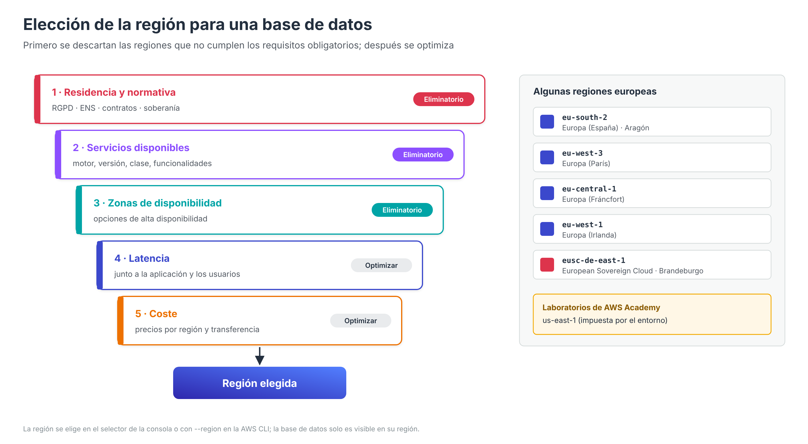

# Elección de la región y residencia de los datos



Antes de crear una base de datos en la nube hay que decidir **dónde** van a residir los datos. Es la primera decisión del despliegue y una de las más costosas de cambiar: una instancia RDS o una tabla DynamoDB pertenecen a una región concreta, y trasladarlas a otra exige copiar o replicar los datos. La elección de la región condiciona el **cumplimiento normativo**, los **servicios disponibles**, la **latencia** que perciben los usuarios y el **coste**.

Este apartado se centra en esa elección inicial. Cuánta redundancia geográfica añadir después (varias zonas, varias regiones) se estudia en el apartado [Replicación y recuperación ante desastres](BD-Replicacion.md), una vez conocidas las opciones de alta disponibilidad de RDS, Aurora y DynamoDB.

---

## Regiones y zonas de disponibilidad

| Concepto | Descripción | Ejemplo |
| --- | --- | --- |
| **Región** | Área geográfica independiente con varios centros de datos. Los datos **no salen de la región** salvo que el cliente lo configure | `eu-south-2` (España), `eu-west-3` (París), `us-east-1` (Norte de Virginia) |
| **Zona de disponibilidad (AZ)** | Uno o varios centros de datos con alimentación, refrigeración y red independientes, conectados con baja latencia a las demás zonas de la región | `eu-south-2a`, `eu-south-2b`, `eu-south-2c` |
| **Zona local** (*Local Zone*) | Extensión de una región situada cerca de grandes ciudades para cargas de latencia muy baja | — |

España dispone de la región **Europa (España), `eu-south-2`**, situada en Aragón, con tres zonas de disponibilidad. El Learner Lab de AWS Academy, en cambio, limita los recursos a las regiones `us-east-1` y `us-west-2`, por lo que los criterios de este apartado deben entenderse aplicados a un entorno real.

---

## Criterios para elegir la región

Los criterios se aplican en un orden lógico: primero se descartan las regiones que no cumplen los requisitos obligatorios y, entre las restantes, se elige la que ofrece el mejor equilibrio entre latencia y coste.

| Orden | Criterio | Qué valorar |
| --- | --- | --- |
| 1 | **Residencia de los datos y normativa** | Requisitos legales o contractuales sobre la ubicación de los datos (ver apartado siguiente). Suele ser el criterio **eliminatorio** |
| 2 | **Disponibilidad de servicios y funcionalidades** | No todas las regiones ofrecen todos los motores, versiones, clases de instancia o funcionalidades (por ejemplo, algunas variantes de Aurora que se estudiarán más adelante o determinadas clases Graviton) |
| 3 | **Número de zonas de disponibilidad** | Determina las opciones de alta disponibilidad: el clúster Multi-AZ de RDS, presentado en la visión general, necesita tres zonas |
| 4 | **Latencia** | Cercanía a los usuarios y, sobre todo, a los **servidores de aplicación**: la base de datos debe estar en la misma región que la aplicación que la consulta |
| 5 | **Coste** | Los precios de instancias, almacenamiento y transferencia **varían entre regiones**; la misma instancia puede costar sensiblemente más en una región que en otra |
| 6 | **Recuperación ante desastres** | Disponibilidad de una segunda región adecuada, cercana pero suficientemente separada, para copias o réplicas |
| 7 | **Sostenibilidad** | AWS publica información sobre el origen de la energía de sus regiones, un criterio cada vez más presente en las organizaciones |

### Medir la latencia

La latencia entre un cliente y una región puede estimarse midiendo el tiempo de conexión con el punto de enlace de un servicio en esa región. Dentro de AWS, como referencia orientativa, la latencia entre zonas de una misma región es del orden de **milisegundos de un solo dígito**, mientras que entre regiones de continentes distintos puede superar los **100 ms**. Por eso, situar la aplicación y la base de datos en regiones distintas penaliza cada consulta.

### Coste según la región y la ubicación de la aplicación

- Los **precios** de RDS, Aurora y DynamoDB se publican **por región**. Conviene compararlos con la **Calculadora de precios de AWS** antes de decidir.
- Dentro de una región, el **tráfico entre zonas de disponibilidad** de la aplicación (por ejemplo, un servidor web en `us-east-1a` que consulta una base de datos en `us-east-1b`) tiene coste por GB.
- El tráfico **entre regiones** se factura siempre, por lo que una aplicación y su base de datos en regiones distintas suman coste además de latencia.

---

## Residencia de los datos

La **residencia de los datos** (*data residency*) es el requisito de que la información se almacene y procese en una ubicación geográfica concreta. En el contexto europeo y español conviene distinguir:

- **Reglamento General de Protección de Datos (RGPD)**. No obliga a que los datos personales residan en la Unión Europea, pero **regula las transferencias internacionales** fuera del Espacio Económico Europeo, que solo pueden realizarse con garantías adecuadas (decisiones de adecuación, cláusulas contractuales tipo, etc.). Elegir una región de la UE simplifica notablemente el cumplimiento.
- **Esquema Nacional de Seguridad (ENS)**. Obligatorio para el sector público español y sus proveedores; exige que los servicios en la nube estén certificados para el nivel correspondiente.
- **Requisitos sectoriales o contractuales**: banca, sanidad o administraciones pueden exigir que los datos no salgan del país o de la UE.
- **Soberanía digital**: algunas organizaciones exigen, además, que la infraestructura esté **operada** por personal residente en la UE y sometida a la legislación europea. Para estos casos, AWS lanzó en enero de 2026 la **AWS European Sovereign Cloud**, una infraestructura separada del resto de regiones, con su primera región (`eusc-de-east-1`) en Brandeburgo (Alemania).

### Cómo garantizar la residencia en AWS

| Mecanismo | Descripción |
| --- | --- |
| Elegir la región | AWS no traslada los datos de una región a otra por iniciativa propia |
| Revisar las funciones que copian datos | Algunas funcionalidades que se estudiarán más adelante **sacan los datos de la región**: réplicas de lectura entre regiones, copias de instantáneas entre regiones, Aurora Global Database, tablas globales de DynamoDB o planes de AWS Backup con copia a otra región. Deben configurarse solo hacia regiones permitidas |
| Restringir regiones con políticas | Una **SCP** de AWS Organizations con la condición `aws:RequestedRegion` impide crear recursos fuera de las regiones autorizadas |
| Auditar | AWS Config y CloudTrail permiten detectar recursos creados en regiones no autorizadas |

Ejemplo de SCP que limita el uso de RDS y DynamoDB a dos regiones europeas:

```json
{
  "Version": "2012-10-17",
  "Statement": [
    {
      "Sid": "SoloRegionesEuropeas",
      "Effect": "Deny",
      "Action": ["rds:*", "dynamodb:*"],
      "Resource": "*",
      "Condition": {
        "StringNotEquals": { "aws:RequestedRegion": ["eu-south-2", "eu-west-3"] }
      }
    }
  ]
}
```

---

## La región en la consola y en la AWS CLI

La región no es una opción del asistente de creación de la base de datos, sino del **contexto** en el que se trabaja:

- En la **consola**, la región activa se selecciona en el desplegable de la esquina superior derecha. La base de datos se crea en la región que esté seleccionada en ese momento, y **solo se ve en esa región**. Una base de datos que «ha desaparecido» de la consola suele estar en otra región.
- En la **AWS CLI**, la región se toma de la configuración (`aws configure set region eu-south-2`), de la variable de entorno `AWS_REGION` o del parámetro `--region` de cada comando.
- La región forma parte del **punto de enlace** de la base de datos (`mi-base-datos.xxxx.eu-south-2.rds.amazonaws.com`) y de los **ARN** de sus recursos (`arn:aws:rds:eu-south-2:…`).
- Los recursos relacionados (VPC, subredes, grupos de seguridad, claves de KMS) también son **regionales**: deben existir en la misma región que la base de datos.

```bash
# Región configurada por defecto
aws configure get region

# Listar las instancias RDS de una región concreta
aws rds describe-db-instances --region eu-south-2 \
  --query "DBInstances[].[DBInstanceIdentifier,AvailabilityZone]" --output table

# Zonas de disponibilidad de la región
aws ec2 describe-availability-zones --region eu-south-2 \
  --query "AvailabilityZones[].ZoneName"
```

---

## Guía de decisión

| Situación | Región recomendada |
| --- | --- |
| Laboratorios de AWS Academy | `us-east-1` (impuesta por el entorno) |
| Aplicación para usuarios en España sin requisitos especiales | `eu-south-2` (España), comprobando que ofrece los servicios necesarios |
| Datos personales de ciudadanos de la UE | Una región de la UE, con restricción mediante SCP |
| Sector público español | Región de la UE con servicios certificados en el ENS para el nivel requerido |
| Requisito de soberanía digital europea | AWS European Sovereign Cloud |
| Servicio o funcionalidad no disponible en la región más cercana | La región más próxima que lo ofrezca y cumpla los requisitos normativos |

---

## Referencias

- AWS. *Regions and Availability Zones* — [Infraestructura global de AWS](https://aws.amazon.com/about-aws/global-infrastructure/regions_az/)
- AWS. *AWS Europe (Spain) Region* — [Región de España](https://aws.amazon.com/local/spain/region/)
- AWS Architecture Blog. *What to consider when selecting a Region for your workloads* — [Criterios de elección de región](https://aws.amazon.com/blogs/architecture/what-to-consider-when-selecting-a-region-for-your-workloads/)
- AWS News Blog. *Opening the AWS European Sovereign Cloud* (14/01/2026) — [Anuncio](https://aws.amazon.com/blogs/aws/opening-the-aws-european-sovereign-cloud)
- AWS. *Data protection and privacy at AWS / GDPR Center* — [Centro RGPD de AWS](https://aws.amazon.com/compliance/gdpr-center/)
- AWS. *Esquema Nacional de Seguridad (ENS)* — [Cumplimiento ENS](https://aws.amazon.com/compliance/esquema-nacional-de-seguridad/)
- AWS. *Example SCPs: deny access to AWS based on the requested AWS Region* — [Restricción de regiones con SCP](https://docs.aws.amazon.com/organizations/latest/userguide/orgs_manage_policies_scps_examples_general.html)
- AWS. *Regions, Availability Zones, and Local Zones (Amazon RDS)* — [Regiones en RDS](https://docs.aws.amazon.com/AmazonRDS/latest/UserGuide/Concepts.RegionsAndAvailabilityZones.html)
- AWS. *Configuring the AWS Region for the AWS CLI* — [Región en la CLI](https://docs.aws.amazon.com/cli/latest/userguide/cli-configure-options.html)
- AWS. *Amazon RDS pricing* — [Precios de RDS](https://aws.amazon.com/rds/pricing/)
- AWS. *AWS Pricing Calculator* — [Calculadora de precios](https://calculator.aws/)
