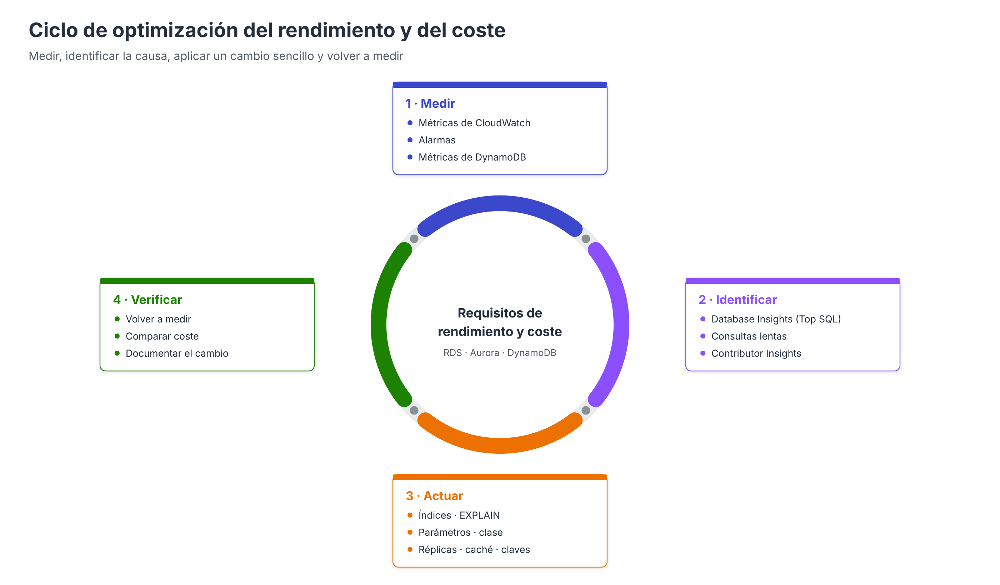

# Monitorización del rendimiento y optimización



El apartado de **Supervisión** describe las métricas de CloudWatch que indican el estado de una instancia: CPU, memoria, IOPS, latencia, conexiones. Estas métricas dicen **que** algo va mal, pero no siempre **por qué**. Este apartado baja al nivel de las **operaciones de inserción, actualización y consulta**: cómo identificar las sentencias que consumen más recursos, cómo analizarlas y qué optimizaciones sencillas pueden aplicarse, tanto en RDS y Aurora como en DynamoDB, para cumplir los requisitos de **rendimiento** y de **coste**.

El trabajo de optimización sigue siempre el mismo ciclo: **medir → identificar la causa → aplicar un cambio → volver a medir**. Optimizar sin medir lleva a cambios que no resuelven el problema o que lo trasladan a otro sitio.

---

## 1. Herramientas de monitorización en RDS y Aurora

| Nivel | Herramienta | Qué responde |
| --- | --- | --- |
| Instancia | **Métricas de CloudWatch** (apartado *Supervisión*) | ¿Está saturada la CPU, la memoria, el disco o la red? |
| Sistema operativo | **Monitorización mejorada** | ¿Qué procesos consumen CPU y memoria? Métricas cada 1–60 s |
| Base de datos | **CloudWatch Database Insights** (antes Performance Insights) | ¿Qué sentencias generan la carga y qué están esperando? |
| Sentencia | **Registro de consultas lentas**, `performance_schema`, `pg_stat_statements` | ¿Qué consultas tardan más y cuántas veces se ejecutan? |
| Plan de ejecución | `EXPLAIN` / `EXPLAIN ANALYZE` | ¿Cómo ejecuta el motor una consulta concreta? |
| Alertas | **Alarmas de CloudWatch** | Avisar cuando una métrica supera un umbral |

### CloudWatch Database Insights

Database Insights representa la **carga de la base de datos** (*DB load*), medida en **sesiones activas medias** (AAS): el número medio de sesiones que, en cada instante, están ejecutando algo o esperando un recurso.

- La gráfica muestra una línea con el **número de vCPU** de la instancia. Si la carga se mantiene **por encima** de esa línea, hay más trabajo del que la instancia puede atender y las sesiones están haciendo cola.
- La carga puede **desglosarse** por:
    - **Eventos de espera**: en qué se pierde el tiempo. Por ejemplo, `CPU`, `io/table/sql/handler` (lectura de tablas), `synch/mutex` o bloqueos de filas (`lock`).
    - **Sentencias SQL principales** (*Top SQL*): qué consultas generan la mayor parte de la carga.
    - **Usuarios, hosts y bases de datos**.
- Dispone de dos modalidades: **estándar** (incluida) y **avanzada** (con coste), que añade mayor retención del historial y análisis adicionales.

| Evento de espera predominante | Interpretación habitual | Acción típica |
| --- | --- | --- |
| CPU | Consultas que procesan muchas filas en memoria | Índices, reescritura de consultas, clase mayor |
| Lectura de disco (E/S) | Datos que no caben en la caché | Índices, más memoria, almacenamiento más rápido |
| Bloqueos de fila o tabla | Transacciones que compiten por los mismos datos | Transacciones más cortas, revisar el orden de acceso |
| Conexiones / red | Exceso de conexiones o resultados muy grandes | RDS Proxy, paginar resultados, evitar `SELECT *` |

### Registro de consultas lentas

El registro de consultas lentas guarda las sentencias que superan un tiempo de ejecución. Se activa en el **grupo de parámetros** y se exporta a **CloudWatch Logs**:

| Motor | Parámetros |
| --- | --- |
| MySQL / MariaDB | `slow_query_log = 1`, `long_query_time = 1` (segundos), `log_output = FILE` |
| PostgreSQL | `log_min_duration_statement = 1000` (milisegundos) |

```bash
aws rds modify-db-parameter-group --db-parameter-group-name tienda-mysql84 \
  --parameters "ParameterName=slow_query_log,ParameterValue=1,ApplyMethod=immediate" \
               "ParameterName=long_query_time,ParameterValue=1,ApplyMethod=immediate"

aws rds modify-db-instance --db-instance-identifier tienda-db-server \
  --cloudwatch-logs-export-configuration '{"EnableLogTypes":["slowquery"]}'
```

Una vez en CloudWatch Logs, **Logs Insights** permite consultar los registros. Por ejemplo, las consultas lentas más frecuentes de la última hora:

```text
fields @timestamp, @message
| filter @message like /Query_time/
| sort @timestamp desc
| limit 20
```

### Estadísticas de sentencias en el motor

```sql
-- MySQL: sentencias con mayor tiempo total de ejecución
SELECT DIGEST_TEXT, COUNT_STAR AS ejecuciones,
       ROUND(SUM_TIMER_WAIT/1e12, 2) AS segundos_totales,
       SUM_ROWS_EXAMINED AS filas_examinadas
FROM performance_schema.events_statements_summary_by_digest
ORDER BY SUM_TIMER_WAIT DESC LIMIT 10;

-- PostgreSQL (extensión pg_stat_statements)
SELECT query, calls, round(total_exec_time) AS ms_totales, rows
FROM pg_stat_statements
ORDER BY total_exec_time DESC LIMIT 10;
```

Una consulta que se ejecuta miles de veces con un coste moderado puede consumir más recursos que una consulta muy lenta que se ejecuta una vez al día. Por eso conviene ordenar por **tiempo total** y no solo por tiempo medio.

### Analizar una consulta con `EXPLAIN`

`EXPLAIN` muestra el **plan de ejecución**: qué tablas se leen, en qué orden, con qué índices y cuántas filas se estiman. Se toma como ejemplo la tabla `producto` de la base de datos `tienda` utilizada en la práctica evaluable (script `00-ud5.sql`), que contiene **1 023 productos** y tiene índices sobre `id_producto` (clave primaria), `codigo` (único), `proveedor` e `id_categoria` (claves foráneas).

**Consulta que aprovecha un índice existente.** El listado de productos de una categoría usa el índice `FK_categoria`, creado para la clave foránea:

```sql
EXPLAIN SELECT codigo, nombre, stock FROM producto WHERE id_categoria = 3;
```

| type | key | rows | Extra |
| --- | --- | --- | --- |
| `ref` | `FK_categoria` | 148 | — |

`type = ref` indica que el motor accede directamente a las filas de esa categoría mediante el índice: examina unas 148 filas, las que realmente cumplen la condición.

**Consulta sin índice.** Un informe habitual en una tienda es el de productos con **stock bajo**, pero la columna `stock` no está indexada:

```sql
EXPLAIN SELECT codigo, nombre, stock FROM producto WHERE stock < 60;
```

| type | key | rows | filtered | Extra |
| --- | --- | --- | --- | --- |
| `ALL` | `NULL` | ≈ 1 023 | 33.33 | Using where |

`type = ALL` indica un **recorrido completo de la tabla**: el motor lee todos los productos para devolver solo 36. La columna `filtered` es una estimación del porcentaje de filas que cumplirán la condición; sin índice, el optimizador desconoce la distribución real de los valores y aplica un valor por defecto. Tras crear un índice sobre `stock`:

```sql
CREATE INDEX idx_producto_stock ON producto (stock);
EXPLAIN SELECT codigo, nombre, stock FROM producto WHERE stock < 60;
```

| type | key | rows | Extra |
| --- | --- | --- | --- |
| `range` | `idx_producto_stock` | 36 | Using index condition |

`type = range` indica que el motor recorre solo el **tramo del índice** que cumple la condición. Las cifras de `rows` son estimaciones del optimizador y pueden variar ligeramente según las estadísticas de la tabla.

Con 1 023 filas la diferencia apenas se percibe, pero el coste de un recorrido completo **crece con el tamaño de la tabla**, mientras que el de una búsqueda por índice se mantiene casi constante: con cientos de miles de productos, o con la consulta ejecutándose miles de veces por hora, el índice marca la diferencia.

El número de filas examinadas se reduce drásticamente. `EXPLAIN ANALYZE` (MySQL 8 y PostgreSQL) ejecuta además la consulta y muestra los **tiempos reales** de cada paso.

!!! note "Escrituras e índices"
    Cada índice acelera las lecturas que lo aprovechan, pero **ralentiza las inserciones, actualizaciones y borrados**, que deben mantenerlo actualizado, y ocupa espacio. Deben crearse índices para los patrones de consulta frecuentes, no para todas las columnas.

### Alarmas

```bash
aws cloudwatch put-metric-alarm --alarm-name tienda-db-cpu-alta \
  --namespace AWS/RDS --metric-name CPUUtilization \
  --dimensions Name=DBInstanceIdentifier,Value=tienda-db-server \
  --statistic Average --period 300 --evaluation-periods 3 \
  --threshold 80 --comparison-operator GreaterThanThreshold \
  --alarm-actions arn:aws:sns:us-east-1:111122223333:avisos-bd
```

La alarma se activa cuando la CPU media supera el 80 % durante tres periodos consecutivos de cinco minutos y envía una notificación a un tema de Amazon SNS.

---

## 2. Monitorización de DynamoDB

DynamoDB no tiene CPU ni memoria que supervisar; las métricas relevantes se refieren a la **capacidad consumida**, las **limitaciones** y la **latencia**:

| Métrica de CloudWatch | Qué indica |
| --- | --- |
| `ConsumedReadCapacityUnits` / `ConsumedWriteCapacityUnits` | Capacidad realmente utilizada (base del coste en modo bajo demanda) |
| `ProvisionedReadCapacityUnits` / `ProvisionedWriteCapacityUnits` | Capacidad aprovisionada (solo modo aprovisionado) |
| `ThrottledRequests`, `ReadThrottleEvents`, `WriteThrottleEvents` | Peticiones rechazadas por superar la capacidad: **deben ser cero o casi cero** |
| `SuccessfulRequestLatency` | Latencia de las operaciones correctas, por tipo de operación |
| `SystemErrors` / `UserErrors` | Errores del servicio (HTTP 500) o de la petición (HTTP 400, como validaciones o permisos) |
| `ReturnedItemCount` frente a `ScannedCount` (en la respuesta) | Eficiencia de `Query` y `Scan` con filtros |

Además:

- **CloudWatch Contributor Insights para DynamoDB** muestra las **claves de partición más accedidas** y las más limitadas, lo que permite detectar **particiones calientes**.
- Los contadores `Count` y `ScannedCount` que devuelven `Query` y `Scan`, como se observó en la práctica, indican cuántos elementos se leyeron frente a cuántos se devolvieron.

---

## 3. Optimizaciones no complejas

### Configuración

| Optimización | Descripción |
| --- | --- |
| **Ajustar la clase de instancia** (*right-sizing*) | Si la CPU se mantiene baja y la memoria libre es alta, una clase menor reduce el coste. Si la carga supera de forma sostenida el número de vCPU, se necesita una clase mayor |
| **Memoria para la caché** | El parámetro `innodb_buffer_pool_size` (MySQL) o `shared_buffers` (PostgreSQL) determina cuántos datos se mantienen en memoria. RDS lo calcula en función de la memoria de la clase; ampliar la clase amplía la caché |
| **Conexiones** | Ajustar `max_connections` y usar **RDS Proxy** cuando hay muchas conexiones cortas |
| **Almacenamiento** | Pasar de `gp2` a `gp3`, que permite ajustar IOPS y rendimiento con independencia del tamaño; usar `io2` solo para cargas con E/S intensiva y sostenida |
| **Optimized Reads / Optimized Writes** | Funcionalidades de RDS y Aurora que usan almacenamiento NVMe local o evitan escrituras dobles en determinadas clases de instancia |

### Rediseño del esquema

| Optimización | Ejemplo |
| --- | --- |
| **Índices adecuados** | Índices sobre las columnas de los `WHERE`, `JOIN` y `ORDER BY` frecuentes; índices compuestos en el orden adecuado |
| **Índices de cobertura** | Un índice que incluye todas las columnas de la consulta evita leer la tabla |
| **Tipos de datos ajustados** | `INT` en lugar de `BIGINT` cuando basta, `VARCHAR` con longitud razonable, fechas como tipo fecha y no como texto |
| **Evitar `SELECT *`** | Recuperar solo las columnas necesarias reduce E/S y tráfico de red |
| **Paginación** | `LIMIT` con criterios de búsqueda por clave en lugar de `OFFSET` elevados |
| **Desnormalización selectiva** | Almacenar un dato derivado (por ejemplo, el total de un pedido) cuando evita uniones costosas y frecuentes |

### Distribución de los datos y de la carga

| Optimización | Descripción |
| --- | --- |
| **Réplicas de lectura** | Desviar las consultas de solo lectura (informes, búsquedas) a réplicas o al punto de enlace de lectura de Aurora |
| **Caché** | **Amazon ElastiCache** (Valkey, Redis OSS o Memcached) delante de RDS, o **DAX** delante de DynamoDB, para datos que se leen con mucha frecuencia y cambian poco |
| **Particionado de tablas** | Particiones por rango de fechas en MySQL o PostgreSQL para tablas históricas muy grandes, que permiten eliminar datos antiguos borrando una partición |
| **Archivado** | Trasladar datos antiguos a almacenamiento más barato (exportación a S3) |
| **DynamoDB: rediseño de claves** | Clave de partición con alta cardinalidad; fragmentación de escrituras ante particiones calientes |
| **DynamoDB: índices en lugar de `Scan`** | Un GSI convierte un `Scan` filtrado en una `Query`; proyectar solo los atributos necesarios |

### Coste

| Servicio | Medida de ahorro |
| --- | --- |
| RDS / Aurora | Instancias **Graviton** (`db.t4g`, `db.m7g`, `db.r7g`…), con mejor relación precio-rendimiento que las equivalentes x86 |
| RDS / Aurora | **Instancias reservadas** (1 o 3 años) para cargas estables |
| RDS / Aurora | **Detener** las instancias de desarrollo fuera del horario de uso; Aurora Serverless con mínimo 0 ACU para cargas intermitentes |
| RDS / Aurora | Eliminar **instantáneas manuales** obsoletas y ajustar la retención de copias |
| RDS / Aurora | Mantener versiones del motor con soporte estándar para evitar el coste de **Extended Support** |
| Aurora | Elegir **Standard** o **I/O-Optimized** según el peso del gasto en E/S (umbral orientativo del 25 %) |
| DynamoDB | **Bajo demanda** para tráfico variable; **aprovisionado con autoescalado** (y capacidad reservada) para tráfico estable |
| DynamoDB | Clase **Standard-IA** para tablas con mucho almacenamiento y poco acceso; **TTL** para eliminar datos caducados sin coste de escritura |
| Todos | **Etiquetas** de asignación de costes y **AWS Cost Explorer** para identificar qué base de datos genera cada gasto |

---

## Ejemplo de diagnóstico completo

1. **Síntoma**: tras crecer el catálogo hasta cientos de miles de productos, el personal de la tienda indica que el panel de productos con stock bajo tarda varios segundos en horas punta.
2. **Métricas** (*Supervisión*): `CPUUtilization` sostenida por encima del 85 %; `ReadIOPS` elevadas.
3. **Database Insights**: la carga supera el número de vCPU y el evento de espera principal es `CPU`. La sentencia principal es `SELECT codigo, nombre, stock FROM producto WHERE stock < ?`, que se ejecuta continuamente desde el panel de reposición de existencias.
4. **`EXPLAIN`**: recorrido completo de la tabla (`type = ALL`).
5. **Acción**: crear el índice `idx_producto_stock`.
6. **Verificación**: la CPU baja al 20 %, la consulta desaparece del registro de consultas lentas y la carga queda por debajo de la línea de vCPU.
7. **Optimización de coste**: con la nueva carga, la instancia está sobredimensionada y puede pasar a una clase menor.

---

## Referencias

- AWS. *Monitoring DB load with Amazon CloudWatch Database Insights on Amazon RDS* — [Database Insights](https://docs.aws.amazon.com/AmazonRDS/latest/UserGuide/USER_PerfInsights.html)
- AWS. *Monitoring OS metrics with Enhanced Monitoring* — [Monitorización mejorada](https://docs.aws.amazon.com/AmazonRDS/latest/UserGuide/USER_Monitoring.OS.html)
- AWS. *Publishing MySQL logs to Amazon CloudWatch Logs* — [Registros de MySQL](https://docs.aws.amazon.com/AmazonRDS/latest/UserGuide/USER_LogAccess.MySQLDB.PublishtoCloudWatchLogs.html)
- AWS. *Amazon RDS for PostgreSQL database log files* — [Registros de PostgreSQL](https://docs.aws.amazon.com/AmazonRDS/latest/UserGuide/USER_LogAccess.Concepts.PostgreSQL.html)
- AWS. *Analyzing log data with CloudWatch Logs Insights* — [Logs Insights](https://docs.aws.amazon.com/AmazonCloudWatch/latest/logs/AnalyzingLogData.html)
- MySQL. *EXPLAIN Statement* — [Manual de referencia de MySQL 8.4](https://dev.mysql.com/doc/refman/8.4/en/explain.html)
- PostgreSQL. *Using EXPLAIN* — [Documentación de PostgreSQL](https://www.postgresql.org/docs/current/using-explain.html)
- PostgreSQL. *pg_stat_statements* — [Documentación de PostgreSQL](https://www.postgresql.org/docs/current/pgstatstatements.html)
- AWS. *Using Amazon CloudWatch alarms* — [Alarmas](https://docs.aws.amazon.com/AmazonCloudWatch/latest/monitoring/AlarmThatSendsEmail.html)
- AWS. *DynamoDB metrics and dimensions* — [Métricas de DynamoDB](https://docs.aws.amazon.com/amazondynamodb/latest/developerguide/metrics-dimensions.html)
- AWS. *Using CloudWatch Contributor Insights for DynamoDB* — [Contributor Insights](https://docs.aws.amazon.com/amazondynamodb/latest/developerguide/contributorinsights_HowItWorks.html)
- AWS. *Best practices for Amazon RDS* — [Buenas prácticas](https://docs.aws.amazon.com/AmazonRDS/latest/UserGuide/CHAP_BestPractices.html)
- AWS. *Amazon ElastiCache* — [ElastiCache](https://docs.aws.amazon.com/AmazonElastiCache/latest/dg/WhatIs.html)
- AWS. *Amazon RDS Reserved Instances* — [Instancias reservadas](https://aws.amazon.com/rds/reserved-instances/)
