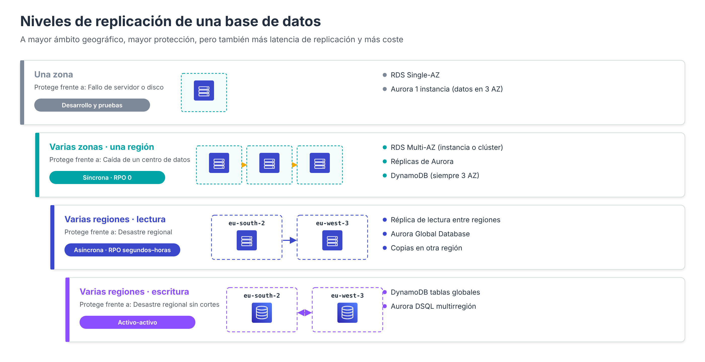

# Replicación y recuperación ante desastres

Una vez elegida la región en la que residirán los datos (véase [Elección de la región y residencia de los datos](BD-Region.md)), es necesario decidir **cuánta redundancia geográfica** necesita cada base de datos: si basta con una zona de disponibilidad, si deben repartirse entre varias zonas o si es necesario mantener una copia en otra región. En los apartados anteriores se han presentado los mecanismos de cada servicio (Multi-AZ y réplicas de lectura en RDS, réplicas y Global Database en Aurora, tablas globales en DynamoDB). Este apartado los reúne en una visión de conjunto para elegir el nivel adecuado.

Para comparar los distintos niveles se utilizan dos objetivos que se desarrollan en el apartado [Ciclo de vida](BD-CicloVida.md#objetivos-de-recuperacion):

- **RPO** (*Recovery Point Objective*): cuántos datos pueden perderse como máximo ante un fallo.
- **RTO** (*Recovery Time Objective*): cuánto tiempo puede estar el servicio sin funcionar.

---

## Niveles de replicación

Cuanto más amplio es el ámbito geográfico de la replicación, mayor es la protección, pero también la latencia de replicación, la complejidad y el coste.

| Nivel | Protege frente a | RDS | Aurora | DynamoDB |
| --- | --- | --- | --- | --- |
| **Una zona** | Fallo de un disco o un servidor (con recuperación lenta) | Instancia Single-AZ | Clúster con una sola instancia (los datos ya están en 3 AZ) | — |
| **Varias zonas** | Caída de un centro de datos | Instancia Multi-AZ, clúster Multi-AZ | Réplicas de Aurora en otras AZ | **Siempre**: 3 zonas por defecto |
| **Varias regiones (lectura)** | Desastre regional; lecturas cercanas a usuarios lejanos | Réplica de lectura entre regiones | Global Database | — |
| **Varias regiones (escritura)** | Desastre regional sin interrupción de escrituras | — | Aurora DSQL multirregión | Tablas globales |
| **Copias en otra región** | Pérdida de la región o borrado accidental | Copia de instantáneas y de copias automáticas entre regiones | Copia de instantáneas | Copias con AWS Backup entre regiones |

!!! warning "Residencia de los datos"
    Todos los niveles que implican **otra región** sacan los datos de la región elegida inicialmente. Antes de configurarlos debe comprobarse que la región de destino cumple los mismos requisitos normativos.

---

## Replicación síncrona y asíncrona

| | Síncrona | Asíncrona |
| --- | --- | --- |
| Confirmación de la escritura | Cuando la copia remota la ha recibido | Antes de que la copia remota la reciba |
| Pérdida de datos ante un fallo (RPO) | Nula | Los datos aún no replicados (segundos) |
| Impacto en la latencia | Mayor, aumenta con la distancia | Mínimo |
| Uso típico | Entre zonas de una región (Multi-AZ) | Entre regiones (réplicas, Global Database, tablas globales MREC) |

La replicación síncrona entre regiones lejanas penalizaría cada escritura con la latencia de la distancia; por eso la replicación entre regiones suele ser asíncrona, con excepciones diseñadas específicamente para ello, como las tablas globales con consistencia fuerte multirregión o Aurora DSQL.

---

## Consideraciones de coste

- **Multi-AZ** duplica (instancia) o triplica (clúster) el coste de cómputo y almacenamiento, aunque la transferencia de datos de la replicación entre zonas no se factura en RDS.
- La **transferencia de datos entre regiones** se factura por GB, tanto en réplicas como en copias de instantáneas.
- En **DynamoDB**, cada réplica de una tabla global factura las escrituras replicadas y su almacenamiento.
- En **Aurora Global Database**, se factura la E/S replicada y la transferencia hacia las regiones secundarias.

Las tablas de precios de cada servicio, y la **Calculadora de precios de AWS**, permiten estimar estos costes antes de decidir.

---

## Guía de decisión

| Requisito | Opción recomendada | RPO / RTO orientativos |
| --- | --- | --- |
| Entorno de desarrollo o pruebas | Una región, una zona (Single-AZ) | Desde la última copia / horas |
| Producción con alta disponibilidad | Una región, varias zonas (Multi-AZ, Aurora con réplicas o DynamoDB) | 0 / segundos a minutos |
| Recuperación ante desastres con RPO de horas | Copias de instantáneas en otra región | Horas / horas |
| Recuperación ante desastres con RPO de segundos | Réplica entre regiones o Aurora Global Database | Segundos / minutos |
| Usuarios en varios continentes con lecturas locales | Aurora Global Database o réplicas entre regiones | Segundos / minutos |
| Escrituras activas en varias regiones | DynamoDB tablas globales o Aurora DSQL | Segundos o 0 / casi inmediato |

---

## Referencias

- AWS. *Disaster recovery of workloads on AWS* (whitepaper) — [Recuperación ante desastres](https://docs.aws.amazon.com/whitepapers/latest/disaster-recovery-workloads-on-aws/disaster-recovery-workloads-on-aws.html)
- AWS. *Configuring and managing a Multi-AZ deployment* — [Multi-AZ en RDS](https://docs.aws.amazon.com/AmazonRDS/latest/UserGuide/Concepts.MultiAZ.html)
- AWS. *Working with DB instance read replicas: cross-Region* — [Réplicas entre regiones](https://docs.aws.amazon.com/AmazonRDS/latest/UserGuide/USER_ReadRepl.XRgn.html)
- AWS. *Copying a DB snapshot* — [Copia de instantáneas entre regiones](https://docs.aws.amazon.com/AmazonRDS/latest/UserGuide/USER_CopySnapshot.html)
- AWS. *Using Amazon Aurora Global Database* — [Global Database](https://docs.aws.amazon.com/AmazonRDS/latest/AuroraUserGuide/aurora-global-database.html)
- AWS. *Global tables – multi-active, multi-Region replication* — [Tablas globales de DynamoDB](https://docs.aws.amazon.com/amazondynamodb/latest/developerguide/GlobalTables.html)
- AWS. *Amazon RDS pricing* — [Precios de RDS](https://aws.amazon.com/rds/pricing/)
- AWS. *AWS Pricing Calculator* — [Calculadora de precios](https://calculator.aws/)
