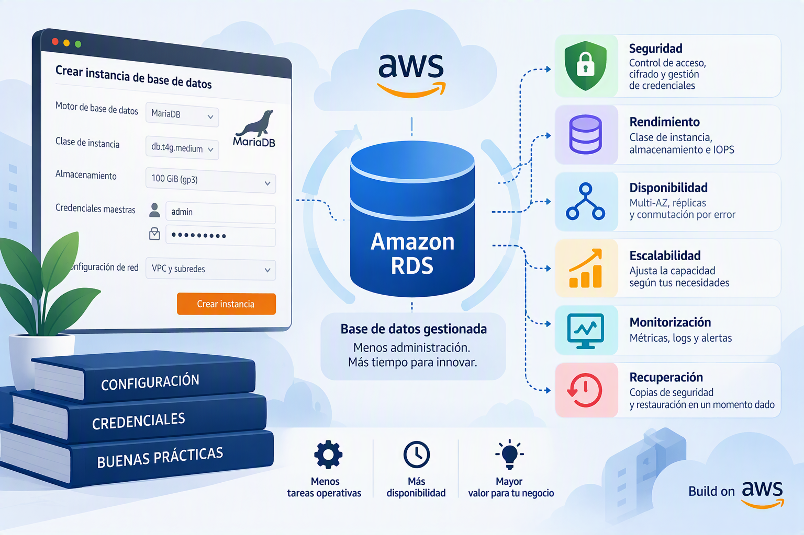

# Configuración inicial, gestión de credenciales y buenas prácticas

Amazon Relational Database Service (Amazon RDS) es el servicio gestionado de bases de datos relacionales de AWS. Su objetivo es simplificar las tareas habituales de administración, eliminando la necesidad de gestionar directamente servidores, almacenamiento, actualizaciones del sistema operativo o mecanismos de alta disponibilidad.

Durante la creación de una instancia MariaDB, AWS solicita una serie de configuraciones que condicionarán aspectos fundamentales del servicio, como el rendimiento, la seguridad, la disponibilidad, la escalabilidad o el coste económico. Comprender el impacto de estas decisiones resulta esencial para diseñar infraestructuras de datos que respondan adecuadamente a los requisitos funcionales y no funcionales de una organización.

La administración de bases de datos en la nube implica precisamente la selección y configuración de estos componentes, prestando especial atención a factores relacionados con el acceso, el cifrado, la monitorización, la replicación y la recuperación de la información.

---

## Selección de la plantilla de despliegue

Uno de los primeros pasos en la creación de una instancia MariaDB consiste en seleccionar una plantilla de configuración. Estas plantillas permiten adaptar automáticamente numerosos parámetros del servicio al escenario para el que se pretende utilizar la base de datos.

AWS ofrece diferentes configuraciones predefinidas orientadas principalmente a entornos de producción, desarrollo y formación. Aunque la elección de una plantilla no determina de forma permanente el comportamiento de la instancia, sí establece una serie de valores iniciales que afectan al coste, a la disponibilidad y a la robustez general del despliegue.

### Entornos de producción

La plantilla de producción está orientada a bases de datos que forman parte de sistemas reales utilizados por usuarios finales. En este contexto, la prioridad es garantizar la continuidad del servicio, minimizar los riesgos de pérdida de información y proporcionar una infraestructura capaz de mantener niveles adecuados de rendimiento incluso ante incrementos de carga.

Por este motivo, AWS suele proponer configuraciones más conservadoras, con mayores niveles de redundancia y mecanismos adicionales de protección. Esta aproximación incrementa el coste total de la solución, aunque proporciona una fiabilidad superior.

La utilización de esta plantilla resulta especialmente adecuada en aplicaciones empresariales, sistemas de gestión corporativa, plataformas de comercio electrónico o cualquier otro entorno donde una interrupción del servicio pueda generar un impacto significativo.

### Entornos de desarrollo y pruebas

La plantilla de desarrollo y pruebas está diseñada para escenarios donde el objetivo principal es validar aplicaciones, realizar experimentos o desarrollar nuevas funcionalidades.

En este tipo de entornos la disponibilidad no suele ser un requisito crítico, por lo que AWS propone una configuración más sencilla y económica. De este modo es posible reducir costes sin comprometer la capacidad de realizar pruebas funcionales o actividades formativas.

La mayoría de las prácticas docentes y laboratorios académicos utilizan configuraciones de este tipo, ya que permiten trabajar con el servicio sin necesidad de desplegar una arquitectura completa de producción.

### Capa gratuita

Cuando la cuenta dispone de acceso a la capa gratuita de AWS, puede utilizarse una configuración especialmente orientada al aprendizaje y a la realización de pruebas básicas.

Esta modalidad permite familiarizarse con los servicios de Amazon RDS sin asumir costes adicionales dentro de los límites establecidos por AWS. Sin embargo, la capacidad disponible y el rendimiento del sistema son considerablemente más reducidos que en los despliegues convencionales.

---

## Selección de la versión del motor MariaDB

Una vez elegida la plantilla, es necesario seleccionar la versión del motor MariaDB que ejecutará la instancia.

La elección de la versión constituye una decisión relevante, ya que determina las funcionalidades disponibles, el nivel de compatibilidad con aplicaciones existentes y el periodo durante el cual se recibirán actualizaciones de seguridad y mantenimiento.

Las versiones más recientes suelen incorporar mejoras relacionadas con el rendimiento, la eficiencia de las consultas, la estabilidad del sistema y la corrección de vulnerabilidades detectadas en versiones anteriores. Sin embargo, determinadas aplicaciones pueden requerir versiones específicas debido a dependencias o limitaciones de compatibilidad.

Por esta razón, la selección de la versión debe realizarse considerando simultáneamente los requisitos técnicos de la aplicación y las recomendaciones de soporte establecidas por AWS.

### Escrituras optimizadas de Amazon RDS

En determinadas versiones del motor, Amazon RDS permite habilitar funcionalidades optimizadas para operaciones de escritura.

Estas mejoras están orientadas a reducir la latencia y aumentar el rendimiento cuando la base de datos debe gestionar un elevado volumen de inserciones o modificaciones de información. Este tipo de optimizaciones puede resultar especialmente interesante en aplicaciones transaccionales, donde se realizan continuamente operaciones de creación y actualización de registros.

Aunque su utilización no modifica el funcionamiento lógico de la base de datos, sí puede aportar beneficios significativos en determinados escenarios de carga.

---

## Identificación de la instancia

Cada instancia de Amazon RDS debe disponer de un identificador único dentro de la cuenta y la región donde se despliega.

Este identificador no corresponde al nombre de la base de datos que almacenará las tablas y registros, sino al propio servicio administrado por AWS. Puede entenderse como el nombre con el que la plataforma identifica el servidor de base de datos dentro de la infraestructura del cliente.

La elección de nombres descriptivos facilita enormemente las tareas de administración posteriores, especialmente cuando una organización mantiene múltiples entornos de trabajo.

Por ejemplo, resulta habitual utilizar convenciones de nomenclatura que permitan identificar de forma inmediata el propósito de la instancia, distinguiendo entre sistemas de desarrollo, pruebas o producción.

Una estrategia de nombrado adecuada reduce errores operativos y simplifica la gestión de recursos a medida que la infraestructura crece.

---

## Configuración de las credenciales de administración

Toda instancia MariaDB requiere la existencia de una cuenta administrativa inicial, también denominada usuario maestro o *master user*.

Esta cuenta constituye el nivel más alto de privilegio dentro de la base de datos y será utilizada para realizar tareas como la creación de esquemas, la administración de usuarios o la configuración de permisos.

Debido a su importancia, AWS proporciona diferentes mecanismos para gestionar de forma segura las credenciales asociadas a esta cuenta.

---

## Gestión de credenciales mediante AWS Secrets Manager

La opción recomendada por AWS consiste en delegar la gestión de credenciales en AWS Secrets Manager.

En este modelo, las contraseñas dejan de almacenarse manualmente por parte del administrador y pasan a gestionarse mediante un servicio especializado en la protección de información sensible.

Además del almacenamiento seguro, Secrets Manager permite automatizar la generación de contraseñas complejas, controlar los accesos a las mismas y programar procesos de rotación periódica que incrementan significativamente el nivel de seguridad del sistema.

Desde una perspectiva operativa, esta aproximación reduce los riesgos asociados a la reutilización de contraseñas, al almacenamiento inseguro de credenciales o a la pérdida accidental de información sensible.

Su principal inconveniente es el coste adicional asociado al servicio, motivo por el cual algunos entornos de formación o desarrollo optan por soluciones más sencillas.

---

## Gestión manual de credenciales

Como alternativa, Amazon RDS permite que las credenciales sean administradas directamente por el responsable de la infraestructura.

En este escenario, la organización define la contraseña inicial y asume completamente las tareas de custodia, actualización y protección de las credenciales.

Aunque esta aproximación resulta más simple y económica, también implica una mayor responsabilidad administrativa. La seguridad del sistema dependerá en gran medida de las políticas internas relacionadas con la creación, almacenamiento y renovación de contraseñas.

En entornos formativos suele ser una solución suficiente, mientras que en sistemas empresariales se recomienda utilizar mecanismos centralizados de gestión de secretos.

---

## Métodos de autenticación

Además de la gestión de credenciales, Amazon RDS permite seleccionar el mecanismo de autenticación que utilizarán los usuarios para acceder al sistema.

La opción tradicional consiste en utilizar usuarios y contraseñas almacenados directamente en MariaDB. Este modelo continúa siendo el más extendido debido a su simplicidad y compatibilidad con cualquier aplicación capaz de conectarse a una base de datos relacional.

Sin embargo, AWS también ofrece la posibilidad de integrar la autenticación con AWS Identity and Access Management (IAM).

Mediante este mecanismo, la gestión de identidades se centraliza dentro de la plataforma AWS, permitiendo controlar accesos, asignar permisos y registrar actividades utilizando las mismas herramientas de gobierno y seguridad empleadas en el resto de servicios de la nube.

Esta aproximación resulta especialmente interesante en entornos corporativos donde la trazabilidad y el control de accesos constituyen requisitos importantes de seguridad.

---

## Cifrado de credenciales y claves KMS

Cuando se utilizan mecanismos avanzados de gestión de identidades o servicios como AWS Secrets Manager, es necesario proteger la información almacenada mediante técnicas de cifrado.

Para ello, Amazon RDS se integra con AWS Key Management Service (KMS), el servicio encargado de la gestión centralizada de claves criptográficas.

KMS permite crear, almacenar y administrar las claves utilizadas para proteger información sensible dentro de AWS. Gracias a este mecanismo, incluso aunque un tercero obtuviera acceso a los datos almacenados, no podría interpretar su contenido sin disponer de las claves correspondientes.

El uso de claves administradas por AWS simplifica la puesta en marcha del sistema, mientras que la utilización de claves personalizadas proporciona un mayor nivel de control para organizaciones sujetas a requisitos normativos o políticas de seguridad más estrictas.

---

## Buenas prácticas recomendadas

Para la mayoría de despliegues académicos y empresariales, una configuración equilibrada debería contemplar el uso de una v**ersión estable y soportada de MariaDB**, nombres descriptivos para las instancias, gestión centralizada de credenciales mediante AWS Secrets Manager y mecanismos de cifrado basados en AWS KMS.

Asimismo, siempre que resulte viable, conviene integrar la autenticación con IAM para unificar la gestión de identidades y mejorar la trazabilidad de las operaciones realizadas sobre la base de datos.

---

## Conclusiones

La configuración inicial de una instancia MariaDB en Amazon RDS constituye la base sobre la que se construirá el resto de la infraestructura de datos. Decisiones aparentemente sencillas, como la selección de una plantilla, la versión del motor o el mecanismo de autenticación, tienen consecuencias directas sobre el nivel de seguridad, los costes operativos y la facilidad de administración del sistema.

Por este motivo, el diseño de una base de datos en la nube no debe limitarse a crear recursos, sino que debe considerar aspectos relacionados con la protección de la información, la gestión de accesos y la gobernanza del servicio, competencias que forman parte de la administración profesional de bases de datos en entornos cloud. 
