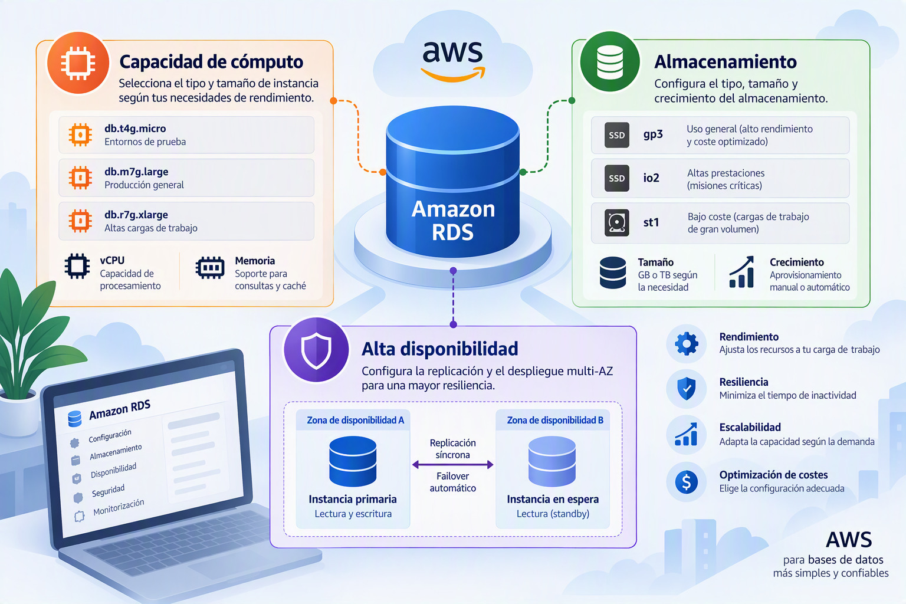
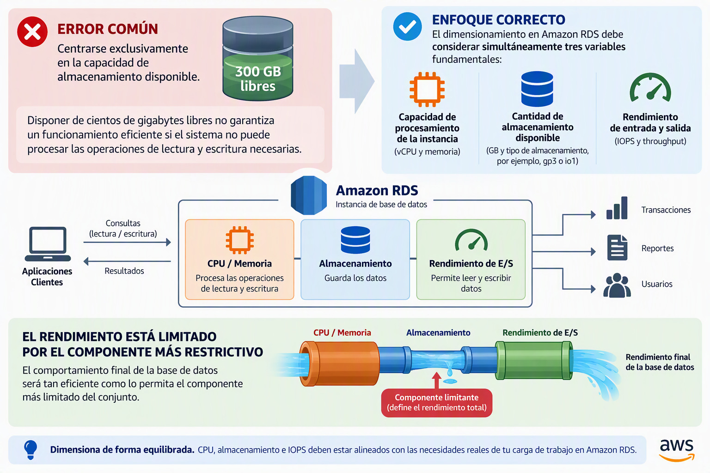

# Configuración de la capacidad de cómputo, almacenamiento y alta disponibilidad

Una vez definidas las características básicas de la instancia, como el motor de base de datos, la gestión de credenciales o los mecanismos de autenticación, el siguiente paso consiste en determinar los recursos físicos que estarán disponibles para ejecutar MariaDB.

Estas decisiones **afectan directamente al rendimiento, la capacidad de crecimiento, la disponibilidad del servicio y el coste económico de la solución**. En un entorno cloud, la administración eficiente de una base de datos no consiste únicamente en desplegar recursos, sino en dimensionarlos adecuadamente para satisfacer los requisitos de rendimiento y disponibilidad sin incurrir en gastos innecesarios. La selección de capacidad de computación, almacenamiento y mecanismos de replicación forma parte de las competencias asociadas a la administración de bases de datos en la nube.

## Configuración de la instancia

Amazon RDS permite seleccionar diferentes tipos de instancia según las características de la carga de trabajo que se espera ejecutar.

La instancia representa el conjunto de recursos de procesamiento asignados a la base de datos y determina aspectos como la capacidad de cálculo disponible, la cantidad de memoria RAM, el ancho de banda de red y el rendimiento máximo que puede alcanzar el sistema.

Puede considerarse el equivalente al servidor físico sobre el que se ejecutaría MariaDB en una infraestructura tradicional.

La elección de una instancia insuficiente puede provocar tiempos de respuesta elevados, bloqueos o saturación del sistema, mientras que una instancia excesivamente grande supondrá un incremento innecesario de los costes operativos.

---

### Familias de instancias

Amazon agrupa las instancias en diferentes familias diseñadas para atender necesidades específicas.

#### Instancias de propósito general

Las instancias de propósito general, identificadas habitualmente por la familia *M*, proporcionan un equilibrio entre capacidad de procesamiento, memoria y coste.

Están diseñadas para aplicaciones que presentan un comportamiento relativamente equilibrado y constituyen la opción más habitual para entornos empresariales, sistemas de gestión, aplicaciones web y bases de datos transaccionales de tamaño medio.

Para la mayoría de implementaciones, estas instancias ofrecen una combinación adecuada de rendimiento y coste, motivo por el cual suelen ser la alternativa recomendada como punto de partida.

---

#### Instancias optimizadas para memoria

Las familias *R* y *X* están orientadas a cargas de trabajo donde la memoria RAM constituye el recurso crítico.

MariaDB utiliza memoria para mantener información en caché, reducir accesos al disco y acelerar la ejecución de consultas complejas. Cuando el volumen de datos o el número de conexiones simultáneas aumenta significativamente, disponer de grandes cantidades de memoria puede mejorar notablemente el rendimiento de la plataforma.

Este tipo de instancias suele emplearse en bases de datos de gran tamaño, sistemas analíticos o aplicaciones empresariales con una elevada concurrencia de usuarios.

---

#### Instancias ampliables

Las instancias de la familia *T* están diseñadas para cargas variables o de baja intensidad.

Su funcionamiento se basa en un sistema de créditos de CPU que permite disponer de recursos adicionales durante periodos concretos de actividad elevada. Como consecuencia, estas instancias son considerablemente más económicas, aunque no resultan adecuadas para cargas sostenidas de trabajo.

Son especialmente interesantes en entornos docentes, laboratorios, pruebas de concepto o aplicaciones con una actividad muy irregular.

---

### Dimensionamiento de la instancia

Entre los aspectos más importantes durante la selección de una instancia destacan el número de procesadores virtuales y la cantidad de memoria RAM disponible.

Los procesadores virtuales determinan la capacidad de ejecutar tareas simultáneamente, mientras que la memoria influye directamente en la capacidad de almacenamiento temporal de datos, índices y consultas frecuentes.

Una base de datos con un número elevado de usuarios concurrentes o que procese consultas complejas necesitará más recursos de computación que otra destinada únicamente al almacenamiento de información con acceso esporádico.

No obstante, **una de las ventajas fundamentales de Amazon RDS es la posibilidad de modificar posteriormente la clase de instancia**. Esto permite comenzar con configuraciones moderadas y ampliar recursos cuando las necesidades del sistema lo requieran, siguiendo así un modelo de crecimiento gradual.

---

## Almacenamiento

### Selección del tipo de almacenamiento

Además de la capacidad de procesamiento, toda base de datos necesita un sistema de almacenamiento donde conservar permanentemente la información.

En Amazon RDS el almacenamiento no solo determina cuánto espacio puede utilizar la base de datos, sino también la velocidad con la que podrán realizarse las operaciones de lectura y escritura.

---

#### SSD de propósito general

Las unidades SSD de propósito general ofrecen un **equilibrio adecuado entre rendimiento y coste**.

Representan la opción más utilizada en aplicaciones corporativas convencionales y proporcionan una capacidad suficiente para la mayoría de los despliegues de tamaño pequeño y medio.

Su principal ventaja reside en la combinación de rendimiento adecuado, simplicidad operativa y costes moderados.

---

#### SSD con IOPS provisionadas

Para aplicaciones con **requisitos elevados de rendimiento**, Amazon RDS permite utilizar almacenamiento SSD con IOPS provisionadas.

En este modelo, además de definir la capacidad de almacenamiento, el administrador puede especificar el número de operaciones de entrada y salida por segundo que deben estar garantizadas.

Esto permite predecir con mayor precisión el comportamiento del sistema bajo cargas intensivas y reducir considerablemente la latencia de acceso a los datos.

Este tipo de almacenamiento suele emplearse en sistemas críticos, aplicaciones financieras, plataformas de comercio electrónico y entornos donde la velocidad de respuesta constituye un requisito esencial.

---

### Capacidad de almacenamiento asignada

El almacenamiento asignado determina la cantidad máxima de espacio disponible para la instancia de base de datos.

Dentro de este espacio **se almacenan no solo las tablas y los índices, sino también registros de transacciones, archivos temporales y diversos elementos necesarios para el funcionamiento del motor MariaDB**.

La capacidad debe dimensionarse teniendo en cuenta tanto las necesidades actuales como el crecimiento previsto de la información.

Asignar una capacidad excesiva incrementará innecesariamente los costes, mientras que una estimación insuficiente puede obligar a realizar ampliaciones posteriores o provocar limitaciones operativas.

Una planificación adecuada requiere analizar el volumen previsto de datos, la velocidad de crecimiento y las políticas de retención establecidas por la organización.

---

### IOPS: rendimiento de entrada y salida

Uno de los conceptos más importantes en entornos de almacenamiento empresarial es el número de operaciones de entrada y salida por segundo, conocido por las siglas IOPS (*Input/Output Operations Per Second*).

Las IOPS representan la capacidad del sistema para leer y escribir información en disco.

Cuando una aplicación ejecuta consultas sobre la base de datos, inserta nuevos registros o actualiza información existente, se generan continuamente operaciones de entrada y salida. Si el almacenamiento no es capaz de atender dichas operaciones con suficiente rapidez, el rendimiento general de la aplicación se verá afectado.

Por este motivo, Amazon RDS permite provisionar una cantidad específica de IOPS en determinadas clases de almacenamiento.

Sin embargo, incrementar las IOPS también incrementa el coste del servicio, por lo que resulta necesario encontrar un equilibrio adecuado entre rendimiento y presupuesto.

---

### Relación entre almacenamiento e IOPS

Uno de los **errores más habituales al diseñar infraestructuras de bases de datos consiste en centrarse exclusivamente en la capacidad** de almacenamiento disponible.

En realidad, disponer de cientos de gigabytes libres no garantiza un funcionamiento eficiente si el sistema no puede procesar las operaciones de lectura y escritura necesarias.

Por esta razón, el dimensionamiento debe realizarse considerando simultáneamente tres variables fundamentales:

- Capacidad de procesamiento de la instancia.
- Cantidad de almacenamiento disponible.
- Rendimiento de entrada y salida.

El comportamiento final de la base de datos será tan eficiente como lo permita el componente más limitado del conjunto.

---

## Disponibilidad y durabilidad

Además del rendimiento, Amazon RDS permite definir el nivel de disponibilidad requerido para la base de datos.

La disponibilidad hace referencia a la capacidad del sistema para continuar funcionando incluso cuando se producen fallos de hardware, problemas de red o incidencias en la infraestructura subyacente.

En sistemas críticos, la disponibilidad constituye un requisito tan importante como el propio rendimiento.

---

### Implementación Multi-AZ

Amazon RDS ofrece la posibilidad de desplegar la base de datos utilizando una arquitectura Multi-AZ (*Multiple Availability Zones*).

Cuando esta opción se encuentra habilitada, AWS mantiene una copia sincronizada de la instancia en una zona de disponibilidad diferente dentro de la misma región.

Las zonas de disponibilidad son centros de datos físicamente separados que disponen de alimentación eléctrica, redes y sistemas de infraestructura independientes.

Como consecuencia, si la instancia principal deja de estar disponible debido a una incidencia, Amazon RDS puede transferir automáticamente el servicio a la instancia de respaldo.

Este mecanismo reduce considerablemente el tiempo de interrupción y mejora la capacidad de recuperación ante fallos. 

---

### Beneficios y limitaciones de Multi-AZ

La principal ventaja de una arquitectura Multi-AZ es el incremento de la disponibilidad del servicio.

Desde la perspectiva del usuario final, la base de datos continúa operativa incluso cuando se produce un fallo grave en la infraestructura principal.

Sin embargo, es importante comprender que Multi-AZ no está diseñado para aumentar el rendimiento de las consultas ni para distribuir la carga entre múltiples servidores.

Su objetivo principal es garantizar la continuidad operativa y reducir el impacto de posibles incidencias.

Esta funcionalidad también implica un incremento del coste, ya que AWS mantiene una segunda infraestructura preparada para asumir el servicio en caso de necesidad.

Por este motivo, suele reservarse para sistemas de producción donde la disponibilidad constituye un requisito prioritario.

---

## Buenas prácticas recomendadas

En la mayoría de escenarios empresariales resulta recomendable comenzar con instancias de **propósito general adecuadamente dimensionadas** y ampliar recursos a medida que la monitorización del sistema evidencie nuevas necesidades.

Asimismo, conviene seleccionar tipos de almacenamiento coherentes con la carga de trabajo prevista, evitando tanto el sobredimensionamiento como configuraciones que puedan convertirse en cuellos de botella.

Cuando la continuidad del servicio sea un requisito importante, la utilización de arquitecturas **Multi-AZ** proporciona un nivel adicional de protección frente a fallos de infraestructura y contribuye a reducir los tiempos de inactividad.

---

## Conclusiones

La configuración de la capacidad de cómputo, el almacenamiento y los mecanismos de alta disponibilidad constituye una de las decisiones más relevantes durante el despliegue de una base de datos MariaDB en Amazon RDS. Estos elementos determinan el rendimiento máximo del sistema, su capacidad de crecimiento y su resistencia ante fallos.

Una administración eficiente requiere evaluar conjuntamente las necesidades de procesamiento, almacenamiento y disponibilidad, seleccionando los recursos que permitan satisfacer los requisitos del proyecto con un equilibrio adecuado entre rendimiento, resiliencia y coste económico.
