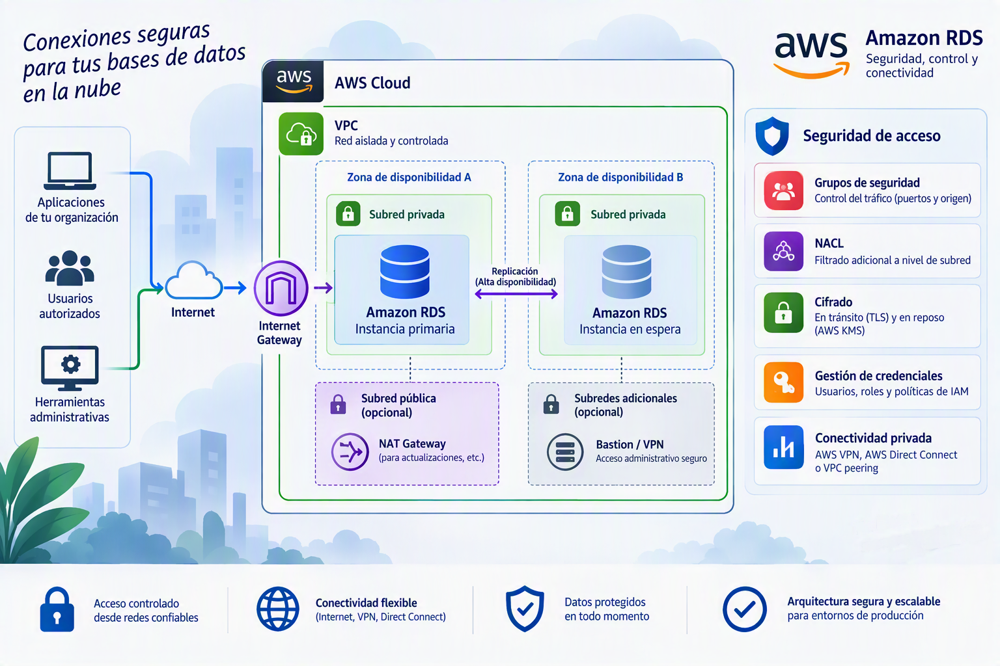
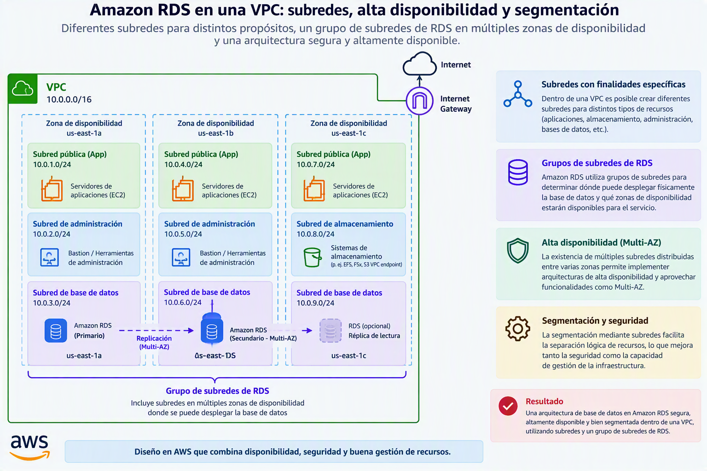
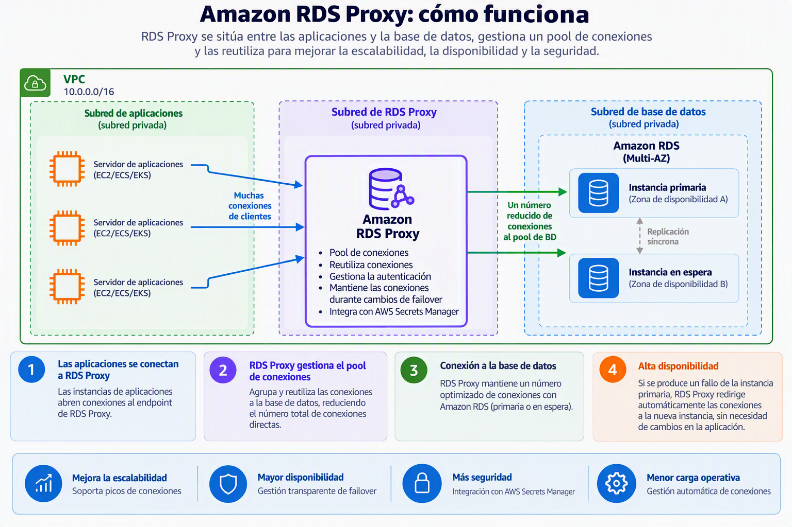

# Redes, conectividad y seguridad de acceso

Una vez definidos los recursos de computación, el almacenamiento y los mecanismos de alta disponibilidad, el siguiente paso consiste en establecer cómo podrán acceder los distintos sistemas a la base de datos.

En muchas ocasiones, **los problemas más graves** de una infraestructura de datos no están relacionados con el rendimiento o la capacidad de almacenamiento, sino con **configuraciones incorrectas de red y seguridad**. Una base de datos excesivamente expuesta puede convertirse en un objetivo para ataques externos, mientras que una configuración demasiado restrictiva puede impedir el funcionamiento correcto de las aplicaciones. 

Por este motivo, Amazon RDS incorpora un conjunto de mecanismos que permiten controlar la conectividad, restringir el acceso a los recursos autorizados y proteger las comunicaciones mediante cifrado. La configuración de parámetros relativos a visibilidad, acceso, seguridad, monitorización y auditoría forma parte de las tareas fundamentales asociadas a la administración de bases de datos en la nube.

## Integración con recursos de computación

Durante la creación de una instancia, Amazon RDS permite asociar la base de datos con recursos de cómputo desplegados en AWS, especialmente instancias Amazon EC2.

Esta integración facilita la creación de arquitecturas donde la aplicación y la base de datos forman parte de la misma infraestructura, simplificando determinados aspectos de la configuración de red.

No obstante, **la base de datos puede desplegarse de forma completamente independiente**. Esta situación es habitual cuando todavía no se han creado los servidores de aplicaciones o cuando la misma instancia debe ser utilizada simultáneamente por varios sistemas diferentes.

Desde el punto de vista arquitectónico, es importante comprender que una base de datos no necesita estar asociada permanentemente a un único servidor. **Amazon RDS actúa como un servicio independiente** al que posteriormente podrán conectarse diferentes aplicaciones autorizadas.

---

## Tipo de red y direccionamiento IP

Toda comunicación en AWS se realiza utilizando protocolos de red basados en direcciones IP.

Durante la configuración de la instancia es posible seleccionar si el servicio utilizará exclusivamente IPv4 o si admitirá simultáneamente IPv4 e IPv6 mediante un esquema de pila dual.

Actualmente, **IPv4 continúa siendo el protocolo predominante** en la mayoría de organizaciones y entornos empresariales. Por este motivo, la inmensa mayoría de las implementaciones utilizan esta opción sin necesidad de realizar configuraciones adicionales.

Sin embargo, IPv6 aporta ventajas relacionadas con la disponibilidad de direcciones y la evolución futura de Internet. Las organizaciones que estén desarrollando nuevas infraestructuras o que trabajen en entornos donde IPv6 ya se encuentra desplegado pueden optar por configuraciones de doble pila para garantizar la compatibilidad con ambos protocolos.

La elección del tipo de red no suele tener impacto sobre el funcionamiento de MariaDB, pero sí influye en la forma en que otros sistemas podrán establecer conexiones con la base de datos.

---

## Redes privadas virtuales (VPC)

Uno de los conceptos más importantes dentro de AWS es la Virtual Private Cloud o VPC.

Una VPC puede entenderse como una red privada definida por software dentro de la infraestructura de Amazon. Todos los recursos desplegados dentro de la misma VPC comparten un entorno de comunicación común y pueden interactuar siguiendo las reglas de seguridad establecidas por el administrador.

Cuando se despliega una instancia RDS, es obligatorio decidir en qué VPC residirá.

Esta decisión tiene una especial relevancia porque condiciona posteriormente la conectividad con otros recursos. Una base de datos desplegada en una determinada VPC podrá comunicarse fácilmente con servicios ubicados en la misma red, mientras que la comunicación con recursos externos requerirá configuraciones adicionales.

Por este motivo, la planificación de la arquitectura de red debe realizarse antes de desplegar los servicios. Una mala elección de la VPC puede obligar a rediseñar parte de la infraestructura o incluso recrear determinados recursos.

La selección adecuada de redes virtuales, rangos de direccionamiento y mecanismos de segmentación constituye un elemento esencial en la administración segura de infraestructuras cloud.

### Subredes y zonas de disponibilidad

Dentro de una VPC es posible crear diferentes subredes con finalidades específicas.

Amazon RDS utiliza grupos de subredes para determinar dónde puede desplegar físicamente la base de datos y qué zonas de disponibilidad estarán disponibles para el servicio.

La existencia de múltiples subredes distribuidas entre varias zonas permite implementar arquitecturas de alta disponibilidad y aprovechar funcionalidades como Multi-AZ.

Desde una perspectiva de diseño, las subredes constituyen un mecanismo de segmentación que facilita la separación lógica de distintos tipos de recursos. Es habitual encontrar subredes específicas para servidores de aplicaciones, sistemas de almacenamiento, servicios de administración y bases de datos.

Esta segmentación contribuye a mejorar tanto la seguridad como la capacidad de gestión de la infraestructura.

---

### Acceso público y acceso privado

Una de las decisiones más relevantes durante la configuración de una base de datos es determinar si la instancia será accesible desde Internet.

Cuando se habilita el acceso público, Amazon puede asignar una dirección accesible desde redes externas. Esto permite que herramientas de administración, aplicaciones remotas o usuarios autorizados establezcan conexiones sin necesidad de encontrarse dentro de la misma VPC.

Aunque esta configuración simplifica considerablemente las tareas de acceso, también incrementa la superficie de exposición del sistema.

Por el contrario, una instancia sin acceso público únicamente podrá ser utilizada por recursos autorizados dentro de la red privada o mediante mecanismos específicos de conectividad segura.

En entornos empresariales, **la práctica más habitual consiste en mantener las bases de datos dentro de redes privadas y permitir el acceso únicamente a través de los servidores de aplicaciones**. De esta manera se añade una capa adicional de protección entre los usuarios externos y la información almacenada.

El acceso público puede ser adecuado para laboratorios, actividades formativas o entornos de pruebas, pero en sistemas de producción debe evaluarse cuidadosamente desde una perspectiva de seguridad.

---

### Grupos de seguridad

Si la VPC define la red donde se encuentra la base de datos, los grupos de seguridad determinan quién puede comunicarse con ella.

Un grupo de seguridad actúa como un **cortafuegos virtual** encargado de controlar el tráfico permitido hacia la instancia.

Cada regla especifica qué sistemas pueden conectarse, utilizando qué protocolos y a través de qué puertos.

En el caso de MariaDB, el puerto de comunicación más habitual es el 3306. Sin embargo, incluso aunque la base de datos disponga de una dirección accesible, ninguna conexión será aceptada si las reglas del grupo de seguridad no la autorizan explícitamente.

La utilización adecuada de grupos de seguridad constituye **una de las medidas de protección más importantes dentro de AWS**. La creación de reglas excesivamente permisivas puede exponer la base de datos a accesos no autorizados, mientras que una configuración correctamente diseñada permite aplicar el principio de mínimo privilegio, autorizando únicamente los accesos estrictamente necesarios. 

---

### RDS Proxy

Las aplicaciones modernas suelen gestionar un elevado número de conexiones simultáneas contra las bases de datos.

Cada conexión consume recursos y, cuando la carga aumenta considerablemente, la apertura y cierre constante de sesiones puede afectar al rendimiento global del sistema.

Para responder a este problema, Amazon ofrece RDS Proxy.

Un proxy actúa como una **capa intermedia entre las aplicaciones y la base de datos**. En lugar de crear conexiones directas para cada petición, el proxy mantiene un conjunto optimizado de conexiones reutilizables y gestiona su distribución entre las aplicaciones que las solicitan.

Esta arquitectura permite reducir la sobrecarga del servidor, mejorar la escalabilidad y aumentar la estabilidad bajo cargas elevadas.

Además, determinadas operaciones de mantenimiento o cambios en la infraestructura pueden resultar más transparentes para las aplicaciones cuando se utiliza un proxy, ya que las conexiones se gestionan desde esta capa intermedia.

No obstante, la incorporación de un proxy introduce cierta complejidad adicional y puede incrementar los costes del despliegue, por lo que normalmente se reserva para sistemas con un número importante de usuarios o conexiones concurrentes.

---

### Certificados y cifrado de las comunicaciones

La seguridad de una base de datos no depende únicamente de quién puede conectarse, sino también de cómo se transmiten los datos a través de la red.

Cuando una aplicación establece una conexión con MariaDB intercambia información sensible que puede incluir credenciales, datos personales o información empresarial.

Para proteger estas comunicaciones, Amazon RDS permite utilizar certificados digitales emitidos por autoridades certificadoras reconocidas.

El uso de certificados posibilita establecer conexiones cifradas mediante TLS, garantizando que **la información transmitida entre clientes y servidores no pueda ser interpretada por terceros** durante su tránsito por la red.

Además del cifrado, los certificados permiten verificar la identidad del servidor, reduciendo el riesgo de ataques basados en la suplantación de sistemas legítimos.

La utilización de conexiones cifradas constituye actualmente una práctica fundamental en cualquier entorno profesional donde se gestione información sensible o crítica.

---

## Etiquetas y organización de recursos

A medida que una infraestructura crece, se vuelve cada vez más importante disponer de mecanismos que permitan clasificar y organizar los recursos desplegados.

Para ello, AWS utiliza etiquetas o *tags*, que consisten en pares clave-valor asociados a cada elemento de la plataforma.

Las etiquetas permiten identificar entornos, departamentos, proyectos, responsables técnicos o cualquier otro criterio relevante para la organización.

Aunque no afectan directamente al funcionamiento de la base de datos, desempeñan un papel fundamental en la administración cotidiana de la infraestructura.

Gracias a ellas resulta posible filtrar recursos, automatizar tareas, generar informes o atribuir costes a proyectos concretos. En organizaciones con cientos o miles de recursos desplegados, las etiquetas son una herramienta imprescindible de gobierno y gestión.

---

## Buenas prácticas recomendadas

La estrategia recomendada para la mayoría de organizaciones consiste en alojar las bases de datos dentro de **redes privadas, limitar el acceso mediante grupos de seguridad específicos y utilizar conexiones cifradas para proteger el tráfico de red**.

Asimismo, resulta conveniente segmentar correctamente las subredes, evitar accesos públicos innecesarios y documentar adecuadamente los recursos mediante etiquetas consistentes.

Cuando las aplicaciones gestionan grandes volúmenes de conexiones simultáneas, la incorporación de RDS Proxy puede contribuir significativamente a mejorar la escalabilidad y la estabilidad del sistema.

---

## Conclusiones

La configuración de la conectividad y la seguridad constituye una de las fases más importantes en el despliegue de una base de datos MariaDB sobre Amazon RDS. La definición de redes, subredes, grupos de seguridad y mecanismos de acceso determina quién podrá utilizar la información almacenada y bajo qué condiciones podrá hacerlo.

Una base de datos correctamente protegida no es aquella que resulta inaccesible, sino aquella que únicamente permite el acceso a los sistemas y usuarios autorizados, manteniendo el equilibrio adecuado entre funcionalidad, rendimiento y seguridad. La configuración de controles de acceso, conectividad segura y mecanismos de protección forma parte de las competencias esenciales de la administración de bases de datos en entornos cloud. 
