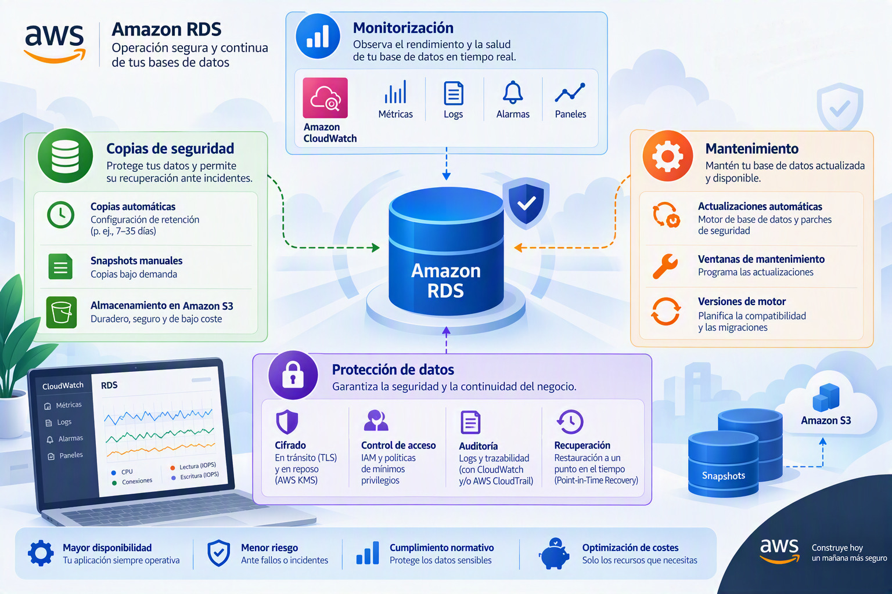

# Monitorización, copias de seguridad, mantenimiento y protección de los datos

La creación de una base de datos no finaliza cuando la instancia comienza a funcionar. De hecho, gran parte del trabajo de administración se desarrolla posteriormente, cuando es necesario supervisar el comportamiento del sistema, detectar problemas de rendimiento, aplicar actualizaciones, proteger la información y garantizar que los datos puedan recuperarse en caso de fallo.

En entornos profesionales, una base de datos no debe considerarse únicamente como un repositorio de información, sino como un servicio crítico cuyo funcionamiento debe supervisarse de forma continua. Por este motivo, Amazon RDS incorpora mecanismos de observabilidad, monitorización, auditoría, copia de seguridad y recuperación que permiten administrar el ciclo de vida completo de la plataforma. La monitorización activa, la configuración de mecanismos de recuperación y la protección de la información forman parte de las competencias asociadas a la administración profesional de bases de datos en la nube.

---

## Opciones de supervisión en el asistente de creación

Toda base de datos experimenta cambios continuos en su carga de trabajo: el número de usuarios conectados, el volumen de consultas, la utilización de memoria o la actividad del almacenamiento varían a lo largo del tiempo. Sin mecanismos de supervisión resulta imposible saber si el sistema funciona correctamente o por qué se degrada su rendimiento. La monitorización permite responder a preguntas como:

- ¿Está la CPU trabajando al límite de su capacidad?
- ¿Existe falta de memoria disponible?
- ¿Se están produciendo cuellos de botella en el almacenamiento?
- ¿Las consultas responden dentro de los tiempos esperados?
- ¿Existen tendencias de crecimiento que requieran ampliar recursos?

Al crear la instancia, el asistente solicita tres decisiones relacionadas con la supervisión. Su uso y su interpretación se desarrollan en el apartado [Monitorización del rendimiento y optimización](BD-Rendimiento.md), y las métricas de CloudWatch se describen una a una en la [Referencia de métricas de RDS](Supervision-RDS.md).

| Opción | Qué activa | Valor en la práctica evaluable |
| --- | --- | --- |
| **Database Insights** (modalidad estándar o avanzada) | Análisis de la carga de la base de datos: sesiones activas, eventos de espera y sentencias SQL que más recursos consumen. La modalidad estándar está incluida; la avanzada amplía la retención del historial y los análisis disponibles, con coste adicional | Estándar, con 7 días de retención |
| **Monitorización mejorada** | Métricas del sistema operativo de la instancia (CPU, memoria, procesos, E/S, red) con una granularidad de 1 a 60 segundos, publicadas en CloudWatch Logs | Deshabilitada (minimiza costes) |
| **Exportación de registros** a CloudWatch Logs | Envío de los registros del motor para su consulta centralizada | Opcional |

### Registros que pueden exportarse

| Registro | Contenido | Observaciones |
| --- | --- | --- |
| **De errores** | Problemas detectados por el motor: fallos de arranque, errores de configuración, incidencias internas | Primer punto de análisis ante una incidencia |
| **General** | Todas las sentencias y conexiones de los clientes | Genera mucho volumen; solo para diagnósticos puntuales |
| **De auditoría** | Quién realizó cada operación y cuándo | Necesario en organizaciones sujetas a requisitos normativos; en MariaDB y MySQL se habilita con el complemento de auditoría del grupo de opciones |
| **De consultas lentas** | Sentencias cuya ejecución supera un umbral de tiempo | Uno de los más valiosos para el rendimiento; su configuración y análisis se explican en el apartado de rendimiento |

---

## Copias de seguridad automáticas

La protección de la información es uno de los pilares fundamentales de cualquier sistema de bases de datos.

Amazon RDS incorpora mecanismos de copia de seguridad automática que permiten recuperar la información ante errores humanos, fallos de infraestructura o incidencias operativas.

Estas copias se **generan automáticamente** sin necesidad de intervención manual y constituyen la base de las estrategias de recuperación ante desastres.

La configuración de políticas de copia de seguridad y recuperación forma parte de las tareas esenciales asociadas a la administración de bases de datos en la nube. 

---

## Periodo de retención

Uno de los parámetros fundamentales de las copias de seguridad es el periodo de retención.

La retención determina **durante cuánto tiempo se conservarán** las copias generadas automáticamente antes de ser eliminadas.

Un periodo de retención amplio proporciona una mayor capacidad de recuperación frente a errores detectados tardíamente, aunque también incrementa el volumen de almacenamiento utilizado.

Por el contrario, una retención reducida minimiza costes, pero limita la capacidad de restaurar información histórica.

La elección adecuada dependerá de las políticas de recuperación y continuidad definidas por la organización.

---

## Ventana de copia de seguridad

Amazon RDS también permite definir la ventana temporal durante la cual se ejecutarán las copias automáticas.

La programación de estas operaciones suele realizarse durante periodos de baja actividad para minimizar cualquier posible impacto sobre las aplicaciones.

Cuando no se especifica una ventana concreta, AWS selecciona automáticamente el momento que considera más adecuado para ejecutar estas tareas.

---

## Replicación de copias entre regiones

Para escenarios donde la protección de la información resulta especialmente crítica, Amazon RDS permite replicar **copias de seguridad en regiones diferentes**.

Esta estrategia proporciona protección adicional frente a incidentes que puedan afectar a una región completa de AWS.

La replicación geográfica incrementa la resiliencia del sistema, aunque también añade costes adicionales asociados al almacenamiento y a la transferencia de datos.

Su utilización suele reservarse para sistemas que requieren elevados niveles de continuidad operativa y recuperación ante desastres.

---

## Actualizaciones y mantenimiento

Toda base de datos requiere tareas periódicas de mantenimiento destinadas a corregir errores, mejorar la estabilidad y solucionar vulnerabilidades de seguridad.

Amazon RDS automatiza gran parte de estas tareas, simplificando considerablemente la administración cotidiana del servicio.

---

### Actualizaciones automáticas de versiones secundarias

AWS permite habilitar la instalación automática de **actualizaciones menores del motor** MariaDB.

Estas actualizaciones suelen incorporar correcciones de errores, mejoras de estabilidad y parches de seguridad sin introducir cambios importantes en la funcionalidad de la plataforma.

Mantener activadas las actualizaciones automáticas reduce la exposición a vulnerabilidades conocidas y simplifica la gestión operacional.

No obstante, algunas organizaciones prefieren validar previamente los cambios en entornos de prueba antes de permitir su despliegue en sistemas de producción.

---

### Ventanas de mantenimiento

Las operaciones programadas de mantenimiento pueden realizarse dentro de franjas horarias definidas por el administrador.

La utilización de ventanas de mantenimiento permite planificar posibles intervenciones en horarios que minimicen el impacto sobre los usuarios.

Este enfoque resulta especialmente importante en sistemas utilizados de forma continua o con elevados requisitos de disponibilidad.

---

## Protección contra eliminación accidental

Una de las características más sencillas y, al mismo tiempo, más valiosas de Amazon RDS es la protección contra eliminación.

Cuando esta función se encuentra habilitada, **la instancia no puede ser eliminada accidentalmente** desde la consola de administración.

Antes de proceder a su eliminación, el administrador deberá desactivar explícitamente esta protección.

Aunque se trata de una medida aparentemente simple, evita numerosos errores operativos y proporciona una capa adicional de seguridad administrativa.

---

## Configuración inicial de la base de datos

Amazon RDS permite crear una base de datos inicial durante el despliegue de la instancia.

Esta funcionalidad facilita la automatización de entornos y simplifica la puesta en marcha de aplicaciones que requieren una estructura básica preparada desde el principio.

No obstante, también es posible crear únicamente la instancia y generar posteriormente las distintas bases de datos según las necesidades del proyecto.

---

## Grupos de parámetros

Los grupos de parámetros constituyen uno de los mecanismos más importantes de personalización de una instancia RDS.

Un grupo de parámetros contiene la **configuración interna utilizada por MariaDB** para controlar aspectos relacionados con memoria, cachés, conexiones, tiempos de espera y numerosos elementos del comportamiento del motor.

AWS proporciona configuraciones predeterminadas adecuadas para la mayoría de escenarios, aunque las organizaciones con necesidades específicas pueden crear grupos personalizados adaptados a sus cargas de trabajo.

La modificación de estos parámetros permite realizar optimizaciones orientadas tanto al rendimiento como al consumo de recursos, una capacidad contemplada dentro de las tareas de administración y optimización de bases de datos.

---

## Grupos de opciones

Además de los parámetros generales del motor, Amazon RDS incorpora grupos de opciones destinados a habilitar funcionalidades adicionales.

Estas opciones permiten extender determinadas capacidades del sistema sin necesidad de modificar manualmente la instalación de MariaDB.

Su disponibilidad depende del motor y de la versión utilizada, así como de las características soportadas por AWS en cada momento.

---

## Cifrado de la base de datos

La protección de la información almacenada constituye otro aspecto fundamental de cualquier despliegue profesional.

Amazon RDS permite **cifrar los datos almacenados** mediante claves gestionadas a través de AWS Key Management Service (KMS).

El cifrado protege la información almacenada frente a accesos no autorizados y contribuye al cumplimiento de requisitos normativos relacionados con la protección de datos.

La configuración de mecanismos de cifrado constituye una de las actividades fundamentales contempladas dentro de la administración segura de bases de datos en la nube.

---

## Conclusiones

La fase de monitorización, protección y mantenimiento representa la última etapa del despliegue inicial de una instancia MariaDB en Amazon RDS, pero marca el comienzo de su ciclo de vida operativo.

Las decisiones relacionadas con observabilidad, copias de seguridad, actualización de software, retención de información, recuperación ante desastres y cifrado tienen una influencia directa sobre la disponibilidad, la seguridad y la capacidad de gestión del sistema. Una infraestructura correctamente diseñada no es únicamente aquella que funciona hoy, sino aquella que puede supervisarse, mantenerse y recuperarse eficazmente cuando se produzca una incidencia. 
