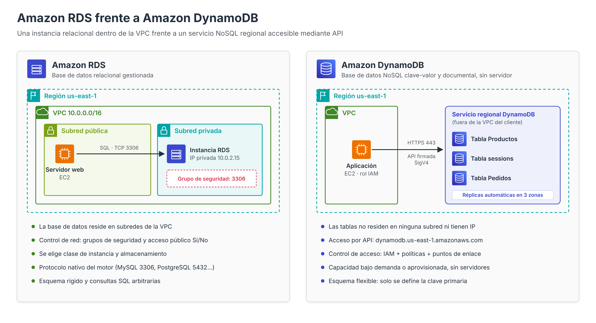
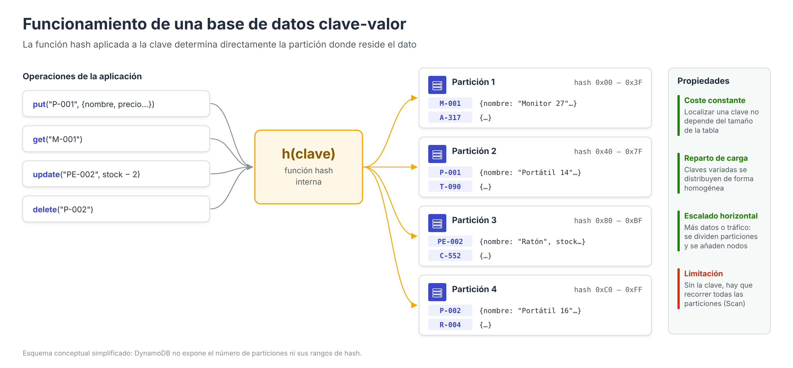
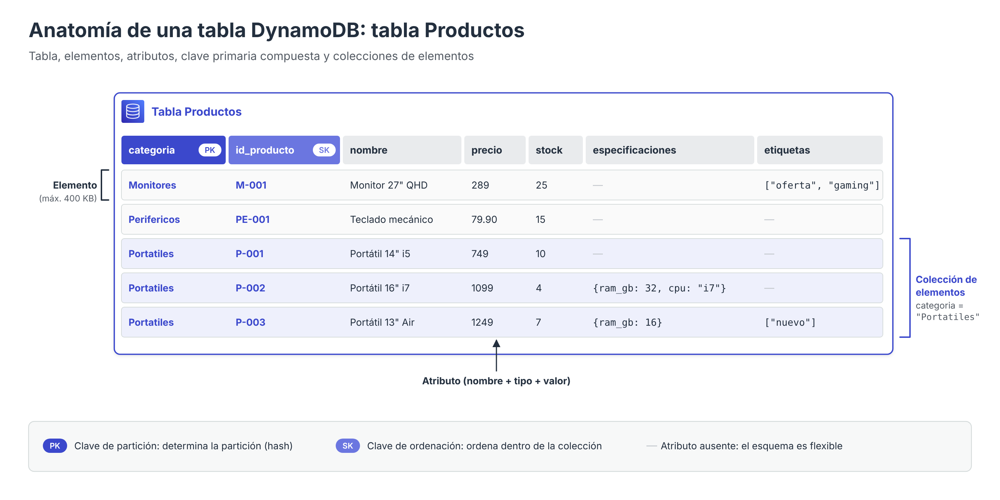

# Amazon DynamoDB: introducción y modelo clave-valor



En los apartados anteriores se ha estudiado Amazon RDS, un servicio que gestiona motores de bases de datos **relacionales** (MariaDB, MySQL, PostgreSQL, etc.) desplegados sobre instancias dentro de una VPC. Amazon DynamoDB responde a un planteamiento radicalmente distinto: es una base de datos **NoSQL**, **sin servidor** (*serverless*) y **totalmente gestionada**, que admite los modelos de datos **clave-valor** y **documento**, y que está diseñada para ofrecer una latencia de un solo dígito de milisegundos con independencia del volumen de datos almacenado o del número de peticiones recibidas.

En DynamoDB no existe una instancia que dimensionar, ni un motor que actualizar, ni un sistema operativo que parchear. El administrador crea **tablas** y AWS se encarga de distribuir los datos, replicarlos, escalar la capacidad y mantener la infraestructura subyacente. Esta abstracción tiene consecuencias importantes sobre la forma de modelar los datos, de consultarlos y, como se verá en el último apartado, de protegerlos.

---

## Las bases de datos NoSQL

El término **NoSQL** (*Not only SQL*) agrupa a un conjunto heterogéneo de sistemas de almacenamiento que renuncian a algunas de las características del modelo relacional (esquema rígido, normalización, consultas declarativas arbitrarias, operaciones *JOIN*) para obtener a cambio **escalabilidad horizontal**, **flexibilidad de esquema** y **rendimiento predecible** con grandes volúmenes de datos.

Habitualmente se distinguen cuatro grandes familias:

| Familia | Unidad de almacenamiento | Ejemplos | Servicio AWS |
| --- | --- | --- | --- |
| **Clave-valor** | Par (clave, valor) | Redis, Riak, DynamoDB | Amazon DynamoDB, Amazon ElastiCache |
| **Documental** | Documento JSON/BSON | MongoDB, Couchbase | Amazon DocumentDB, Amazon DynamoDB |
| **Columnar (wide-column)** | Filas con familias de columnas | Apache Cassandra, HBase | Amazon Keyspaces |
| **Grafos** | Nodos y aristas | Neo4j, JanusGraph | Amazon Neptune |

DynamoDB se sitúa en la intersección de las dos primeras familias: el acceso se realiza siempre a través de una **clave**, pero el **valor** asociado no es un bloque opaco, sino un conjunto de atributos tipados que pueden contener estructuras anidadas, como en una base de datos documental.

---

## Funcionamiento de una base de datos clave-valor

Una base de datos clave-valor puede entenderse como un **diccionario** (o tabla *hash*) de gran tamaño, persistente y distribuido entre muchos servidores. Cada dato almacenado se compone de dos partes:

- **Clave**: identificador único del dato. Es el único elemento por el que el sistema sabe localizar la información.
- **Valor**: el contenido asociado a la clave. En los almacenes clave-valor puros el valor es opaco (el sistema no conoce su estructura); en DynamoDB, en cambio, el valor es un conjunto de atributos con nombre y tipo.



### Operaciones fundamentales

El modelo clave-valor se apoya en un conjunto muy reducido de operaciones primitivas:

| Operación | Semántica | Equivalente en DynamoDB |
| --- | --- | --- |
| `put(clave, valor)` | Almacena (o sustituye) el valor asociado a una clave | `PutItem` |
| `get(clave)` | Recupera el valor asociado a una clave | `GetItem` |
| `update(clave, cambios)` | Modifica parte del valor | `UpdateItem` |
| `delete(clave)` | Elimina el par clave-valor | `DeleteItem` |

### Por qué este modelo escala horizontalmente

La característica esencial de un almacén clave-valor es que **toda operación conoce de antemano la clave del dato**. Esto permite aplicar sobre la clave una **función hash** que determina de forma inmediata en qué servidor (o *partición*) reside la información, sin necesidad de consultar índices globales ni de recorrer tablas completas.

De este principio se derivan tres propiedades fundamentales:

1. **Coste constante de acceso.** Localizar un elemento cuesta lo mismo con mil registros que con mil millones, porque el cálculo del *hash* no depende del tamaño de la tabla.
2. **Reparto natural de la carga.** Si las claves son variadas, la función hash distribuye los datos y las peticiones de forma homogénea entre todas las particiones.
3. **Crecimiento por adición de nodos.** Para aumentar la capacidad basta con dividir particiones y repartirlas entre más servidores (*escalado horizontal*), a diferencia del modelo relacional tradicional, que tiende a escalar aumentando el tamaño de una única máquina (*escalado vertical*), como se ha visto al elegir la clase de instancia en RDS.

La contrapartida es evidente: **el sistema solo es eficiente cuando se accede por clave**. Una consulta del tipo «todos los productos cuyo precio sea superior a 300 €» no puede resolverse calculando un *hash*, por lo que obliga a recorrer la tabla completa o a crear estructuras adicionales (índices secundarios). Este hecho condiciona todo el diseño de las tablas en DynamoDB.

---

## Modelo relacional frente a modelo clave-valor

La siguiente tabla resume las diferencias conceptuales más relevantes entre una base de datos relacional gestionada (Amazon RDS) y DynamoDB:

| Aspecto | Modelo relacional (RDS) | Modelo clave-valor / documento (DynamoDB) |
| --- | --- | --- |
| Esquema | Rígido: columnas y tipos definidos para todas las filas | Flexible: solo se define la clave primaria; cada elemento puede tener atributos distintos |
| Diseño | Se parte de las entidades y se normalizan los datos | Se parte de los **patrones de acceso** y se desnormalizan los datos |
| Consultas | SQL declarativo, consultas *ad hoc* arbitrarias | Acceso por clave (`GetItem`, `Query`) o recorrido completo (`Scan`) |
| Relaciones | Claves foráneas y `JOIN` | No existen `JOIN`; las relaciones se modelan agrupando datos bajo una misma clave de partición |
| Escalado | Principalmente vertical (clase de instancia) y réplicas de lectura | Horizontal y automático (particiones) |
| Capacidad | Se aprovisiona una instancia y almacenamiento | Bajo demanda o aprovisionada en unidades de lectura/escritura |
| Transacciones | ACID completas | ACID limitadas (hasta 100 elementos por transacción) |
| Ubicación de red | Instancia dentro de subredes de una VPC | Servicio regional accesible mediante un *endpoint* de API |
| Lenguaje | SQL | API propia y, opcionalmente, PartiQL (subconjunto compatible con SQL) |

!!! note "Idea clave"
    En una base de datos relacional se diseña primero el modelo de datos y después se escriben las consultas que se necesiten. En DynamoDB el proceso es el inverso: **primero se identifican las consultas que la aplicación va a realizar** (patrones de acceso) y, a partir de ellas, se diseñan las claves de las tablas.

---

## Componentes del modelo de datos de DynamoDB

DynamoDB organiza la información en tres niveles:

- **Tabla**: colección de elementos. Es el recurso que se crea, se configura (capacidad, cifrado, copias de seguridad…) y sobre el que se aplican las políticas de acceso. Su nombre es único dentro de una cuenta y una región.
- **Elemento** (*item*): equivalente aproximado a una fila. Cada elemento se identifica de forma unívoca por su **clave primaria** y puede ocupar como máximo **400 KB**, incluyendo los nombres y los valores de todos sus atributos.
- **Atributo** (*attribute*): par nombre-valor tipado, equivalente aproximado a una columna. Salvo los atributos que forman la clave primaria, **no es necesario declarar los atributos de antemano**.



### Flexibilidad de esquema

Tomando como referencia la tabla `Productos` de la práctica, los siguientes tres elementos pueden convivir en la misma tabla aunque su estructura sea diferente:

```json
{ "categoria": "Portatiles", "id_producto": "P-001", "nombre": "Portátil 14\" i5", "precio": 749, "stock": 10 }

{ "categoria": "Portatiles", "id_producto": "P-002", "nombre": "Portátil 16\" i7", "precio": 1099, "stock": 4,
  "especificaciones": { "ram_gb": 32, "cpu": "i7", "puertos": ["USB-C", "HDMI"] } }

{ "categoria": "Monitores", "id_producto": "M-001", "nombre": "Monitor 27\" QHD", "precio": 289,
  "etiquetas": ["oferta", "gaming"] }
```

Los únicos atributos obligatorios son `categoria` y `id_producto`, que forman la clave primaria. El segundo elemento contiene un **mapa** anidado (`especificaciones`) y el tercero una **lista** (`etiquetas`); esta capacidad para almacenar estructuras jerárquicas es la que confiere a DynamoDB su carácter documental.

### Colección de elementos

Cuando una tabla tiene clave compuesta (partición + ordenación), el conjunto de elementos que comparten el mismo valor de clave de partición se denomina **colección de elementos** (*item collection*). En la tabla `Productos`, todos los elementos con `categoria = "Portatiles"` forman una colección; DynamoDB los almacena juntos y **ordenados por la clave de ordenación**, lo que permite recuperarlos de forma eficiente con una única operación `Query`. Este concepto se desarrolla en el apartado dedicado a las claves.

---

## Cómo se accede a los datos

DynamoDB no expone un lenguaje de consulta general, sino una **API** con operaciones bien delimitadas. Conocer su coste relativo es imprescindible para diseñar correctamente las tablas:

| Operación | Qué hace | Requisito | Coste relativo |
| --- | --- | --- | --- |
| `GetItem` | Lee un único elemento | Clave primaria completa | Mínimo |
| `BatchGetItem` | Lee hasta 100 elementos (16 MB) de una o varias tablas | Claves primarias completas | Suma de lecturas individuales |
| `PutItem` | Crea o sustituye un elemento completo | Clave primaria completa | Una escritura |
| `UpdateItem` | Modifica atributos de un elemento (o lo crea si no existe) | Clave primaria completa | Una escritura |
| `DeleteItem` | Elimina un elemento | Clave primaria completa | Una escritura |
| `BatchWriteItem` | Hasta 25 operaciones `Put`/`Delete` (16 MB) | Claves primarias completas | Suma de escrituras |
| `Query` | Lee los elementos de **una** colección, opcionalmente filtrando por la clave de ordenación | Valor de la clave de partición | Proporcional a los elementos leídos de esa colección |
| `Scan` | Recorre **toda** la tabla o índice | Ninguno | Proporcional al tamaño total de la tabla |
| `TransactWriteItems` / `TransactGetItems` | Operaciones ACID sobre hasta 100 elementos | Claves completas | El doble que la operación normal |
| `ExecuteStatement` (PartiQL) | Sentencias con sintaxis tipo SQL | Se traduce internamente a las operaciones anteriores | Según la operación resultante |

Las operaciones `Query` y `Scan` devuelven como máximo **1 MB** de datos por llamada; si hay más resultados, la respuesta incluye `LastEvaluatedKey` para solicitar la página siguiente.

!!! warning "Query frente a Scan"
    Una expresión de filtro (`FilterExpression`) **no reduce el coste** de una operación: DynamoDB lee primero los elementos y descarta después los que no cumplen el filtro. Así se observó en la práctica, donde el `Scan` de productos con precio superior a 300 € devolvía `Count = 2` pero `ScannedCount = 5`. Si un patrón de acceso es frecuente, debe resolverse mediante una `Query` sobre la tabla o sobre un índice secundario, nunca mediante un `Scan` filtrado.

---

## Diseño orientado a patrones de acceso

El proceso de diseño de una tabla DynamoDB suele seguir estos pasos:

1. **Enumerar los patrones de acceso** de la aplicación: qué datos se leen, con qué criterio y con qué frecuencia.
2. **Elegir la clave de partición** para que las consultas más frecuentes se resuelvan con `GetItem` o `Query` y para que la carga se distribuya uniformemente.
3. **Elegir la clave de ordenación** (si procede) para agrupar y ordenar los elementos relacionados.
4. **Añadir índices secundarios** únicamente para los patrones que no puedan resolverse con la clave primaria.
5. **Desnormalizar**: duplicar información cuando evite lecturas adicionales, puesto que no existen *JOIN*.

Aplicado a la tabla `Productos` de la práctica:

| Patrón de acceso | Operación | Solución |
| --- | --- | --- |
| Obtener un producto concreto | `GetItem` | Clave completa (`categoria`, `id_producto`) |
| Listar los productos de una categoría | `Query` | Clave de partición `categoria` |
| Listar los periféricos cuyo código empieza por `PE-` | `Query` | `categoria = :c AND begins_with(id_producto, :p)` |
| Productos con precio superior a 300 € | `Scan` (ineficiente) | Requeriría un índice secundario global sobre `precio` |

### Casos de uso adecuados

DynamoDB resulta especialmente apropiado cuando:

- Los patrones de acceso son **conocidos y estables** y se resuelven por clave.
- Se requiere **latencia baja y constante** con volúmenes muy elevados de peticiones: carritos de la compra, perfiles de usuario, catálogos, marcadores de videojuegos, Internet de las cosas.
- Se necesita almacenar **estado efímero compartido**, como las **sesiones de usuario** de la práctica evaluable, donde cada sesión se recupera exclusivamente por su identificador.
- La carga es **muy variable o impredecible**, y conviene pagar solo por las peticiones realizadas.

Por el contrario, no es la opción más adecuada cuando la aplicación necesita **consultas analíticas o ad hoc**, agregaciones complejas, numerosas relaciones entre entidades o transacciones que afecten a grandes conjuntos de registros. En esos escenarios, un motor relacional como los ofrecidos por Amazon RDS o Amazon Aurora suele ser preferible.

---

## Referencias

- AWS. *What is Amazon DynamoDB?* — [Guía para desarrolladores](https://docs.aws.amazon.com/amazondynamodb/latest/developerguide/Introduction.html)
- AWS. *Core components of Amazon DynamoDB* — [Componentes principales](https://docs.aws.amazon.com/amazondynamodb/latest/developerguide/HowItWorks.CoreComponents.html)
- AWS. *From SQL to NoSQL* — [De SQL a NoSQL](https://docs.aws.amazon.com/amazondynamodb/latest/developerguide/SQLtoNoSQL.html)
- AWS. *Querying tables in DynamoDB* — [Operación Query](https://docs.aws.amazon.com/amazondynamodb/latest/developerguide/Query.html)
- AWS. *Scanning tables in DynamoDB* — [Operación Scan](https://docs.aws.amazon.com/amazondynamodb/latest/developerguide/Scan.html)
- AWS. *Best practices for designing and architecting with DynamoDB* — [Buenas prácticas de diseño](https://docs.aws.amazon.com/amazondynamodb/latest/developerguide/best-practices.html)
- AWS. *PartiQL – a SQL-compatible query language for Amazon DynamoDB* — [PartiQL](https://docs.aws.amazon.com/amazondynamodb/latest/developerguide/ql-reference.html)
- AWS. *What is NoSQL?* — [Bases de datos NoSQL](https://aws.amazon.com/nosql/)
