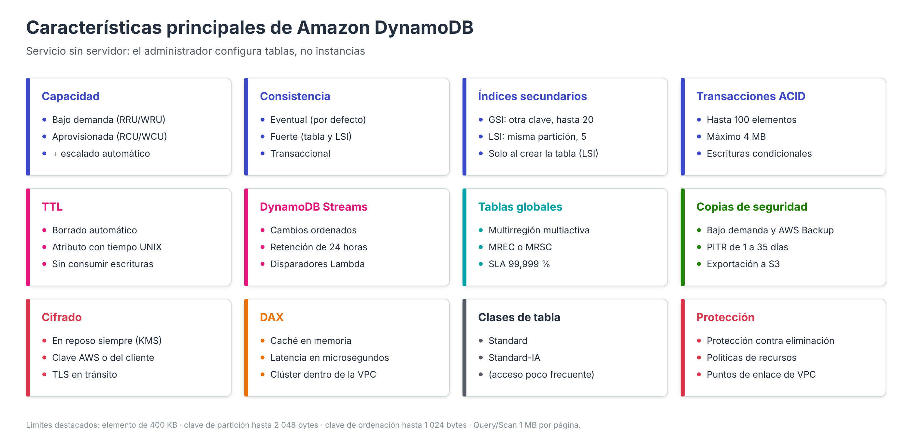

# Características de Amazon DynamoDB

Una vez comprendido el modelo de datos, conviene analizar en detalle las características que AWS ofrece sobre él. Muchas de ellas tienen un equivalente conceptual en Amazon RDS (copias de seguridad, cifrado, alta disponibilidad, réplicas), pero su implementación y su configuración son distintas porque **DynamoDB no se administra como una instancia, sino como un conjunto de tablas**.

---

## Servicio sin servidor y totalmente gestionado

DynamoDB es un servicio *serverless*: no existen servidores, clases de instancia ni volúmenes de almacenamiento que dimensionar. Las tareas que en RDS correspondían al administrador o se configuraban explícitamente quedan aquí absorbidas por el servicio:

| Tarea | Amazon RDS | Amazon DynamoDB |
| --- | --- | --- |
| Elegir hardware | Clase de instancia (vCPU, RAM) | No aplica |
| Almacenamiento | Tipo y tamaño de volumen, IOPS, autoescalado de almacenamiento | Ilimitado y automático; se factura por GB almacenado |
| Parches y versiones del motor | Ventana de mantenimiento | Transparente, sin ventanas de mantenimiento |
| Alta disponibilidad | Opción Multi-AZ | Siempre activa: réplicas en varias zonas de disponibilidad |
| Escalado | Cambio de clase, réplicas de lectura | Automático por particiones |

El resultado es un servicio con **rendimiento de latencia de un solo dígito de milisegundos** para operaciones por clave, que se mantiene estable aunque la tabla crezca hasta contener terabytes de información.

---

## Modos de capacidad

La capacidad de lectura y escritura es el principal factor de coste y de rendimiento de DynamoDB. Cada tabla funciona en uno de dos modos, que pueden cambiarse posteriormente: de aprovisionado a bajo demanda hasta **cuatro veces en un periodo de 24 horas**, y de bajo demanda a aprovisionado en cualquier momento.

### Modo bajo demanda (*on-demand*)

Es el **modo predeterminado y recomendado** por AWS. No se planifica capacidad: se paga por cada petición realizada, medida en:

- **Unidad de solicitud de lectura (RRU)**: una lectura fuertemente consistente por segundo, o dos lecturas eventualmente consistentes, de un elemento de hasta **4 KB**.
- **Unidad de solicitud de escritura (WRU)**: una escritura por segundo de un elemento de hasta **1 KB**.

Su comportamiento de escalado presenta algunos matices que conviene conocer:

- Una tabla nueva puede atender inicialmente hasta **4 000 escrituras** y **12 000 lecturas por segundo**.
- La tabla absorbe de forma instantánea hasta **el doble del pico de tráfico anterior**. Si el tráfico supera ese doble en menos de 30 minutos, pueden producirse limitaciones (*throttling*).
- Puede configurarse opcionalmente un **rendimiento máximo** de lectura y escritura por tabla o índice, que actúa como límite de coste frente a picos inesperados.
- Si la tabla no recibe tráfico, no se factura capacidad (sí el almacenamiento).

Es el modo utilizado en la práctica y el adecuado para cargas desconocidas, irregulares o con periodos de inactividad.

### Modo aprovisionado (*provisioned*)

El administrador declara cuántas **unidades de capacidad de lectura (RCU)** y **de escritura (WCU)** por segundo necesita la tabla y paga por ellas tanto si las utiliza como si no. Se complementa habitualmente con:

- **Escalado automático** (*Application Auto Scaling*), que ajusta las RCU/WCU entre un mínimo y un máximo en función de un porcentaje objetivo de utilización.
- **Capacidad reservada**, que permite comprometer un consumo durante uno o tres años a cambio de un descuento.

Es adecuado para cargas **predecibles y sostenidas**, en las que resulta más económico que el modo bajo demanda.

### Cálculo de unidades de capacidad

Las unidades se calculan **redondeando hacia arriba** el tamaño del elemento al múltiplo de 4 KB (lecturas) o de 1 KB (escrituras):

| Operación | Elemento de 6 KB | Elemento de 2,5 KB |
| --- | --- | --- |
| Lectura eventualmente consistente | ⌈6/4⌉ = 2 → **1 RCU** (la mitad) | ⌈2,5/4⌉ = 1 → **0,5 RCU** |
| Lectura fuertemente consistente | **2 RCU** | **1 RCU** |
| Lectura transaccional | **4 RCU** (el doble) | **2 RCU** |
| Escritura estándar | ⌈6/1⌉ = **6 WCU** | ⌈2,5/1⌉ = **3 WCU** |
| Escritura transaccional | **12 WCU** (el doble) | **6 WCU** |

En una `Query` o un `Scan`, el consumo se calcula sobre el **tamaño total de los datos leídos**, no sobre el número de elementos devueltos tras aplicar el filtro.

### Rendimiento en caliente (*warm throughput*)

DynamoDB informa del **rendimiento en caliente** de cada tabla e índice, es decir, el número de lecturas y escrituras por segundo que puede atender de forma inmediata. Este valor puede **preaumentarse** (*pre-warming*) antes de eventos con picos previsibles, como una campaña de ventas, para evitar limitaciones durante los primeros minutos.

---

## Modelos de consistencia de lectura

DynamoDB replica cada dato en varias zonas de disponibilidad, lo que obliga a elegir qué garantías de actualización ofrece cada lectura:

| Tipo de lectura | Garantía | Coste | Disponibilidad |
| --- | --- | --- | --- |
| **Eventualmente consistente** (predeterminada) | Puede no reflejar una escritura muy reciente; normalmente converge en menos de un segundo | 0,5 RCU por 4 KB | Tabla, LSI y GSI |
| **Fuertemente consistente** | Devuelve siempre el último valor confirmado | 1 RCU por 4 KB | Tabla y LSI (**no** en GSI ni en Streams) |
| **Transaccional** | Aislamiento serializable dentro de una transacción | 2 RCU por 4 KB | Tabla |

En la práctica se utilizó el parámetro `--consistent-read` de `get-item` para solicitar una lectura fuertemente consistente.

---

## Índices secundarios

Un índice secundario es una estructura de datos que contiene un subconjunto de los atributos de la tabla, **organizado con una clave alternativa**, y que permite ejecutar `Query` con criterios distintos de la clave primaria.

| Característica | Índice secundario global (GSI) | Índice secundario local (LSI) |
| --- | --- | --- |
| Clave de partición | **Distinta** de la de la tabla | **La misma** que la de la tabla |
| Clave de ordenación | Cualquier atributo (opcional) | Distinta de la de la tabla (obligatoria) |
| Momento de creación | En cualquier momento | **Solo al crear la tabla** |
| Consistencia de lectura | Solo eventual | Eventual o fuerte |
| Capacidad | Propia, independiente de la tabla | Compartida con la tabla |
| Límite de tamaño | Ninguno | 10 GB por colección de elementos |
| Número máximo por tabla | 20 (ampliable) | 5 |

Algunos aspectos adicionales:

- **Proyección**: al crear el índice se decide qué atributos se copian en él: solo las claves (`KEYS_ONLY`), determinados atributos (`INCLUDE`) o todos (`ALL`). Cuantos más atributos se proyectan, mayor es el coste de almacenamiento y de escritura.
- **Índices dispersos** (*sparse indexes*): un elemento solo aparece en un GSI si contiene los atributos de la clave del índice. Esta propiedad se aprovecha para indexar únicamente un subconjunto de elementos (por ejemplo, solo los pedidos pendientes).
- **Claves multiatributo en GSI**: desde noviembre de 2025, la clave de partición y la de ordenación de un GSI pueden componerse de **hasta cuatro atributos cada una**, lo que evita tener que concatenar valores artificialmente en un único atributo.

Siguiendo el ejemplo de la práctica, un GSI con clave de partición `categoria` y clave de ordenación `precio` permitiría resolver con una `Query` la consulta «portátiles de más de 300 €», evitando el `Scan`.

---

## Escrituras condicionales y transacciones

### Escrituras condicionales

Las operaciones `PutItem`, `UpdateItem` y `DeleteItem` admiten una **expresión de condición** (`ConditionExpression`) que se evalúa de forma atómica antes de aplicar el cambio. Si la condición no se cumple, la operación falla con `ConditionalCheckFailedException` y el elemento no se modifica. Esto permite:

- Evitar sobrescrituras accidentales (`attribute_not_exists(clave)`), como en la inserción de periféricos de la práctica.
- Implementar **control de concurrencia optimista** mediante un atributo de versión.
- Validar reglas de negocio, como impedir que el stock sea negativo (`stock >= :n`).

### Transacciones ACID

Las operaciones `TransactWriteItems` y `TransactGetItems` agrupan acciones sobre varios elementos, incluso de distintas tablas, que se ejecutan con **todo o nada**. Sus restricciones son:

- Hasta **100 elementos** distintos y **4 MB** de datos por transacción.
- Todas las tablas deben pertenecer a la misma cuenta y región.
- Dos acciones de la misma transacción no pueden afectar al mismo elemento.
- Consumen el **doble de capacidad** que las operaciones equivalentes no transaccionales.
- Admiten un **token de idempotencia** (`ClientRequestToken`) para que un reintento no aplique dos veces la misma transacción.

---

## Tiempo de vida (TTL)

El **TTL** (*Time to Live*) permite indicar un atributo que contiene la fecha de caducidad del elemento en formato **tiempo UNIX en segundos** (de tipo Number). Una vez superada esa fecha, DynamoDB elimina el elemento de forma automática, normalmente en un plazo de pocos días y **sin consumir capacidad de escritura**.

Mientras no se eliminan físicamente, los elementos caducados siguen apareciendo en las lecturas, por lo que la aplicación debe filtrarlos si necesita precisión. En la práctica evaluable se activa el TTL sobre el atributo `expires` de la tabla de sesiones para que las sesiones caducadas desaparezcan sin procesos de limpieza en la aplicación.

---

## DynamoDB Streams

**DynamoDB Streams** captura en orden cronológico cada modificación realizada sobre los elementos de una tabla y la conserva durante **24 horas**. Para cada cambio puede registrarse:

| Tipo de vista | Información registrada |
| --- | --- |
| `KEYS_ONLY` | Solo los atributos clave del elemento modificado |
| `NEW_IMAGE` | El elemento tal como queda tras el cambio |
| `OLD_IMAGE` | El elemento tal como era antes del cambio |
| `NEW_AND_OLD_IMAGES` | Ambas versiones |

Los registros aparecen exactamente una vez y en el mismo orden en que se produjeron las modificaciones de cada elemento. El uso más habitual es activar funciones **AWS Lambda** que reaccionan a los cambios (auditoría, notificaciones, sincronización con otros sistemas). Como alternativa, una tabla puede enviar sus cambios a **Amazon Kinesis Data Streams**, que ofrece mayor retención y más consumidores.

---

## Tablas globales

Las **tablas globales** replican automáticamente una tabla en varias regiones de AWS, de modo que la aplicación puede leer y escribir en cualquiera de ellas (replicación **multiactiva**). Existen dos modos de consistencia:

- **Consistencia eventual multirregión (MREC)**: modo tradicional. Las escrituras se propagan de forma asíncrona, normalmente en menos de un segundo; los conflictos se resuelven con la regla *la última escritura prevalece*.
- **Consistencia fuerte multirregión (MRSC)**: disponible de forma general desde junio de 2025. Una escritura se confirma solo cuando se ha replicado en al menos otra región, lo que permite lecturas fuertemente consistentes en cualquier réplica y un **objetivo de punto de recuperación (RPO) igual a cero**.

Las tablas globales elevan el compromiso de disponibilidad del servicio (SLA) del **99,99 %** de una tabla regional al **99,999 %**.

---

## Copias de seguridad y recuperación

| Mecanismo | Funcionamiento | Retención |
| --- | --- | --- |
| **Copias bajo demanda** | Copia completa de la tabla sin impacto en el rendimiento; puede gestionarse también con **AWS Backup** | Hasta que se eliminen |
| **Recuperación a un momento dado (PITR)** | Copia continua que permite restaurar la tabla a cualquier segundo del periodo de recuperación | Configurable entre **1 y 35 días** (desde enero de 2025) |
| **Exportación a Amazon S3** | Vuelca la tabla (completa o incremental) a S3 en formato DynamoDB JSON o Amazon Ion para análisis | Según la política del bucket |
| **Importación desde Amazon S3** | Crea una tabla nueva a partir de ficheros CSV, DynamoDB JSON o Ion | — |

Las restauraciones generan siempre una **tabla nueva**; no sobrescriben la existente. Este comportamiento es análogo al de las restauraciones de RDS estudiadas en el apartado de copias de seguridad.

---

## Cifrado

- **Cifrado en reposo**: siempre activo y no puede deshabilitarse. Se puede elegir la clave de AWS KMS utilizada:
    - **Clave propiedad de AWS** (predeterminada, sin coste adicional).
    - **Clave administrada por AWS** (`aws/dynamodb`), visible en la cuenta.
    - **Clave administrada por el cliente**, que ofrece control total sobre la política de la clave, su rotación y su revocación.
- **Cifrado en tránsito**: las peticiones a la API se realizan mediante HTTPS (TLS). Los SDK y la AWS CLI utilizan HTTPS de forma predeterminada; en el apartado de seguridad se explica cómo exigirlo mediante políticas.

---

## Otras características relevantes

- **Clases de tabla**: *DynamoDB Standard* (predeterminada) y *DynamoDB Standard-Infrequent Access* (Standard-IA), que reduce el coste de almacenamiento a cambio de un mayor coste por petición. Esta última es adecuada para tablas con muchos datos y poco acceso, como históricos o registros.
- **Protección contra eliminación** (*deletion protection*): impide que la tabla se borre hasta que se desactive explícitamente esta opción, de forma similar a la protección contra eliminación de RDS.
- **DynamoDB Accelerator (DAX)**: caché en memoria totalmente compatible con la API de DynamoDB que reduce la latencia de lectura a **microsegundos**. A diferencia de la tabla, un clúster DAX **sí se despliega en subredes de una VPC**.
- **PartiQL**: permite ejecutar sentencias `SELECT`, `INSERT`, `UPDATE` y `DELETE` con sintaxis similar a SQL, que el servicio traduce a las operaciones nativas. Un `SELECT` sin condición sobre la clave de partición se ejecuta como un `Scan`.
- **Integraciones**: AWS Lambda, Amazon Kinesis, integraciones *zero-ETL* con Amazon Redshift y Amazon OpenSearch Service, Amazon CloudWatch (métricas y alarmas) y AWS CloudTrail (auditoría).
- **Etiquetado y ABAC**: las tablas admiten etiquetas que pueden usarse tanto para la asignación de costes como para el control de acceso basado en atributos (véase el apartado de seguridad).

---

## Límites relevantes

| Elemento | Límite |
| --- | --- |
| Tamaño máximo de un elemento | 400 KB |
| Longitud de la clave de partición | 1 – 2 048 bytes |
| Longitud de la clave de ordenación | 1 – 1 024 bytes |
| Profundidad de anidamiento de atributos | 32 niveles |
| Precisión de los números | 38 dígitos |
| Datos devueltos por `Query` / `Scan` | 1 MB por llamada (paginación) |
| `BatchGetItem` | 100 elementos / 16 MB |
| `BatchWriteItem` | 25 operaciones / 16 MB |
| Transacciones | 100 elementos / 4 MB |
| GSI por tabla | 20 (ampliable) |
| LSI por tabla | 5 |
| Tamaño de una política basada en recursos | 20 KB |
| Rendimiento máximo por partición | 3 000 unidades de lectura y 1 000 de escritura por segundo |
| Retención de DynamoDB Streams | 24 horas |

---

## Referencias

- AWS. *DynamoDB throughput capacity* — [Modos de capacidad](https://docs.aws.amazon.com/amazondynamodb/latest/developerguide/capacity-mode.html)
- AWS. *DynamoDB on-demand capacity mode* — [Modo bajo demanda](https://docs.aws.amazon.com/amazondynamodb/latest/developerguide/on-demand-capacity-mode.html)
- AWS. *DynamoDB maximum throughput for on-demand tables* — [Rendimiento máximo](https://docs.aws.amazon.com/amazondynamodb/latest/developerguide/on-demand-capacity-mode-max-throughput.html)
- AWS. *Understanding DynamoDB warm throughput* — [Rendimiento en caliente](https://docs.aws.amazon.com/amazondynamodb/latest/developerguide/warm-throughput.html)
- AWS. *DynamoDB read consistency* — [Consistencia de lectura](https://docs.aws.amazon.com/amazondynamodb/latest/developerguide/HowItWorks.ReadConsistency.html)
- AWS. *Improving data access with secondary indexes* — [Índices secundarios](https://docs.aws.amazon.com/amazondynamodb/latest/developerguide/SecondaryIndexes.html)
- AWS. *Amazon DynamoDB now supports multi-attribute composite keys in global secondary indexes* (19/11/2025) — [Anuncio](https://aws.amazon.com/about-aws/whats-new/2025/11/amazon-dynamodb-multi-attribute-composite-keys-global-secondary-indexes)
- AWS. *Managing complex workflows with DynamoDB transactions* — [Transacciones](https://docs.aws.amazon.com/amazondynamodb/latest/developerguide/transactions.html)
- AWS. *Using time to live (TTL) in DynamoDB* — [TTL](https://docs.aws.amazon.com/amazondynamodb/latest/developerguide/TTL.html)
- AWS. *Change data capture for DynamoDB Streams* — [DynamoDB Streams](https://docs.aws.amazon.com/amazondynamodb/latest/developerguide/Streams.html)
- AWS. *Global tables – multi-active, multi-Region replication* — [Tablas globales](https://docs.aws.amazon.com/amazondynamodb/latest/developerguide/GlobalTables.html)
- AWS. *Amazon DynamoDB global tables with multi-Region strong consistency is now generally available* (06/2025) — [Anuncio MRSC](https://aws.amazon.com/about-aws/whats-new/2025/06/amazon-dynamo-db-global-tables-multi-region-strong-consistency-generally-available)
- AWS. *Backup and restore for DynamoDB* — [Copias de seguridad](https://docs.aws.amazon.com/amazondynamodb/latest/developerguide/Backup-and-Restore.html)
- AWS. *Amazon DynamoDB now supports configurable point-in-time-recovery periods* (01/2025) — [Anuncio PITR configurable](https://aws.amazon.com/about-aws/whats-new/2025/01/amazon-dynamodb-configurable-point-in-time-recovery-periods)
- AWS. *DynamoDB encryption at rest* — [Cifrado en reposo](https://docs.aws.amazon.com/amazondynamodb/latest/developerguide/EncryptionAtRest.html)
- AWS. *Table classes* — [Clases de tabla](https://docs.aws.amazon.com/amazondynamodb/latest/developerguide/HowItWorks.TableClasses.html)
- AWS. *In-memory acceleration with DynamoDB Accelerator (DAX)* — [DAX](https://docs.aws.amazon.com/amazondynamodb/latest/developerguide/DAX.html)
- AWS. *Constraints in Amazon DynamoDB* — [Restricciones](https://docs.aws.amazon.com/amazondynamodb/latest/developerguide/Constraints.html)
- AWS. *Amazon DynamoDB endpoints and quotas* — [Cuotas y puntos de enlace](https://docs.aws.amazon.com/general/latest/gr/ddb.html)
- AWS. *Amazon DynamoDB Service Level Agreement* — [SLA](https://aws.amazon.com/dynamodb/sla/)
