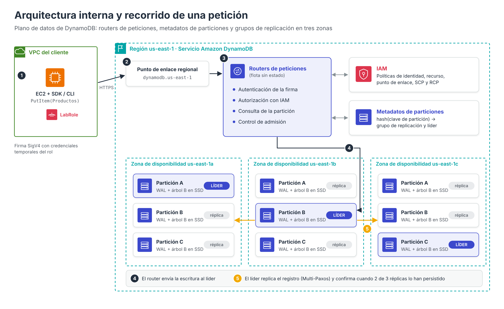
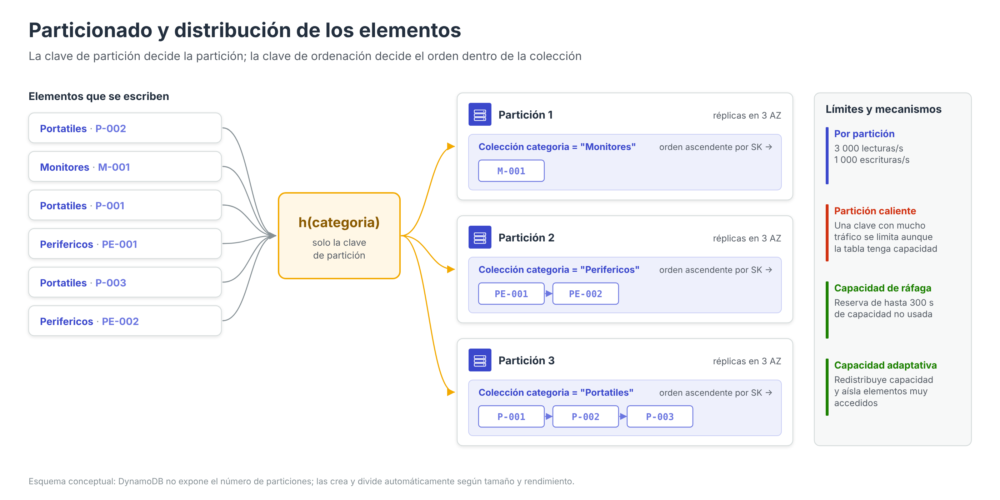

# Arquitectura de Amazon DynamoDB

Para administrar y securizar DynamoDB correctamente es necesario comprender **dónde reside** el servicio y **cómo procesa** cada petición. La mayor parte de las decisiones de diseño (elección de claves, modo de capacidad, uso de puntos de enlace de VPC, políticas de acceso) encuentran su justificación en la arquitectura interna que se describe en este apartado.

La descripción combina la documentación oficial del servicio con el artículo académico publicado por los ingenieros de AWS en la conferencia USENIX ATC 2022, que detalla el diseño interno de DynamoDB tras más de una década en producción.

---

## Un servicio regional situado fuera de la VPC

La primera diferencia arquitectónica con Amazon RDS es la ubicación. Una instancia RDS se despliega **dentro de las subredes de una VPC** (a través del grupo de subredes) y recibe una dirección IP privada; por eso en RDS tenía sentido configurar el acceso público, los grupos de seguridad o la zona de disponibilidad.

DynamoDB, en cambio, es un **servicio regional** operado por AWS **fuera de cualquier VPC del cliente**:

- Una tabla pertenece a una **cuenta** y a una **región**, no a una VPC ni a una subred.
- AWS distribuye internamente los datos de la tabla entre **varias zonas de disponibilidad** de la región, sin que el administrador tenga que elegirlas.
- Se accede a la tabla a través de un **punto de enlace de API regional** (por ejemplo, `dynamodb.us-east-1.amazonaws.com`), es decir, mediante peticiones HTTPS firmadas.
- Las tablas **no tienen grupos de seguridad** ni dirección IP propia; el control de acceso se basa en la **identidad** (IAM) y, opcionalmente, en el **origen de red** de la petición.

!!! note "Consecuencia práctica"
    No es posible «meter» una tabla DynamoDB en una subred privada como se hace con una instancia EC2 o RDS. Lo que sí puede colocarse en la VPC es la **puerta de entrada** al servicio: un punto de enlace de VPC. Este concepto, trabajado en la práctica, se desarrolla en el apartado de seguridad.

---

## Plano de control y plano de datos

Las operaciones de la API de DynamoDB se dividen en dos grupos:

| Plano | Finalidad | Operaciones representativas |
| --- | --- | --- |
| **Plano de control** (*control plane*) | Crear y administrar tablas e índices | `CreateTable`, `DescribeTable`, `UpdateTable`, `DeleteTable`, `ListTables`, `PutResourcePolicy`, `UpdateTimeToLive`, `CreateBackup` |
| **Plano de datos** (*data plane*) | Leer y escribir elementos | `GetItem`, `PutItem`, `UpdateItem`, `DeleteItem`, `Query`, `Scan`, `BatchGetItem`, `BatchWriteItem`, `TransactWriteItems`, `ExecuteStatement` |

Esta distinción es relevante en la administración diaria y, especialmente, en la seguridad. En la práctica, la política de la tabla **solo denegaba operaciones del plano de datos**, de forma que el administrador podía seguir modificando o eliminando la política desde la consola aunque ya no pudiera consultar los elementos.

---

## Componentes internos del plano de datos

Según la descripción publicada por AWS, el plano de datos de DynamoDB se compone de varios subsistemas que colaboran en cada petición:

| Componente | Función |
| --- | --- |
| **Balanceadores y routers de peticiones** (*request routers*) | Reciben las peticiones de los clientes, las **autentican** y **autorizan** contra IAM, consultan en qué partición se encuentra el elemento y la reenvían al nodo de almacenamiento adecuado |
| **Sistema de metadatos de particiones** | Mantiene la correspondencia entre rangos de *hash* de la clave de partición y los nodos de almacenamiento que contienen cada partición |
| **Nodos de almacenamiento** (*storage nodes*) | Almacenan las réplicas de las particiones en discos SSD; cada réplica mantiene un **registro de escritura anticipada** (*write-ahead log*) y un **árbol B** con los elementos |
| **Control de admisión** | Comprueba que la petición no supera la capacidad disponible de la tabla y de la partición; en caso contrario se produce una limitación (*throttling*) |
| **Subsistema de administración** (*autoadmin*) | Supervisa el estado de la flota, sustituye réplicas defectuosas, divide particiones y ejecuta las operaciones del plano de control |

### Recorrido de una petición

El siguiente ejemplo describe qué ocurre cuando la instancia EC2 de la práctica ejecuta un `PutItem` sobre la tabla `Productos`:

1. **Firma de la petición.** La AWS CLI o el SDK obtiene credenciales temporales del rol asociado a la instancia y firma la petición con el algoritmo **Signature Version 4 (SigV4)**.
2. **Resolución DNS.** El nombre `dynamodb.us-east-1.amazonaws.com` (o el nombre del punto de enlace de VPC, si se usa `--endpoint-url`) se resuelve a una dirección IP.
3. **Router de peticiones.** La petición llega a un router, que verifica la firma, evalúa las **políticas de IAM** aplicables (de identidad, de recursos, del punto de enlace, de la organización) y, si la autorización es correcta, consulta el sistema de metadatos.
4. **Cálculo de la partición.** Se aplica la función *hash* al valor de la clave de partición (`categoria`) para determinar la partición responsable.
5. **Escritura en el líder.** La petición se envía a la **réplica líder** de esa partición, que comprueba las condiciones (`ConditionExpression`), genera el registro en su *write-ahead log* y lo propaga a las demás réplicas.
6. **Confirmación por quórum.** Cuando **dos de las tres réplicas**, situadas en zonas de disponibilidad distintas, han persistido el registro, la escritura se considera confirmada y se responde al cliente.

La figura que encabeza este apartado representa este recorrido con la misma numeración.

### Grupos de replicación y consenso

Cada partición de una tabla se almacena en un **grupo de replicación** compuesto por réplicas distribuidas en **varias zonas de disponibilidad** de la región. Las réplicas utilizan el protocolo de consenso **Multi-Paxos** para elegir a un **líder**:

- Solo el líder acepta **escrituras** y atiende las **lecturas fuertemente consistentes**.
- Las **lecturas eventualmente consistentes** pueden ser atendidas por cualquier réplica, lo que explica que puedan devolver un valor ligeramente desactualizado y que su coste sea la mitad.
- Si el líder falla o pierde la comunicación, las réplicas restantes eligen un nuevo líder de forma automática. Este proceso es transparente para la aplicación, que como mucho experimenta un reintento.

Este diseño es el que permite a DynamoDB ofrecer **alta disponibilidad y durabilidad sin necesidad de configurar Multi-AZ**, a diferencia de RDS, donde la réplica en espera era una opción de creación de la instancia.

---

## Particionado y distribución de los datos

Una **partición** es una asignación de almacenamiento para una tabla, respaldada por discos SSD y replicada automáticamente en varias zonas de disponibilidad. El número de particiones de una tabla no se configura ni se consulta directamente: DynamoDB lo gestiona según el volumen de datos y el rendimiento requerido.

### Ubicación de los elementos

- **Tabla con clave simple** (solo partición): DynamoDB aplica una función *hash* interna al valor de la clave. El resultado determina la partición en la que se guarda el elemento. Los elementos **no se almacenan en ningún orden** útil para la aplicación.
- **Tabla con clave compuesta** (partición + ordenación): el *hash* de la clave de partición determina la partición, y dentro de ella los elementos que comparten clave de partición se guardan **juntos y ordenados de forma ascendente por la clave de ordenación**. Por eso una `Query` puede devolver resultados en orden ascendente o, con `ScanIndexForward = false`, descendente.

### Crecimiento de la tabla

DynamoDB añade particiones de forma automática en dos situaciones:

1. Cuando una partición se llena y se necesita más espacio de almacenamiento.
2. Cuando la capacidad requerida (aprovisionada o demandada) supera lo que pueden atender las particiones existentes.

La operación consiste en **dividir** (*split*) una partición en dos y repartir su rango de claves, sin interrumpir el servicio. En tablas con clave compuesta y sin LSI, una misma colección de elementos puede llegar a repartirse entre varias particiones si su tamaño o su tráfico lo requieren.

### Límite por partición y particiones calientes

Cada partición puede atender como máximo **3 000 unidades de lectura** y **1 000 unidades de escritura por segundo**. Si una clave de partición concentra una parte desproporcionada del tráfico (una **partición caliente**, *hot partition*), las peticiones dirigidas a ella se limitarán aunque la tabla en su conjunto tenga capacidad disponible.

Para mitigar este problema, DynamoDB incorpora dos mecanismos automáticos y sin coste:

- **Capacidad de ráfaga** (*burst capacity*): conserva hasta **300 segundos** de capacidad no utilizada para absorber picos puntuales.
- **Capacidad adaptativa** (*adaptive capacity*): aumenta automáticamente la capacidad de las particiones que reciben más tráfico y, si es necesario, **aísla los elementos más accedidos** en particiones propias.

Estos mecanismos no sustituyen a un buen diseño: la medida más eficaz es elegir una **clave de partición con muchos valores distintos y accesos uniformes**, como se explica en el apartado de claves.

---

## Arquitectura de los índices secundarios

Los dos tipos de índice tienen una implementación física distinta, lo que explica sus diferentes propiedades:

- **Índice secundario global (GSI)**: se almacena en **particiones propias**, independientes de las de la tabla, porque su clave de partición es diferente. DynamoDB actualiza el índice de forma **asíncrona** después de cada escritura en la tabla; por ese motivo **solo admite lecturas eventualmente consistentes** y dispone de su propia capacidad.
- **Índice secundario local (LSI)**: se almacena **en la misma partición** que los elementos de la tabla a los que indexa, puesto que comparte la clave de partición. Esto permite actualizarlo de forma síncrona y ofrecer lecturas fuertemente consistentes, pero impone el límite de **10 GB por colección de elementos** e impide que la capacidad adaptativa reparta una colección entre varias particiones.

---

## Durabilidad, disponibilidad y recuperación

- **Durabilidad**: cada escritura confirmada se encuentra persistida en al menos dos zonas de disponibilidad. Además, los registros de escritura se archivan de forma continua en Amazon S3, lo que constituye la base de la **recuperación a un momento dado (PITR)** y de las copias de seguridad, que se realizan sin consumir capacidad de la tabla.
- **Disponibilidad**: el acuerdo de nivel de servicio (SLA) de DynamoDB es del **99,99 %** para tablas regionales y del **99,999 %** para tablas globales.
- **Sin ventanas de mantenimiento**: las actualizaciones de software, la sustitución de hardware y la división de particiones se realizan sin detener el servicio.

### Tablas globales

En una tabla global, cada región contiene una **réplica completa** de la tabla con su propia arquitectura de particiones. Un proceso de replicación interno propaga las escrituras entre regiones: de forma asíncrona en el modo de consistencia eventual (MREC) o de forma síncrona con otra región en el modo de consistencia fuerte (MRSC).

---

## Comparativa arquitectónica con Amazon RDS

| Aspecto | Amazon RDS | Amazon DynamoDB |
| --- | --- | --- |
| Unidad de despliegue | Instancia de base de datos | Tabla |
| Ubicación | Subredes de una VPC (grupo de subredes) | Servicio regional fuera de la VPC |
| Dirección de acceso | Punto de enlace DNS que resuelve a la IP de la instancia | Punto de enlace de API regional (o punto de enlace de VPC) |
| Protocolo | Protocolo nativo del motor (p. ej., MySQL en el puerto 3306) | HTTPS (puerto 443) con peticiones firmadas SigV4 |
| Control de red | Grupos de seguridad y opción de acceso público | Puntos de enlace de VPC y condiciones en políticas |
| Autenticación | Usuarios del motor de base de datos (y opcionalmente IAM) | Exclusivamente IAM |
| Réplicas | Multi-AZ (opcional) y réplicas de lectura | Tres réplicas en varias AZ siempre; tablas globales opcionales |
| Escalado | Vertical (clase) y réplicas de lectura | Horizontal y automático (particiones) |
| Mantenimiento | Ventana de mantenimiento | Transparente |

---

## Referencias

- Elhemali, M., Gallagher, N., Gordon, N., Idziorek, J., Krog, R., Lazier, C., Mo, E., Mritunjai, A., Perianayagam, S., Rath, T., Sivasubramanian, S., Sorenson, J. C., Sosothikul, S., Terry, D., Vig, A. (2022). *Amazon DynamoDB: A Scalable, Predictably Performant, and Fully Managed NoSQL Database Service*. USENIX Annual Technical Conference (ATC 22) — [Artículo](https://www.usenix.org/conference/atc22/presentation/elhemali)
- AWS. *Partitions and data distribution in DynamoDB* — [Particiones](https://docs.aws.amazon.com/amazondynamodb/latest/developerguide/HowItWorks.Partitions.html)
- AWS. *DynamoDB burst and adaptive capacity* — [Capacidad de ráfaga y adaptativa](https://docs.aws.amazon.com/amazondynamodb/latest/developerguide/burst-adaptive-capacity.html)
- AWS. *DynamoDB read consistency* — [Consistencia de lectura](https://docs.aws.amazon.com/amazondynamodb/latest/developerguide/HowItWorks.ReadConsistency.html)
- AWS. *DynamoDB API* — [Planos de control y de datos](https://docs.aws.amazon.com/amazondynamodb/latest/developerguide/HowItWorks.API.html)
- AWS. *Resilience in Amazon DynamoDB* — [Resiliencia](https://docs.aws.amazon.com/amazondynamodb/latest/developerguide/disaster-recovery-resiliency.html)
- AWS. *How DynamoDB global tables work* — [Funcionamiento de las tablas globales](https://docs.aws.amazon.com/amazondynamodb/latest/developerguide/V2globaltables_HowItWorks.html)
- AWS. *Signature Version 4 for API requests* — [Firma SigV4](https://docs.aws.amazon.com/IAM/latest/UserGuide/reference_sigv.html)
- AWS. *Amazon DynamoDB Service Level Agreement* — [SLA](https://aws.amazon.com/dynamodb/sla/)
