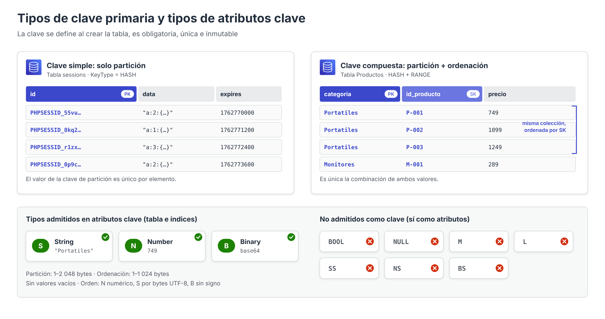

# Clave primaria, clave de ordenación y tipos de atributos



Al crear una tabla en DynamoDB, la única estructura que debe definirse obligatoriamente es la **clave primaria**. Esta decisión es la más importante del diseño: determina cómo se distribuyen los datos entre las particiones, qué consultas pueden resolverse de forma eficiente y **no puede modificarse una vez creada la tabla**. Si la clave elegida no es adecuada, la única solución es crear una tabla nueva y migrar los datos.

---

## La clave primaria

La clave primaria identifica de forma unívoca cada elemento de la tabla. Sus propiedades son:

- **Obligatoria**: todo elemento debe contener los atributos que forman la clave.
- **Única**: no pueden existir dos elementos con la misma clave primaria. Un `PutItem` con una clave existente **sustituye** el elemento anterior (de ahí el uso de `attribute_not_exists` en la práctica).
- **Inmutable**: los valores de los atributos clave de un elemento no pueden modificarse con `UpdateItem`. Para «cambiar» la clave es necesario borrar el elemento y crearlo de nuevo, preferiblemente dentro de una transacción.
- **Definida en la creación**: el esquema de la clave (nombres, tipos y papel de cada atributo) se fija en `CreateTable` y no puede alterarse.

DynamoDB admite dos tipos de clave primaria.

### Clave primaria simple (clave de partición)

Está formada por **un único atributo**, denominado **clave de partición** (*partition key*). En la documentación y en la API también recibe el nombre de **atributo hash** (`HASH`), porque su valor es la entrada de la función *hash* que decide la partición.

En una tabla con clave simple, **el valor de la clave de partición debe ser único** para cada elemento. Solo es posible recuperar elementos individuales (`GetItem`) o recorrer la tabla (`Scan`); la operación `Query` devolvería como máximo un elemento.

*Ejemplo*: la tabla `sessions` de la práctica evaluable utiliza como clave de partición el identificador de la sesión (`id`). Cada sesión se recupera siempre por su identificador, por lo que no se necesita nada más.

### Clave primaria compuesta (partición + ordenación)

Está formada por **dos atributos**:

1. **Clave de partición** (`HASH`): determina la partición, igual que en la clave simple.
2. **Clave de ordenación** (*sort key*), también denominada **atributo de rango** (`RANGE`): determina el orden de los elementos dentro de la colección que comparte una misma clave de partición.

En este caso, **varios elementos pueden compartir clave de partición**, siempre que tengan claves de ordenación distintas: lo que debe ser único es la **combinación** de ambos valores. No existe un límite al número de valores de clave de ordenación distintos para una misma clave de partición (salvo el límite de 10 GB por colección cuando la tabla tiene índices secundarios locales).

*Ejemplo*: en la tabla `Productos` de la práctica, `categoria` es la clave de partición e `id_producto` la clave de ordenación. Pueden existir muchos productos de la categoría `Portatiles`, pero no dos portátiles con el mismo `id_producto`.

La clave compuesta habilita los patrones de acceso más potentes de DynamoDB:

- Recuperar **todos** los elementos de una colección (`categoria = :c`).
- Recuperar un **rango** de la colección mediante condiciones sobre la clave de ordenación.
- Obtener los resultados **ordenados** de forma ascendente o descendente.

---

## Tipos de datos admitidos en los atributos clave

Aunque DynamoDB admite una gran variedad de tipos para los atributos ordinarios, **los atributos que forman la clave primaria (y las claves de los índices secundarios) solo pueden ser de uno de estos tres tipos escalares**:

| Tipo | Descriptor | Contenido | Observaciones para su uso como clave |
| --- | --- | --- | --- |
| **String** (cadena) | `S` | Texto Unicode codificado en UTF-8 | No puede estar vacía si es clave. Es el tipo más habitual |
| **Number** (número) | `N` | Número positivo, negativo o cero, entero o decimal, con hasta **38 dígitos** de precisión | Se transmite como cadena en la API (`{"N": "749"}`) para no perder precisión |
| **Binary** (binario) | `B` | Secuencia de bytes arbitraria (datos comprimidos, cifrados, identificadores binarios) | El cliente debe codificarla en **base64** al enviarla. No puede estar vacía si es clave |

No pueden utilizarse como clave los tipos booleanos, nulos, mapas, listas ni conjuntos. La longitud máxima es de **2 048 bytes** para la clave de partición y de **1 024 bytes** para la clave de ordenación.

En la consola, estos tipos aparecen como **Cadena**, **Número** y **Binario** en los desplegables de *Clave de partición* y *Clave de ordenación*. En la AWS CLI se indican con las letras `S`, `N` y `B`.

### El tipo condiciona el orden

La elección del tipo de la **clave de ordenación** no es indiferente, porque determina cómo se ordenan los elementos y cómo se evalúan las condiciones de rango:

| Tipo | Criterio de ordenación | Ejemplo |
| --- | --- | --- |
| `N` | Valor numérico | `2 < 9 < 10 < 100` |
| `S` | Orden de los **bytes UTF-8** (lexicográfico, no alfabético) | `"10" < "100" < "2" < "9"`; las mayúsculas preceden a las minúsculas (`"Z" < "a"`) y las letras acentuadas se sitúan después de `"z"` |
| `B` | Bytes interpretados como valores sin signo | `0x00 < 0x7F < 0xFF` |

De esta tabla se derivan algunas recomendaciones de diseño:

- Si la clave de ordenación es un número que se va a comparar con `<`, `>` o `BETWEEN`, debe declararse como `N`. Si se declara como `S`, el valor `"1099"` sería «menor» que `"749"`.
- Las **fechas** suelen almacenarse como cadenas en formato **ISO 8601** (`2026-11-10T11:30:00Z`), cuyo orden lexicográfico coincide con el cronológico, o bien como números con el tiempo UNIX.
- Cuando se usan cadenas con números, conviene **rellenar con ceros** a la izquierda (`P-001`, `P-002`, …, `P-010`) para que el orden sea el esperado.

---

## Tipos de datos del resto de atributos

Los atributos que no forman parte de la clave pueden ser de cualquiera de los siguientes tipos, y no es necesario declararlos al crear la tabla:

| Categoría | Tipo | Descriptor | Ejemplo en DynamoDB JSON |
| --- | --- | --- | --- |
| Escalar | String | `S` | `{"S": "Monitor 27\" QHD"}` |
| Escalar | Number | `N` | `{"N": "289"}` |
| Escalar | Binary | `B` | `{"B": "dGV4dG8="}` |
| Escalar | Boolean | `BOOL` | `{"BOOL": true}` |
| Escalar | Null | `NULL` | `{"NULL": true}` |
| Documento | Map (mapa) | `M` | `{"M": {"ram_gb": {"N": "32"}, "cpu": {"S": "i7"}}}` |
| Documento | List (lista) | `L` | `{"L": [{"S": "USB-C"}, {"N": "2"}]}` |
| Conjunto | String Set | `SS` | `{"SS": ["oferta", "gaming"]}` |
| Conjunto | Number Set | `NS` | `{"NS": ["1", "2", "3"]}` |
| Conjunto | Binary Set | `BS` | `{"BS": ["U3Vubnk=", "UmFpbnk="]}` |

Aspectos a tener en cuenta:

- Las **listas** pueden contener elementos de tipos distintos y admiten duplicados; los **conjuntos** solo contienen valores del mismo tipo, sin duplicados y sin orden, y **no pueden estar vacíos**.
- Mapas y listas pueden anidarse hasta **32 niveles** de profundidad.
- Las cadenas y binarios vacíos están permitidos en los atributos que no son clave.

### DynamoDB JSON frente a JSON convencional

La API de DynamoDB utiliza un formato denominado **DynamoDB JSON**, en el que cada valor va acompañado de su descriptor de tipo. Por eso en la práctica los comandos de la CLI tenían este aspecto:

```json
{
  "categoria":   {"S": "Perifericos"},
  "id_producto": {"S": "PE-001"},
  "precio":      {"N": "79.90"},
  "stock":       {"N": "15"}
}
```

En cambio, la consola (con la opción *Ver DynamoDB JSON* desactivada) y las interfaces de alto nivel de los SDK, como el recurso `Table` de **boto3**, permiten trabajar con JSON convencional y realizan la conversión de tipos automáticamente. En Python, los números se devuelven como objetos `Decimal` para preservar la precisión de 38 dígitos.

---

## Definición de la clave al crear una tabla

### Desde la consola

En **DynamoDB → Tablas → Crear tabla** se solicitan:

1. **Nombre de la tabla**: entre 3 y 255 caracteres (`A-Z`, `a-z`, `0-9`, `_`, `-`, `.`).
2. **Clave de partición**: nombre del atributo y tipo (*Cadena*, *Número* o *Binario*).
3. **Clave de ordenación – opcional**: nombre y tipo. Si se deja vacía, la tabla tendrá clave simple.

### Desde la AWS CLI

```bash
aws dynamodb create-table \
  --table-name Productos \
  --attribute-definitions \
      AttributeName=categoria,AttributeType=S \
      AttributeName=id_producto,AttributeType=S \
  --key-schema \
      AttributeName=categoria,KeyType=HASH \
      AttributeName=id_producto,KeyType=RANGE \
  --billing-mode PAY_PER_REQUEST
```

- `--attribute-definitions` declara el **tipo** (`S`, `N` o `B`) de los atributos que actúan como clave de la tabla o de sus índices. **Solo deben declararse esos atributos**: incluir aquí atributos ordinarios como `precio` produce un error de validación.
- `--key-schema` indica el **papel** de cada atributo: `HASH` para la clave de partición y `RANGE` para la de ordenación.
- `--billing-mode PAY_PER_REQUEST` selecciona el modo de capacidad bajo demanda (el alternativo es `PROVISIONED`).

---

## Operadores disponibles sobre la clave en una `Query`

La expresión `KeyConditionExpression` de una `Query` está limitada por la naturaleza de cada clave:

| Clave | Operadores permitidos |
| --- | --- |
| Clave de partición | Solo igualdad: `=` |
| Clave de ordenación | `=`, `<`, `<=`, `>`, `>=`, `BETWEEN … AND …`, `begins_with(…)` |

La clave de partición **siempre** debe compararse por igualdad, porque se necesita su valor exacto para calcular el *hash*. Las condiciones sobre cualquier otro atributo deben expresarse en una `FilterExpression`, que, como se ha indicado, no reduce la capacidad consumida.

Ejemplos con la tabla `Productos`:

```bash
# Periféricos cuyo código empieza por "PE-"
--key-condition-expression "categoria = :c AND begins_with(id_producto, :p)"

# Portátiles con código entre P-001 y P-005
--key-condition-expression "categoria = :c AND id_producto BETWEEN :desde AND :hasta"
```

---

## Criterios para elegir una buena clave

### Clave de partición

La clave de partición debe cumplir dos condiciones: **alta cardinalidad** (muchos valores distintos) y **acceso uniforme** (ningún valor concentra una parte desproporcionada del tráfico).

| Clave de partición | Cardinalidad | Uniformidad | Valoración |
| --- | --- | --- | --- |
| Identificador de usuario, de sesión o de dispositivo | Muy alta | Alta | Muy adecuada |
| Código de producto | Alta | Media (productos superventas) | Adecuada |
| Categoría de producto | Baja | Baja | Válida solo para volúmenes pequeños, como el de la práctica |
| Estado de un pedido (`PENDIENTE`, `ENVIADO`…) | Muy baja | Muy baja | Inadecuada: crea particiones calientes |
| Fecha del día | Baja | Muy baja (todo el tráfico va al día actual) | Inadecuada |

Cuando un valor de clave recibe inevitablemente mucho tráfico, puede aplicarse la técnica de **fragmentación de escrituras** (*write sharding*): añadir un sufijo aleatorio o calculado a la clave (`2026-11-10#1`, `2026-11-10#2`, …) para repartir los elementos entre varias particiones.

### Clave de ordenación

La clave de ordenación debe reflejar **cómo se consultan los elementos dentro de la colección**:

- **Claves jerárquicas**: concatenar niveles con un separador permite consultar a distintos niveles de detalle con `begins_with`. Por ejemplo, `ESP#GALICIA#PONTEVEDRA#VIGO` admite consultas por país, comunidad, provincia o ciudad.
- **Fechas o marcas de tiempo**: permiten obtener los registros más recientes o los de un intervalo.
- **Versionado**: prefijos como `v0` (versión actual) y `v1`, `v2`… (históricas) permiten conservar el histórico de cambios de un elemento.

### Claves de los índices secundarios

Las claves de los índices secundarios siguen las mismas reglas de tipo (`S`, `N`, `B`). En los GSI, desde noviembre de 2025, la clave de partición y la de ordenación pueden componerse de **hasta cuatro atributos cada una**, lo que evita construir claves concatenadas como la del ejemplo jerárquico anterior.

---

## Referencias

- AWS. *Core components of Amazon DynamoDB: primary key* — [Clave primaria](https://docs.aws.amazon.com/amazondynamodb/latest/developerguide/HowItWorks.CoreComponents.html#HowItWorks.CoreComponents.PrimaryKey)
- AWS. *Supported data types and naming rules in Amazon DynamoDB* — [Tipos de datos y reglas de nomenclatura](https://docs.aws.amazon.com/amazondynamodb/latest/developerguide/HowItWorks.NamingRulesDataTypes.html)
- AWS. *Constraints in Amazon DynamoDB* — [Restricciones](https://docs.aws.amazon.com/amazondynamodb/latest/developerguide/Constraints.html)
- AWS. *Key condition expressions for the Query operation* — [Expresiones de condición de clave](https://docs.aws.amazon.com/amazondynamodb/latest/developerguide/Query.KeyConditionExpressions.html)
- AWS. *Best practices for designing and using partition keys effectively* — [Diseño de la clave de partición](https://docs.aws.amazon.com/amazondynamodb/latest/developerguide/bp-partition-key-design.html)
- AWS. *Best practices for using sort keys to organize data* — [Diseño de la clave de ordenación](https://docs.aws.amazon.com/amazondynamodb/latest/developerguide/bp-sort-keys.html)
- AWS. *Using write sharding to distribute workloads evenly* — [Fragmentación de escrituras](https://docs.aws.amazon.com/amazondynamodb/latest/developerguide/bp-partition-key-sharding.html)
- AWS. *AWS CLI Command Reference: create-table* — [create-table](https://awscli.amazonaws.com/v2/documentation/api/latest/reference/dynamodb/create-table.html)
- AWS. *Multi-key support for global secondary index in Amazon DynamoDB* (AWS Database Blog) — [Claves multiatributo en GSI](https://aws.amazon.com/blogs/database/multi-key-support-for-global-secondary-index-in-amazon-dynamodb)
