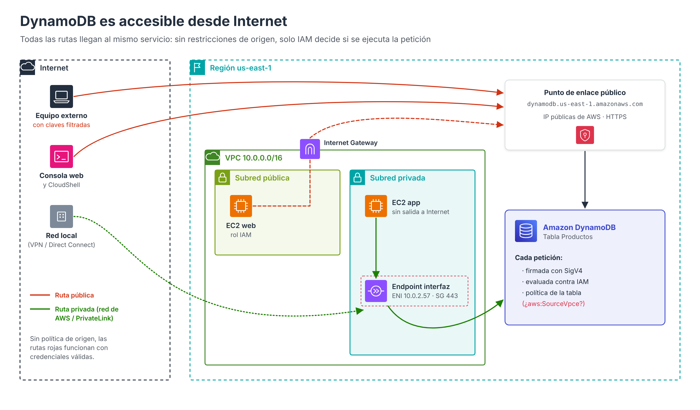
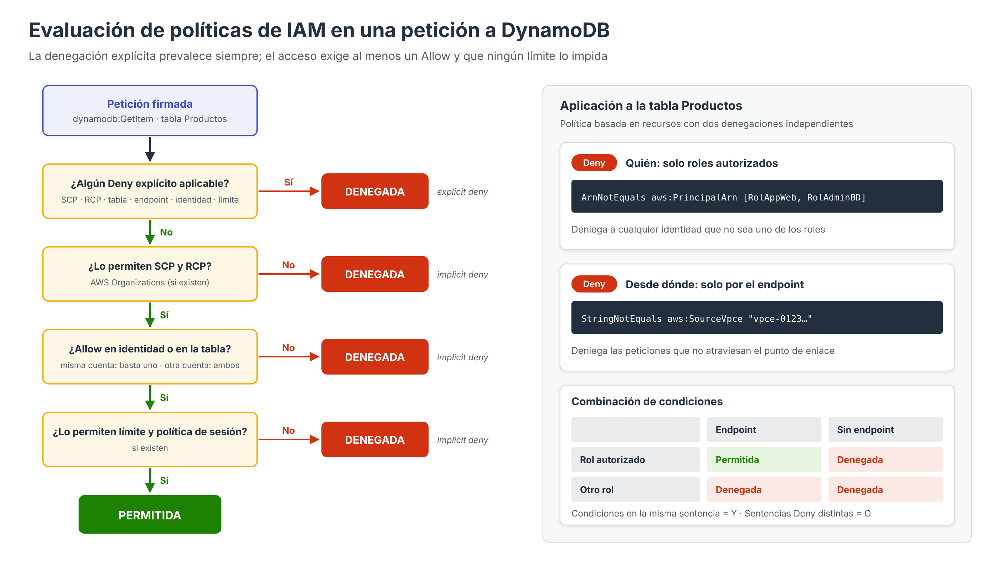
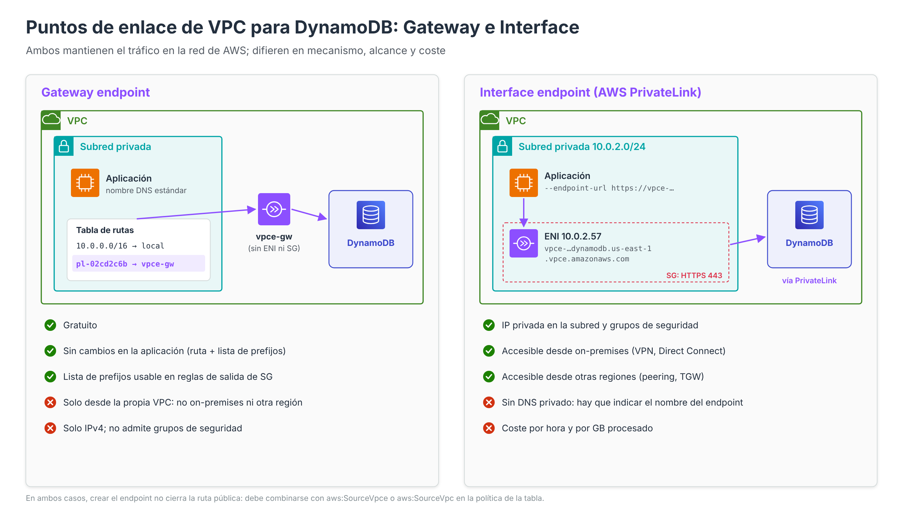

# Acceso a DynamoDB y securización



En el apartado dedicado a las redes de Amazon RDS se estudió que una instancia puede configurarse como **no accesible públicamente** y protegerse mediante **grupos de seguridad** dentro de una VPC. Ese modelo de seguridad, basado principalmente en el **perímetro de red**, no es directamente aplicable a DynamoDB. Como se ha visto en el apartado de arquitectura, una tabla no reside en ninguna subred y no tiene dirección IP propia: se accede a ella a través de una **API pública** de AWS.

Este apartado analiza las implicaciones de esa exposición y las técnicas disponibles para securizar el acceso, con especial atención a las dos que se trabajan en las prácticas: **limitar el acceso a determinados roles** y **obligar a que el tráfico llegue a través de un punto de enlace de VPC**.

---

## DynamoDB es un servicio accesible desde Internet

Todas las operaciones de DynamoDB, tanto del plano de control como del plano de datos, se realizan mediante **peticiones HTTP a un punto de enlace (*endpoint*) de la API**. Estos puntos de enlace tienen nombres DNS públicos que resuelven a direcciones IP públicas de AWS. En la región `us-east-1` son, entre otros:

| Punto de enlace | Tipo |
| --- | --- |
| `dynamodb.us-east-1.amazonaws.com` | Estándar (IPv4) |
| `dynamodb.us-east-1.api.aws` | Pila doble (IPv4 e IPv6) |
| `dynamodb-fips.us-east-1.amazonaws.com` | Validado FIPS 140 |
| `ID-CUENTA.ddb.us-east-1.amazonaws.com` | Basado en la cuenta, usado por defecto en las versiones recientes de los SDK para optimizar el enrutamiento |

Esto significa que **cualquier equipo conectado a Internet puede enviar peticiones a DynamoDB**: un portátil, una función Lambda, la consola web, AWS CloudShell o una instancia EC2 con salida a Internet. No existe en DynamoDB una casilla equivalente a la opción *Accesible públicamente: No* de RDS.

Que el punto de enlace sea público **no significa que los datos lo sean**. Cada petición debe estar **firmada** con credenciales de AWS válidas mediante el algoritmo **Signature Version 4 (SigV4)**, y DynamoDB solo la ejecuta si las **políticas de IAM** la autorizan. Por defecto, ninguna identidad tiene acceso a ninguna tabla salvo que una política se lo conceda de forma explícita.

!!! warning "El riesgo real"
    En DynamoDB **la identidad es el perímetro principal**. Si unas credenciales con permisos sobre una tabla se filtran (por ejemplo, unas claves de acceso publicadas por error en un repositorio), un atacante podría utilizarlas **desde cualquier lugar de Internet**. Por este motivo, la securización de DynamoDB combina dos líneas de defensa:

    1. **Quién** puede acceder: identidades y políticas de IAM con mínimo privilegio.
    2. **Desde dónde** puede acceder: restricciones de origen de red mediante puntos de enlace de VPC y condiciones en las políticas.

Este comportamiento se observó en ambas prácticas: antes de aplicar la política de la tabla, la instancia EC2 podía consultar la tabla **sin** utilizar el punto de enlace de VPC, porque la petición salía por el Internet Gateway hacia el punto de enlace público y estaba firmada con las credenciales válidas del rol `LabRole`.

---

## Autenticación y autorización con IAM

DynamoDB no tiene usuarios propios como un motor relacional: **toda la autenticación y autorización se delega en AWS Identity and Access Management (IAM)**.

### Identidades

| Identidad | Credenciales | Uso recomendado |
| --- | --- | --- |
| **Rol de IAM** | Temporales, obtenidas mediante AWS STS y renovadas automáticamente | **Opción preferente** para aplicaciones: instancias EC2 (perfil de instancia), funciones Lambda, contenedores ECS/EKS |
| **Usuario de IAM** | Claves de acceso de larga duración | Desaconsejado para aplicaciones; si se usa, con rotación y mínimo privilegio |
| **Identidad federada** | Temporales, a partir de un proveedor externo (IAM Identity Center, SAML, OIDC, Amazon Cognito) | Usuarios humanos y aplicaciones web o móviles |

En las prácticas, la instancia EC2 obtiene las credenciales del rol `LabRole` a través del perfil de instancia `LabInstanceProfile`, de modo que **no es necesario almacenar claves de acceso** en la aplicación ni en el fichero `.env`. El SDK consulta automáticamente el servicio de metadatos de la instancia para obtener y renovar las credenciales.

### Tipos de políticas que intervienen

| Tipo de política | Dónde se asocia | Qué controla |
| --- | --- | --- |
| **Basada en identidad** | Usuario, grupo o rol de IAM | Qué puede hacer esa identidad sobre qué tablas |
| **Basada en recursos** | Tabla, índice o *stream* de DynamoDB | Quién puede acceder a ese recurso y en qué condiciones |
| **Política del punto de enlace de VPC** | Punto de enlace de VPC | Qué peticiones pueden atravesar ese punto de enlace |
| **Límite de permisos** (*permissions boundary*) | Usuario o rol | Permisos máximos que puede llegar a tener la identidad |
| **SCP** (*Service Control Policy*) | Cuentas u OU de AWS Organizations | Permisos máximos de las **identidades** de la organización |
| **RCP** (*Resource Control Policy*) | Cuentas u OU de AWS Organizations | Permisos máximos sobre los **recursos** de la organización |
| **Política de sesión** | Sesión de un rol asumido | Restringe los permisos de esa sesión concreta |

### Lógica de evaluación



IAM combina todas las políticas aplicables a cada petición según estas reglas:

1. **Denegación por defecto**: si ninguna política permite la acción, se deniega (denegación implícita).
2. **La denegación explícita prevalece**: si **cualquier** política contiene un `Deny` aplicable, la petición se rechaza, aunque otras políticas la permitan.
3. **SCP, RCP, límites de permisos y políticas de sesión no conceden permisos**: solo establecen el máximo. Deben permitir la acción para que pueda concederse.
4. **Misma cuenta**: basta con que la política basada en identidad **o** la política basada en recursos permitan la acción.
5. **Acceso entre cuentas**: es necesario que lo permitan **ambas**: la política de identidad en la cuenta de origen y la política de recursos de la tabla.

La regla 2 es la que hace posibles las técnicas de restricción que se describen a continuación: se concede el acceso de forma general y se añade una **denegación explícita condicionada** que elimina todo lo que no cumpla los requisitos.

---

## Políticas basadas en identidad: mínimo privilegio

La política que se asocia al rol de una aplicación debe conceder únicamente las acciones necesarias sobre las tablas concretas que utiliza. Por ejemplo, para un rol que solo lee y actualiza productos:

```json
{
  "Version": "2012-10-17",
  "Statement": [
    {
      "Sid": "LecturaEscrituraProductos",
      "Effect": "Allow",
      "Action": [
        "dynamodb:GetItem",
        "dynamodb:Query",
        "dynamodb:PutItem",
        "dynamodb:UpdateItem"
      ],
      "Resource": [
        "arn:aws:dynamodb:us-east-1:111122223333:table/Productos",
        "arn:aws:dynamodb:us-east-1:111122223333:table/Productos/index/*"
      ]
    }
  ]
}
```

Obsérvese que el recurso `table/Productos/index/*` es necesario para poder ejecutar `Query` sobre los índices secundarios, que tienen un ARN propio.

!!! info "Entorno AWS Academy"
    En el Learner Lab no es posible crear roles ni modificar las políticas de `LabRole`, que tiene permisos amplios sobre DynamoDB. Por ese motivo, en las prácticas la restricción se aplica desde el lado del **recurso**, mediante la política de la tabla, que sí está bajo nuestro control.

---

## Políticas basadas en recursos en la tabla

Desde marzo de 2024, DynamoDB permite asociar **políticas basadas en recursos** a tablas, índices y *streams*. La política de una tabla se aplica también a sus índices. Se gestionan desde la consola en **DynamoDB → Tablas → *tabla* → pestaña Permisos → Política de la tabla basada en recursos**, o con las operaciones `PutResourcePolicy`, `GetResourcePolicy` y `DeleteResourcePolicy`. Su tamaño máximo es de **20 KB**.

Estas políticas presentan dos ventajas fundamentales frente a las basadas en identidad:

- Permiten **conceder acceso entre cuentas** sin necesidad de asumir roles.
- Permiten **imponer restricciones a todas las identidades** que intenten acceder a la tabla, con independencia de los permisos que tengan en sus propias políticas. Es decir, el propietario de la tabla controla el acceso aunque no controle las identidades.

### Permitir el acceso solo a determinados roles

Supóngase que la tabla `Productos` solo debe ser accesible por el rol de la aplicación (`RolAppWeb`) y por el rol de los administradores de bases de datos (`RolAdminBD`), aunque en la cuenta existan otros usuarios y roles con permisos amplios sobre DynamoDB.

**Por qué no basta con un `Allow`.** Si la política de la tabla se limitara a permitir el acceso a esos dos roles, cualquier otra identidad de la misma cuenta cuya política de identidad conceda `dynamodb:*` seguiría pudiendo acceder (regla 4 de la evaluación). Es necesaria una **denegación explícita** para todos los demás:

```json
{
  "Version": "2012-10-17",
  "Statement": [
    {
      "Sid": "DenegarDatosSalvoRolesAutorizados",
      "Effect": "Deny",
      "Principal": "*",
      "Action": [
        "dynamodb:GetItem", "dynamodb:BatchGetItem",
        "dynamodb:Query", "dynamodb:Scan",
        "dynamodb:PutItem", "dynamodb:UpdateItem", "dynamodb:DeleteItem",
        "dynamodb:BatchWriteItem"
      ],
      "Resource": [
        "arn:aws:dynamodb:us-east-1:111122223333:table/Productos",
        "arn:aws:dynamodb:us-east-1:111122223333:table/Productos/index/*"
      ],
      "Condition": {
        "ArnNotEquals": {
          "aws:PrincipalArn": [
            "arn:aws:iam::111122223333:role/RolAppWeb",
            "arn:aws:iam::111122223333:role/RolAdminBD"
          ]
        }
      }
    }
  ]
}
```

Análisis de la política:

- **`"Principal": "*"`** aplica la sentencia a cualquier identidad que realice la petición.
- **`aws:PrincipalArn`** contiene el ARN de la identidad que firma la petición. Cuando se trata de un rol asumido (como el de una instancia EC2), la clave contiene el **ARN del rol** (`arn:aws:iam::…:role/RolAppWeb`) y no el de la sesión temporal (`arn:aws:sts::…:assumed-role/RolAppWeb/i-0abc…`). Por eso la condición funciona con cualquier instancia que tenga asociado el rol.
- **`ArnNotEquals` con varios valores** se evalúa como «el ARN no coincide con **ninguno** de los valores de la lista». La petición se deniega si no procede de ninguno de los dos roles.
- Solo se deniegan **acciones del plano de datos**. Si la aplicación utiliza PartiQL, deben añadirse también las acciones `dynamodb:PartiQLSelect`, `dynamodb:PartiQLInsert`, `dynamodb:PartiQLUpdate` y `dynamodb:PartiQLDelete`, ya que se autorizan por separado. Si se denegasen también las del plano de control (`dynamodb:*`), se correría el riesgo de que nadie pudiera volver a modificar o eliminar la política de la tabla.
- Incluir un **rol de administración** en la lista es una buena práctica para no perder el acceso a los datos si cambia el rol de la aplicación.

Si las identidades autorizadas pertenecen a otras cuentas, la política debe incluir además una sentencia `Allow` que les conceda las acciones, ya que en el acceso entre cuentas el permiso debe existir en ambos lados.

Existen alternativas a la enumeración de ARN que escalan mejor cuando el número de roles crece:

| Condición | Ejemplo de uso |
| --- | --- |
| `aws:PrincipalArn` con comodines (`StringNotLike`) | Todos los roles cuyo nombre empiece por `app-produccion-` |
| `aws:PrincipalTag/clave` | Solo identidades con la etiqueta `departamento = ventas` |
| `aws:PrincipalAccount` | Solo identidades de determinadas cuentas |
| `aws:PrincipalOrgID` | Solo identidades de la organización de AWS Organizations |

### Bloqueo del acceso público (BPA)

DynamoDB incorpora de forma automática y sin configuración un mecanismo de **bloqueo del acceso público** (*Block Public Access*) en las políticas basadas en recursos. Mediante razonamiento automatizado, el servicio analiza cada política que se crea o modifica y **rechaza aquellas que conceden acceso público**, es decir, las que permiten el acceso a `"Principal": "*"` sin una condición que lo restrinja.

Una política con `Principal` comodín se considera no pública si incluye una condición sobre alguna de las claves admitidas, entre ellas `aws:PrincipalArn`, `aws:PrincipalAccount`, `aws:PrincipalOrgID`, `aws:SourceVpc`, `aws:SourceVpce` o `aws:SourceAccount`, con valores **sin comodines ni variables**. Este mecanismo protege frente a errores de configuración, pero solo analiza las políticas de DynamoDB; las políticas de identidad y las de otros recursos relacionados (como las claves de KMS) deben revisarse por separado.

---

## Evitar el acceso público: puntos de enlace de VPC

Las políticas anteriores controlan **quién** accede. Para controlar **por dónde** llega el tráfico se utilizan los **puntos de enlace de VPC** (*VPC endpoints*), que permiten que los recursos de una VPC se comuniquen con DynamoDB a través de la **red privada de AWS**, sin atravesar Internet y sin necesidad de un Internet Gateway ni de un NAT Gateway.



DynamoDB admite dos tipos de punto de enlace.

### Punto de enlace de tipo puerta de enlace (*Gateway*)

- Se asocia a una o varias **tablas de rutas** de la VPC. Al hacerlo, AWS añade automáticamente una ruta cuyo destino es la **lista de prefijos** gestionada de DynamoDB (`pl-xxxxxxxx`, con los rangos IP públicos del servicio) y cuyo objetivo es el punto de enlace (`vpce-xxxxxxxx`).
- Las aplicaciones siguen usando el **nombre DNS estándar** (`dynamodb.us-east-1.amazonaws.com`); es la tabla de rutas la que desvía el tráfico hacia el punto de enlace. **No requiere cambios en la aplicación.**
- **No tiene coste** adicional.
- No crea interfaces de red ni admite grupos de seguridad. La lista de prefijos puede utilizarse, no obstante, en las reglas de salida de los grupos de seguridad de las instancias.
- Solo admite **IPv4** y **no es accesible desde fuera de la VPC**: ni desde redes locales (VPN, Direct Connect), ni desde VPC emparejadas de otra región, ni a través de Transit Gateway.

### Punto de enlace de tipo interfaz (*Interface*, AWS PrivateLink)

- Crea una **interfaz de red elástica (ENI)** con una **dirección IP privada** en cada subred seleccionada. Es la «presencia» de DynamoDB dentro de la subred privada que se observó en la práctica (`10.0.2.x`).
- Se protege con **grupos de seguridad**, que deben permitir el tráfico HTTPS (TCP 443) desde los clientes autorizados. En las prácticas, el grupo del punto de enlace solo admite tráfico procedente del grupo de seguridad de los servidores.
- Genera **nombres DNS propios**, regional y zonales, con el formato `vpce-1a2b3c4d-5e6f.dynamodb.us-east-1.vpce.amazonaws.com`.
- **No admite DNS privado**: el nombre estándar de DynamoDB sigue resolviendo a direcciones públicas. La aplicación debe configurarse **explícitamente** para usar el nombre del punto de enlace (parámetro `--endpoint-url` en la CLI, `endpoint_url` en boto3 o la variable `dynamo.endpoint` de la práctica evaluable). AWS desaconseja crear zonas alojadas privadas que sobrescriban los nombres de DynamoDB para forzar este comportamiento.
- Es accesible desde **redes locales** mediante VPN o Direct Connect y desde otras regiones mediante emparejamiento de VPC o Transit Gateway.
- **Tiene coste** por hora y por GB procesado.

### Comparativa

| Característica | Gateway | Interface (PrivateLink) |
| --- | --- | --- |
| Direcciones utilizadas | IP públicas de DynamoDB, encaminadas por la red de AWS | IP privadas de la VPC |
| Mecanismo | Ruta en la tabla de rutas (lista de prefijos) | ENI en la subred + nombre DNS propio |
| Cambios en la aplicación | Ninguno | Indicar el nombre DNS del punto de enlace |
| Grupos de seguridad | No (sí la lista de prefijos en las reglas de salida) | Sí |
| Acceso desde redes locales u otras regiones | No | Sí |
| Coste | Gratuito | Por hora y por GB |
| Uso recomendado | Cargas que se ejecutan dentro de la VPC | Entornos híbridos o acceso entre regiones |

Ambos tipos pueden coexistir en la misma VPC: un diseño habitual consiste en usar el punto de enlace **Gateway** para las aplicaciones de la VPC y el de tipo **Interface** solo para los clientes locales.

!!! note "¿Por qué se usa un punto de enlace de tipo interfaz en las prácticas?"
    Como se indica en la práctica evaluable, en un entorno real sin requisitos híbridos lo más adecuado sería un punto de enlace de tipo **Gateway**, por ser gratuito y transparente para la aplicación. En las prácticas se utiliza el de tipo **Interface** porque hace **visible** cuándo se usa el punto de enlace (al configurar `--endpoint-url`) y cuándo no, lo que facilita comprobar el efecto de las políticas.

### El punto de enlace por sí solo no impide el acceso público

Crear un punto de enlace **ofrece** una ruta privada, pero **no cierra** la ruta pública. En la práctica, tras crear el punto de enlace de tipo interfaz, el comando `aws dynamodb scan` **sin** `--endpoint-url` seguía funcionando: la petición salía por el Internet Gateway hacia el punto de enlace público. Del mismo modo, la consola web y CloudShell seguían teniendo acceso, y también lo tendría cualquier persona con credenciales válidas desde fuera de AWS.

Para que la ruta privada sea **la única** posible, es necesario combinar el punto de enlace con una **condición de origen de red** en la política de la tabla.

### Obligar a que el tráfico llegue por el punto de enlace

La clave de condición `aws:SourceVpce` contiene el identificador del punto de enlace de VPC por el que ha llegado la petición; si la petición no ha pasado por ningún punto de enlace, la clave no existe. Una denegación condicionada sobre ella convierte la ruta de red en un **requisito de acceso**:

```json
{
  "Version": "2012-10-17",
  "Statement": [
    {
      "Sid": "SoloDesdeEndpointPrivado",
      "Effect": "Deny",
      "Principal": "*",
      "Action": [
        "dynamodb:GetItem", "dynamodb:BatchGetItem",
        "dynamodb:Query", "dynamodb:Scan",
        "dynamodb:PutItem", "dynamodb:UpdateItem", "dynamodb:DeleteItem",
        "dynamodb:BatchWriteItem"
      ],
      "Resource": [
        "arn:aws:dynamodb:us-east-1:111122223333:table/Productos",
        "arn:aws:dynamodb:us-east-1:111122223333:table/Productos/index/*"
      ],
      "Condition": {
        "StringNotEquals": { "aws:SourceVpce": "vpce-0123456789abcdef0" }
      }
    }
  ]
}
```

Esta condición funciona tanto con puntos de enlace de tipo Gateway como de tipo Interface. Otras claves de condición relacionadas con el origen de red son:

| Clave | Contenido | Uso |
| --- | --- | --- |
| `aws:SourceVpce` | ID del punto de enlace de VPC | Exigir un punto de enlace concreto |
| `aws:SourceVpc` | ID de la VPC desde la que se origina la petición a través de un punto de enlace | Admitir cualquier punto de enlace de una VPC |
| `aws:VpcSourceIp` | IP privada del cliente dentro de la VPC | Restringir a determinadas subredes o equipos |
| `aws:SourceIp` | IP pública del cliente | Restringir accesos que llegan **por Internet**. **No está disponible** cuando la petición llega por un punto de enlace de VPC |

Consecuencias que deben tenerse en cuenta al aplicar esta política:

- La **consola web** y **CloudShell** dejan de poder consultar los elementos, porque sus peticiones no llegan por el punto de enlace (así se comprobó en la tarea 6 de la práctica). Las operaciones de administración siguen funcionando porque no se han denegado.
- Una aplicación que **olvide** configurar el punto de enlace recibirá un error `AccessDeniedException … with an explicit deny in a resource-based policy`, como el que se muestra en el paso 12 de la práctica evaluable.
- Si otros servicios de AWS deben acceder a la tabla en nombre del cliente (por ejemplo, en tablas globales o integraciones), es necesario revisar la documentación de buenas prácticas y prever excepciones.

### Combinar condiciones: quién **y** desde dónde

En un escenario real interesa exigir simultáneamente ambas restricciones: que la petición proceda de un rol autorizado **y** que llegue por el punto de enlace. Para construir correctamente la política es imprescindible conocer cómo combina IAM las condiciones:

- **Dentro de una misma sentencia**, las distintas claves de condición se combinan con **Y lógico** (todas deben cumplirse para que la sentencia se aplique).
- **Entre sentencias distintas**, cada `Deny` actúa de forma independiente: basta con que **una** se aplique para que la petición se rechace (equivale a un **O lógico** entre denegaciones).

Si se colocaran las dos condiciones (`aws:PrincipalArn` y `aws:SourceVpce`) en **una sola sentencia** `Deny`, la denegación solo se produciría cuando **ambas** se cumplieran a la vez, es decir, cuando la petición no procede de un rol autorizado **y además** no llega por el punto de enlace:

| Rol autorizado | Llega por el endpoint | Una sentencia con ambas condiciones | Dos sentencias `Deny` independientes |
| --- | --- | --- | --- |
| Sí | Sí | Permitido | Permitido |
| Sí | No | **Permitido** (no deseado) | Denegado |
| No | Sí | **Permitido** (no deseado) | Denegado |
| No | No | Denegado | Denegado |

Por tanto, para exigir las dos condiciones a la vez la política de la tabla debe contener **dos sentencias `Deny` independientes**, cada una con su propia condición, construidas a partir de los dos ejemplos anteriores.

### Política del punto de enlace de VPC

Además de la política de la tabla, cada punto de enlace admite su propia **política del punto de enlace**, que restringe qué peticiones pueden atravesarlo. Su valor predeterminado es *Acceso completo*. Restringirla permite, por ejemplo, impedir que desde la VPC se utilicen tablas distintas de las autorizadas, lo que dificulta la **exfiltración de datos** hacia tablas de otras cuentas:

```json
{
  "Statement": [
    {
      "Sid": "SoloTablaProductos",
      "Effect": "Allow",
      "Principal": "*",
      "Action": [
        "dynamodb:GetItem", "dynamodb:Query", "dynamodb:Scan",
        "dynamodb:PutItem", "dynamodb:UpdateItem", "dynamodb:DeleteItem"
      ],
      "Resource": [
        "arn:aws:dynamodb:us-east-1:111122223333:table/Productos",
        "arn:aws:dynamodb:us-east-1:111122223333:table/Productos/*"
      ]
    }
  ]
}
```

La política del punto de enlace y la política de la tabla son complementarias: la primera protege **la red** (qué puede salir de la VPC), la segunda protege **el dato** (por dónde y quién puede entrar a la tabla).

---

## Otras técnicas de securización

Además de las anteriores, AWS ofrece otros mecanismos que permiten construir una estrategia de **defensa en profundidad**.

### Control de acceso detallado por elemento y atributo

Las claves de condición propias de DynamoDB permiten restringir el acceso **dentro** de una tabla:

- `dynamodb:LeadingKeys`: limita los elementos accesibles a aquellos cuya **clave de partición** coincide con un valor, habitualmente el identificador del usuario autenticado. Es la base de las aplicaciones móviles o web en las que cada usuario solo puede leer sus propios datos (por ejemplo, mediante **Amazon Cognito**).
- `dynamodb:Attributes`: limita los **atributos** que pueden leerse o escribirse.
- `dynamodb:Select` y `dynamodb:ReturnValues`: impiden que se devuelvan atributos no autorizados por otras vías.

```json
"Condition": {
  "ForAllValues:StringEquals": {
    "dynamodb:LeadingKeys": ["${cognito-identity.amazonaws.com:sub}"]
  }
}
```

### Control de acceso basado en atributos (ABAC)

Disponible de forma general desde noviembre de 2024, permite autorizar en función de las **etiquetas** de la identidad y de la tabla. Por ejemplo, una política puede permitir el acceso solo cuando la etiqueta `proyecto` del rol coincide con la etiqueta `proyecto` de la tabla (`aws:ResourceTag/proyecto` = `${aws:PrincipalTag/proyecto}`). Esto evita mantener listas de ARN y escala bien en organizaciones con muchas tablas y equipos.

### Perímetro de datos con AWS Organizations: SCP y RCP

En organizaciones con varias cuentas se pueden establecer **barreras de protección centralizadas**:

- Las **SCP** limitan lo que pueden hacer las identidades de las cuentas de la organización (por ejemplo, impedir que desactiven la protección contra eliminación o que usen DynamoDB fuera de determinadas regiones).
- Las **RCP**, que admiten DynamoDB desde febrero de 2026, limitan quién puede acceder a los recursos de la organización. Permiten, por ejemplo, impedir que **cualquier identidad ajena a la organización** acceda a las tablas, aunque alguien añada por error una política de tabla permisiva:

```json
{
  "Version": "2012-10-17",
  "Statement": [
    {
      "Sid": "SoloIdentidadesDeLaOrganizacion",
      "Effect": "Deny",
      "Principal": "*",
      "Action": "dynamodb:*",
      "Resource": "*",
      "Condition": {
        "StringNotEqualsIfExists": { "aws:PrincipalOrgID": "o-a1b2c3d4e5" },
        "BoolIfExists": { "aws:PrincipalIsAWSService": "false" }
      }
    }
  ]
}
```

Estas políticas no pueden utilizarse en el Learner Lab, pero constituyen la práctica recomendada en entornos empresariales.

### Cifrado con claves administradas por el cliente

Utilizar una **clave de AWS KMS administrada por el cliente** añade una capa de control independiente: la política de la clave determina qué identidades y servicios pueden usarla, toda utilización queda registrada en CloudTrail y, si la clave se deshabilita o se programa su eliminación, **la tabla deja de ser accesible**.

### Exigir cifrado en tránsito

Aunque los SDK utilizan HTTPS por defecto, puede imponerse mediante una denegación sobre la clave `aws:SecureTransport`:

```json
"Condition": { "Bool": { "aws:SecureTransport": "false" } }
```

### Restringir dónde pueden usarse las credenciales de una instancia

Las claves de condición `aws:Ec2InstanceSourceVpc` y `aws:Ec2InstanceSourcePrivateIPv4` permiten garantizar que las credenciales de un rol de instancia EC2 **solo se utilicen desde la propia instancia** o desde su VPC. Si un atacante extrae las credenciales temporales de la instancia y trata de usarlas desde fuera, la petición se deniega.

### Seguridad de red complementaria

- **Grupos de seguridad** en los puntos de enlace de tipo interfaz, que admitan HTTPS solo desde los grupos de seguridad de los servidores (técnica usada en las prácticas).
- **Reglas de salida** en los grupos de seguridad de las instancias que solo permitan el tráfico hacia la lista de prefijos de DynamoDB o hacia el grupo del punto de enlace.
- **Subredes privadas sin ruta a Internet**: si las instancias no tienen salida a Internet (ni Internet Gateway ni NAT), el punto de enlace es la única vía posible hacia DynamoDB.

### Auditoría y detección

- **AWS CloudTrail** registra por defecto los eventos del plano de control (crear tablas, modificar políticas…). Los **eventos de datos** (`GetItem`, `PutItem`, etc.) deben activarse expresamente y tienen coste adicional.
- **IAM Access Analyzer** analiza las políticas de las tablas e informa de los accesos concedidos a entidades externas a la cuenta o a la organización.
- **AWS Config** permite evaluar de forma continua reglas como `dynamodb-pitr-enabled` o `dynamodb-table-encrypted-kms`.

### Protección frente a pérdida de datos

La seguridad incluye también la **disponibilidad** de la información: protección contra eliminación, recuperación a un momento dado (PITR) y copias de seguridad, ya descritas en el apartado de características.

---

## Resumen: defensa en profundidad

| Capa | Técnica | Protege frente a |
| --- | --- | --- |
| Identidad | Roles con credenciales temporales; mínimo privilegio | Robo de claves de larga duración; permisos excesivos |
| Recurso | Política de tabla con `Deny` y `aws:PrincipalArn` | Accesos de identidades no autorizadas aunque tengan permisos amplios |
| Recurso | Bloqueo del acceso público (automático) | Políticas de tabla públicas por error |
| Red | Punto de enlace de VPC (Gateway o Interface) | Tráfico a través de Internet |
| Red + recurso | Política de tabla con `aws:SourceVpce` / `aws:SourceVpc` | Uso de credenciales válidas desde fuera de la red corporativa |
| Red | Política del punto de enlace | Exfiltración de datos hacia otras tablas o cuentas |
| Dato | `dynamodb:LeadingKeys`, `dynamodb:Attributes`, ABAC | Acceso a elementos o atributos ajenos |
| Organización | SCP y RCP | Errores de configuración en cuentas individuales; acceso externo |
| Cifrado | KMS con clave del cliente; `aws:SecureTransport` | Acceso al almacenamiento; interceptación |
| Auditoría | CloudTrail, IAM Access Analyzer, AWS Config | Accesos no detectados; desviaciones de configuración |

---

## Referencias

- AWS. *Identity and Access Management for Amazon DynamoDB* — [IAM en DynamoDB](https://docs.aws.amazon.com/amazondynamodb/latest/developerguide/security-iam.html)
- AWS. *Using resource-based policies for DynamoDB* — [Políticas basadas en recursos](https://docs.aws.amazon.com/amazondynamodb/latest/developerguide/access-control-resource-based.html)
- AWS. *Amazon DynamoDB now supports resource-based policies* (20/03/2024) — [Anuncio](https://aws.amazon.com/about-aws/whats-new/2024/03/amazon-dynamodb-resource-based-policies)
- AWS. *Blocking public access with resource-based policies in DynamoDB* — [Bloqueo del acceso público](https://docs.aws.amazon.com/amazondynamodb/latest/developerguide/rbac-bpa-rbp.html)
- AWS. *DynamoDB resource-based policy best practices* — [Buenas prácticas](https://docs.aws.amazon.com/amazondynamodb/latest/developerguide/rbac-best-practices.html)
- AWS. *Policy evaluation logic* — [Lógica de evaluación de políticas](https://docs.aws.amazon.com/IAM/latest/UserGuide/reference_policies_evaluation-logic.html)
- AWS. *AWS global condition context keys* — [Claves de condición globales](https://docs.aws.amazon.com/IAM/latest/UserGuide/reference_policies_condition-keys.html)
- AWS. *Gateway endpoints for Amazon DynamoDB* — [Punto de enlace Gateway](https://docs.aws.amazon.com/vpc/latest/privatelink/vpc-endpoints-ddb.html)
- AWS. *AWS PrivateLink for DynamoDB* — [Punto de enlace Interface](https://docs.aws.amazon.com/amazondynamodb/latest/developerguide/privatelink-interface-endpoints.html)
- AWS. *Simplify private connectivity to Amazon DynamoDB with AWS PrivateLink* (AWS Database Blog) — [Artículo](https://aws.amazon.com/blogs/database/simplify-private-connectivity-to-amazon-dynamodb-with-aws-privatelink)
- AWS. *Amazon DynamoDB endpoints and quotas* — [Puntos de enlace públicos](https://docs.aws.amazon.com/general/latest/gr/ddb.html)
- AWS. *Using IAM policy conditions for fine-grained access control* — [Control de acceso detallado](https://docs.aws.amazon.com/amazondynamodb/latest/developerguide/specifying-conditions.html)
- AWS. *Using attribute-based access control with DynamoDB* — [ABAC](https://docs.aws.amazon.com/amazondynamodb/latest/developerguide/attribute-based-access-control.html)
- AWS. *AWS expands Resource Control Policies support to Amazon DynamoDB* (12/02/2026) — [Anuncio RCP](https://aws.amazon.com/about-aws/whats-new/2026/02/aws-expands-resource-control-policies-amazon/)
- AWS. *Resource control policies (RCPs)* — [RCP en AWS Organizations](https://docs.aws.amazon.com/organizations/latest/userguide/orgs_manage_policies_rcps.html)
- AWS. *Building a data perimeter on AWS* (whitepaper) — [Perímetros de datos](https://docs.aws.amazon.com/whitepapers/latest/building-a-data-perimeter-on-aws/building-a-data-perimeter-on-aws.html)
- AWS. *DynamoDB encryption at rest* — [Cifrado en reposo con KMS](https://docs.aws.amazon.com/amazondynamodb/latest/developerguide/EncryptionAtRest.html)
- AWS Security Blog. *How to use policies to restrict where EC2 instance credentials can be used from* — [Artículo](https://aws.amazon.com/blogs/security/how-to-use-policies-to-restrict-where-ec2-instance-credentials-can-be-used-from)
- AWS. *Logging DynamoDB operations by using AWS CloudTrail* — [CloudTrail](https://docs.aws.amazon.com/amazondynamodb/latest/developerguide/logging-using-cloudtrail.html)
- AWS. *Security best practices for Amazon DynamoDB* — [Buenas prácticas de seguridad](https://docs.aws.amazon.com/amazondynamodb/latest/developerguide/best-practices-security.html)
