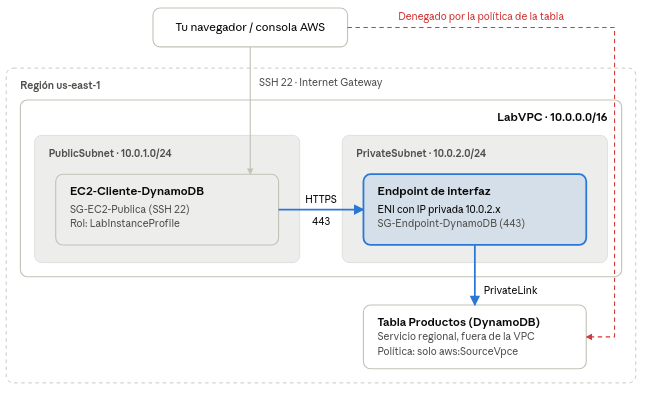

# Práctica: DynamoDB privado en LabVPC

## 1. Contexto, objetivos y arquitectura

En esta práctica crearemos una tabla DynamoDB accesible solo desde la subred privada de `LabVPC`, mediante un **VPC endpoint de interfaz** situado en `PrivateSubnet`, y trabaja con ella desde una EC2 en `PublicSubnet`.

**Idea clave antes de empezar.** DynamoDB es un servicio gestionado y regional: la tabla no se despliega dentro de una subred. Lo que sí se coloca en la subred privada es la *puerta de entrada* al servicio: el endpoint de interfaz crea una interfaz de red (ENI) con una IP privada `10.0.2.x`. *El contenido relacionado con la puerta de entrada se trabaja en el módulo de Redes correspondiente*. Después, una política de recursos en la tabla rechaza cualquier petición que no llegue por ese endpoint. El resultado práctico es una base de datos "privada".

El tráfico de datos va de la EC2 a la ENI del endpoint (10.0.2.x) y de ahí a DynamoDB por la red de AWS; lo que no entra por el endpoint, como la consola, se rechaza tras la tarea 6.

**Duración estimada:** 1,5 horas. *No es necesario realizarlo en una sola sesión, se puede pausar y retomar en sesiones consecutivas.*

**Entorno:** AWS Academy Learner Lab, región `us-east-1` (se usan `LabInstanceProfile` y el par de claves `vockey`).

**Objetivos de aprendizaje**

1. Diferenciar servicios desplegados en la VPC (EC2) de servicios regionales gestionados (DynamoDB).
2. Crear y configurar un VPC endpoint de interfaz y sus grupos de seguridad.
3. Diseñar una tabla DynamoDB con clave de partición y clave de ordenación.
4. Realizar operaciones CRUD, consultas (`Query`) y escaneos (`Scan`) desde la AWS CLI y desde Python (boto3).
5. Restringir el acceso a una tabla con una política basada en recursos y la condición `aws:SourceVpce`.

**Recursos que se crean**

| Recurso                  | Nombre                  | Dónde                       |
| ------------------------ | ----------------------- | --------------------------- |
| Grupo de seguridad       | `SG-EC2-Publica`        | LabVPC                      |
| Grupo de seguridad       | `SG-Endpoint-DynamoDB`  | LabVPC                      |
| VPC endpoint (Interface) | `vpce-dynamodb-privado` | PrivateSubnet (10.0.2.0/24) |
| Tabla DynamoDB           | `Productos`             | Región us-east-1            |
| Instancia EC2            | `EC2-Cliente-DynamoDB`  | PublicSubnet (10.0.1.0/24)  |

> La práctica se ha subido con la solución por si os encontráis con algún aspecto que no os permita avanzar. Mi recomendación es que intentéis hacer todas las tareas por vuestra cuenta salvo la 5 y la 6.

> **Las tareas 5 y 6, hacedlas guiándoos por las soluciones** pero intentando comprender cómo estamos haciendo en las consultas y entender cómo funciona la política que planteamos en la tarea 6.

## 2. Enunciado

La empresa ficticia *TecnoStock* quiere guardar su catálogo de productos en DynamoDB. Por seguridad, la tabla solo debe aceptar peticiones que lleguen por la red privada de la VPC. Una instancia EC2 en la subred pública actuará como cliente. Todo se hace desde la **consola de AWS**, salvo los comandos que se ejecutan dentro de la EC2.

**Tarea 0. Preparar la red.** Ejecuta el script `inicializar-entorno.sh` en AWS CloudShell. En la consola de VPC, comprueba y anota los IDs de la VPC, las dos subredes y las dos tablas de rutas.

**Tarea 1. Grupos de seguridad.** Crea dos grupos de seguridad en `LabVPC`:

- `SG-EC2-Publica`: permite SSH (22) desde tu IP y desde EC2 Instance Connect.
- `SG-Endpoint-DynamoDB`: permite HTTPS (443) **solo** desde `SG-EC2-Publica`.

**Tarea 2. Endpoint de DynamoDB en la subred privada.** Crea un VPC endpoint llamado vpce-dynamodb de tipo *Interface* para el servicio `com.amazonaws.us-east-1.dynamodb`, ubicado en `PrivateSubnet` y asociado a `SG-Endpoint-DynamoDB`. Anota su ID (`vpce-…`), su nombre DNS regional y la IP privada de su interfaz de red. Para crearlo debemos ir a: VPC > Punto de enlace > Crear punto de conexión.

**Tarea 3. Tabla DynamoDB.** Crea la tabla `Productos` con la configuración predeterminada:

- Clave de partición: `categoria` (String).
- Clave de ordenación: `id_producto` (String).

Inserta desde la consola estos tres elementos:

| categoria  | id\_producto | nombre          | precio (Number) | stock (Number) |
| ---------- | ------------ | --------------- | --------------- | -------------- |
| Portatiles | P-001        | Portátil 14" i5 | 749             | 10             |
| Portatiles | P-002        | Portátil 16" i7 | 1099            | 4              |
| Monitores  | M-001        | Monitor 27" QHD | 289             | 25             |

**Tarea 4. Instancia cliente.** Lanza una EC2 Amazon Linux 2023 (`t3.micro`) en `PublicSubnet`, con IP pública, el grupo `SG-EC2-Publica`, el par de claves `vockey` y el perfil de instancia `LabInstanceProfile`.

**Tarea 5. Trabajar con DynamoDB a través del endpoint.** Conéctate a la EC2 y, usando siempre el endpoint privado (`--endpoint-url`):

1. Comprueba que el nombre DNS del endpoint resuelve a una IP `10.0.2.x`.
2. Lista las tablas.
3. Inserta dos productos nuevos de la categoría `Perifericos`.
4. Recupera un producto concreto por su clave completa.
5. Consulta (`Query`) todos los productos de `Portatiles`.
6. Resta 2 unidades al stock de `P-002`, pero solo si queda stock suficiente.
7. Haz un `Scan` de los productos con precio superior a 300 €.
8. Borra uno de los periféricos.
9. Repite las operaciones de lectura con un pequeño script en Python (boto3).

**Tarea 6. Hacer la tabla privada.** Añade a la tabla una política basada en recursos que deniegue las operaciones de datos si la petición no llega por tu endpoint. Demuestra que:

- Desde la EC2, con `--endpoint-url`, todo sigue funcionando.
- Desde la EC2 sin `--endpoint-url`, la lectura se rechaza.
- Desde la consola (*Explorar elementos*), la lectura también se rechaza.

**Tarea 7. Preguntas y limpieza.** Responde a las preguntas de reflexión y elimina todos los recursos.

## Verificación, preguntas y limpieza

### Lista de comprobación

- [ ] El endpoint está *Available* y su ENI tiene una IP de `10.0.2.0/24`.
- [ ] `getent hosts` del nombre DNS del endpoint devuelve esa IP privada.
- [ ] `list-tables` con `--endpoint-url` muestra `Productos`.
- [ ] La segunda resta de stock sobre P-002 falla con `ConditionalCheckFailedException`.
- [ ] `productos.py` lista los portátiles y los productos con poco stock.
- [ ] Con la política de la tabla, las lecturas sin endpoint y desde la consola se deniegan.

### Preguntas de reflexión (con solución)

1. ¿Por qué no podemos "meter" la tabla DynamoDB en `PrivateSubnet` como hacemos con una EC2?
2. ¿Qué ocurre si quitas la regla HTTPS de `SG-Endpoint-DynamoDB`? 
3. ¿Por qué, antes de la tarea 6, funcionaba `aws dynamodb scan` sin `--endpoint-url`? 
4. Diferencias entre endpoint de tipo Gateway e Interface para DynamoDB.
5. ¿Qué aporta la condición `aws:SourceVpce` en la política de la tabla?
6. ¿Por qué la consulta de la tarea 5.5 es `Query` y la de 5.7 es `Scan`? ¿Cuál es más eficiente?
7. ¿Es necesario el NAT Gateway para esta práctica?

### Limpieza (en este orden)

1. **DynamoDB → Tables → Productos → Delete** (borra también la política de recursos).
2. **EC2 → Instances → EC2-Cliente-DynamoDB → Instance state → Terminate**.
3. **VPC → Endpoints → vpce-dynamodb-privado → Actions → Delete VPC endpoints**.
4. **VPC → NAT gateways → Delete** y espera a *Deleted*. Después, **Elastic IPs → Release Elastic IP addresses**.
5. Borra `SG-Endpoint-DynamoDB` y luego `SG-EC2-Publica` (en ese orden, porque el primero referencia al segundo).
6. **Internet gateways**: *Detach from VPC* y *Delete*.
7. **Your VPCs → LabVPC → Delete VPC**: elimina también subredes y tablas de rutas.

El NAT Gateway y la IP elástica son los recursos que más coste generan si se olvidan.

### Fuentes

- [AWS PrivateLink for DynamoDB (documentación AWS)](https://docs.aws.amazon.com/amazondynamodb/latest/developerguide/privatelink-interface-endpoints.html)
- [Simplify private connectivity to Amazon DynamoDB with AWS PrivateLink (AWS Database Blog)](https://aws.amazon.com/blogs/database/simplify-private-connectivity-to-amazon-dynamodb-with-aws-privatelink)
