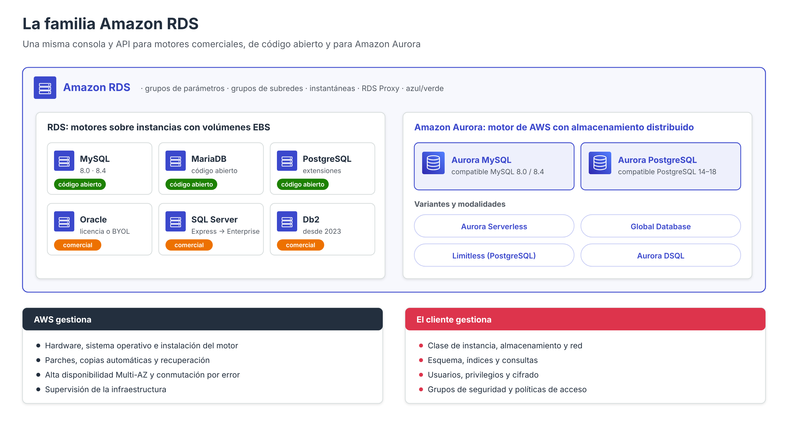
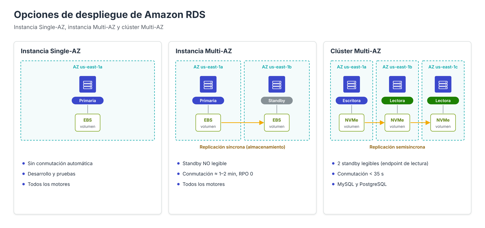

# Amazon RDS: visión general

**Amazon Relational Database Service (Amazon RDS)** es el servicio de AWS que permite desplegar, operar y escalar bases de datos relacionales en la nube sin necesidad de administrar el hardware, el sistema operativo ni la instalación del motor. Bajo el nombre RDS se agrupa en realidad una **familia de servicios**: por un lado, los motores comerciales y de código abierto que AWS ofrece en su versión «estándar» y, por otro, **Amazon Aurora**, un motor relacional diseñado por AWS para la nube y compatible con MySQL y PostgreSQL.

En este apartado se presenta una visión de conjunto del servicio. A continuación, el apartado de **elección de la región** recoge la decisión previa a cualquier despliegue; los apartados de **Creación de sistema RDS** describen en detalle cada decisión de configuración de una instancia; el apartado de **securización** profundiza en el control de acceso; el de **RDS Proxy** analiza la gestión de conexiones; y los apartados dedicados a **Aurora** estudian su arquitectura y sus variantes.

---

## Qué gestiona AWS y qué gestiona el cliente

RDS se sitúa en un punto intermedio entre instalar un motor de base de datos en una máquina virtual (por ejemplo, MySQL sobre EC2) y utilizar un servicio completamente sin servidor como DynamoDB. El reparto de responsabilidades es el siguiente:

| Tarea | Base de datos en EC2 | Amazon RDS / Aurora |
| --- | --- | --- |
| Hardware, red física, centro de datos | AWS | AWS |
| Sistema operativo e instalación del motor | Cliente | AWS |
| Parches del sistema operativo y del motor | Cliente | AWS (en la ventana de mantenimiento) |
| Copias de seguridad automáticas y recuperación a un momento dado | Cliente | AWS (configurables) |
| Alta disponibilidad y conmutación por error | Cliente | AWS (Multi-AZ, réplicas) |
| Supervisión de la infraestructura | Cliente | AWS (CloudWatch, Database Insights) |
| Elección de clase, almacenamiento y red | Cliente | **Cliente** |
| Diseño del esquema, índices y consultas | Cliente | **Cliente** |
| Usuarios, privilegios y seguridad de los datos | Cliente | **Cliente** |
| Reglas de red, cifrado y políticas de acceso | Cliente | **Cliente** |

Este reparto es una aplicación concreta del **modelo de responsabilidad compartida** de AWS: el proveedor es responsable de la seguridad *de* la nube, y el cliente de la seguridad *en* la nube. En RDS, **el cliente no tiene acceso al sistema operativo** de la instancia (no hay SSH) ni privilegios de superusuario completos en el motor; el usuario maestro dispone de los privilegios necesarios para administrar la base de datos, pero no de los que permitirían alterar la plataforma.

!!! note "RDS Custom"
    Para aplicaciones que necesitan acceso al sistema operativo o privilegios que RDS no concede (por ejemplo, ciertas aplicaciones empresariales de Oracle o SQL Server), AWS ofrece **Amazon RDS Custom**, una variante en la que el cliente asume parte de la administración del sistema a cambio de ese acceso.

---

## Motores disponibles

| Motor | Tipo | Observaciones |
| --- | --- | --- |
| **RDS for MySQL** | Código abierto | Versiones de la rama 8.0 y 8.4 |
| **RDS for MariaDB** | Código abierto | Motor utilizado en los apartados de creación de este módulo |
| **RDS for PostgreSQL** | Código abierto | Amplio catálogo de extensiones (PostGIS, pgvector, pgAudit…) |
| **RDS for Oracle** | Comercial | Licencia incluida o «trae tu propia licencia» (BYOL) |
| **RDS for SQL Server** | Comercial | Ediciones Express, Web, Standard y Enterprise |
| **RDS for Db2** | Comercial | Incorporado en 2023 |
| **Amazon Aurora MySQL** | Motor de AWS compatible con MySQL | Arquitectura de almacenamiento distribuido |
| **Amazon Aurora PostgreSQL** | Motor de AWS compatible con PostgreSQL | Arquitectura de almacenamiento distribuido |

La elección del motor depende de la compatibilidad requerida por las aplicaciones, de las licencias disponibles y de los requisitos de rendimiento y disponibilidad. Cambiar de motor posteriormente implica una **migración**, que puede apoyarse en servicios como AWS Database Migration Service (DMS).

---

## Conceptos básicos del servicio

| Concepto | Descripción |
| --- | --- |
| **Instancia de base de datos** (*DB instance*) | Entorno de base de datos aislado con una clase de cómputo, un almacenamiento y un punto de enlace DNS propios |
| **Clúster de base de datos** (*DB cluster*) | En Aurora y en los clústeres Multi-AZ, conjunto de instancias que comparten datos (una de escritura y varias de lectura) |
| **Clase de instancia** | Combinación de vCPU y memoria (`db.t4g`, `db.m7g`, `db.r7g`…), estudiada en el apartado de capacidad |
| **Punto de enlace** (*endpoint*) | Nombre DNS al que se conectan las aplicaciones (`mibd.xxxx.us-east-1.rds.amazonaws.com`) |
| **Grupo de subredes** | Subredes de la VPC, en al menos dos zonas de disponibilidad, donde RDS puede situar las instancias |
| **Grupo de parámetros** | Configuración del motor (equivalente a `my.cnf` o `postgresql.conf`) |
| **Grupo de opciones** | Funcionalidades adicionales del motor (sobre todo en Oracle, SQL Server y MySQL/MariaDB) |
| **Instantánea** (*snapshot*) | Copia de seguridad completa del almacenamiento, automática o manual |

### Almacenamiento

En RDS «estándar», cada instancia utiliza volúmenes **Amazon EBS** dedicados: SSD de propósito general (`gp3`, recomendado), SSD de IOPS aprovisionadas (`io2 Block Express`) o tipos de generaciones anteriores. El tamaño máximo es de **64 TiB** para MySQL, MariaDB, PostgreSQL y Db2; Oracle y SQL Server pueden alcanzar **256 TiB** mediante volúmenes de almacenamiento adicionales. En Aurora, como se verá, el almacenamiento no es un volumen EBS sino un **volumen de clúster distribuido** que crece automáticamente.

---

## Opciones de despliegue y alta disponibilidad

RDS ofrece tres modalidades de despliegue con distintos niveles de disponibilidad:

| Modalidad | Componentes | Replicación | ¿Standby legible? | Conmutación por error | Motores |
| --- | --- | --- | --- | --- | --- |
| **Instancia Single-AZ** | Una instancia | — | — | Sin conmutación automática; se recupera la instancia o se restaura una copia | Todos |
| **Instancia Multi-AZ** | Primaria + 1 *standby* en otra AZ | Síncrona a nivel de almacenamiento | **No** | Automática, normalmente en 1–2 minutos, sin pérdida de datos | Todos |
| **Clúster Multi-AZ** | Escritora + 2 *standby* legibles en 3 AZ | Semisíncrona | **Sí** (punto de enlace de lectura) | Automática, normalmente en menos de 35 segundos | MySQL y PostgreSQL |

Además de estas modalidades, pueden crearse **réplicas de lectura** (*read replicas*), que se alimentan mediante replicación asíncrona nativa del motor y sirven para **escalar las lecturas**, incluso en otras regiones. Una réplica de lectura puede **promocionarse** a instancia independiente, por ejemplo como parte de un plan de recuperación ante desastres.

!!! warning "No confundir alta disponibilidad con escalado"
    Como se desarrollará en el apartado de capacidad, la *standby* de una instancia Multi-AZ **no atiende consultas**: su única función es tomar el relevo en caso de fallo. Para repartir la carga de lectura se necesitan réplicas de lectura, un clúster Multi-AZ o Aurora.

---

## Amazon RDS frente a Amazon Aurora

Aurora forma parte de la familia RDS (se administra desde la misma consola y la misma API, y comparte conceptos como grupos de parámetros, grupos de subredes o instantáneas), pero su arquitectura es distinta:

| Aspecto | RDS (MySQL, MariaDB, PostgreSQL…) | Amazon Aurora |
| --- | --- | --- |
| Almacenamiento | Volumen EBS por instancia | Volumen de clúster compartido, 6 copias en 3 AZ |
| Crecimiento del almacenamiento | Se aprovisiona (con autoescalado opcional) | Automático, hasta 128–256 TiB según la versión; se paga por lo usado |
| Réplicas de lectura | Hasta 15 (según motor), replicación asíncrona del motor | Hasta 15, comparten el almacenamiento: retraso normalmente de milisegundos |
| Conmutación por error | 1–2 min (instancia Multi-AZ) | Normalmente menos de 30 s promocionando una réplica |
| Copias de seguridad | Instantáneas EBS | Continuas y sin impacto en el rendimiento |
| Funcionalidades exclusivas | — | Aurora Serverless, Global Database, clonado rápido, Backtrack (MySQL), Limitless (PostgreSQL)… |
| Coste | Menor en cargas pequeñas | Mayor por instancia, pero puede compensar en cargas exigentes |

En términos generales, RDS «estándar» es adecuado para cargas pequeñas o medianas, para motores comerciales o cuando se requiere la máxima compatibilidad con el motor original. Aurora está orientado a cargas de producción que exigen alta disponibilidad, escalado de lecturas y recuperación rápida.

---

## Herramientas de operación habituales

- **Implementaciones azul/verde** (*Blue/Green Deployments*): crean una copia sincronizada del entorno (verde) sobre la que aplicar cambios, como una actualización de versión principal, y permiten conmutar en segundos con mínima interrupción.
- **RDS Proxy**: grupo de conexiones gestionado que reduce la sobrecarga de conexiones y acelera la conmutación por error. Se presenta en el apartado de redes y se estudia en su propio apartado.
- **Database Insights** (antes Performance Insights): análisis de la carga de la base de datos, descrito en el apartado de monitorización del rendimiento.
- **AWS Backup**: gestión centralizada de copias de seguridad y retención.
- **AWS DMS**: migración homogénea o heterogénea de datos hacia RDS y Aurora.

---

## Referencias

- AWS. *What is Amazon Relational Database Service (Amazon RDS)?* — [Guía del usuario de RDS](https://docs.aws.amazon.com/AmazonRDS/latest/UserGuide/Welcome.html)
- AWS. *Shared responsibility model* — [Modelo de responsabilidad compartida](https://aws.amazon.com/compliance/shared-responsibility-model/)
- AWS. *Amazon RDS DB instance storage* — [Almacenamiento de RDS](https://docs.aws.amazon.com/AmazonRDS/latest/UserGuide/CHAP_Storage.html)
- AWS. *Amazon RDS for Oracle and SQL Server now support up to 256 TiB storage with additional storage volumes* (12/2025) — [Anuncio](https://aws.amazon.com/about-aws/whats-new/2025/12/rds-oracle-sql-server-256-tib-storage-support)
- AWS Database Blog. *Choose the right Amazon RDS deployment option: Single-AZ instance, Multi-AZ instance, or Multi-AZ database cluster* — [Artículo](https://aws.amazon.com/blogs/database/choose-the-right-amazon-rds-deployment-option-single-az-instance-multi-az-instance-or-multi-az-database-cluster)
- AWS. *Working with DB instance read replicas* — [Réplicas de lectura](https://docs.aws.amazon.com/AmazonRDS/latest/UserGuide/USER_ReadRepl.html)
- AWS. *Amazon RDS Custom* — [RDS Custom](https://docs.aws.amazon.com/AmazonRDS/latest/UserGuide/rds-custom.html)
- AWS. *Using Amazon RDS Blue/Green Deployments for database updates* — [Implementaciones azul/verde](https://docs.aws.amazon.com/AmazonRDS/latest/UserGuide/blue-green-deployments.html)
- AWS. *Amazon RDS FAQs* — [Preguntas frecuentes](https://aws.amazon.com/rds/faqs/)
