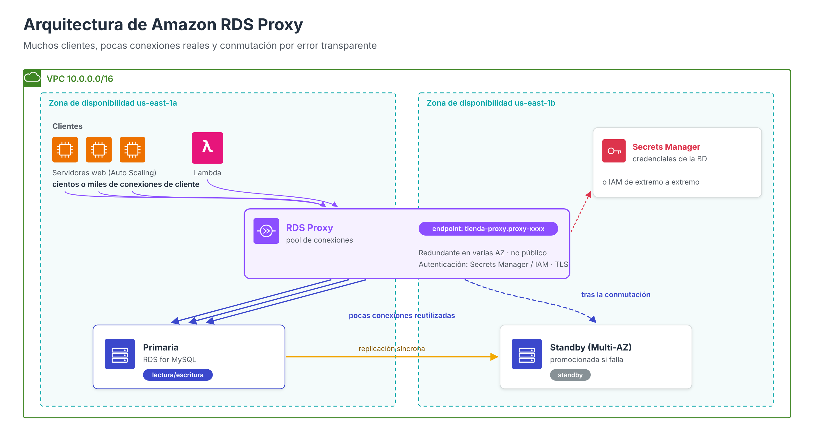
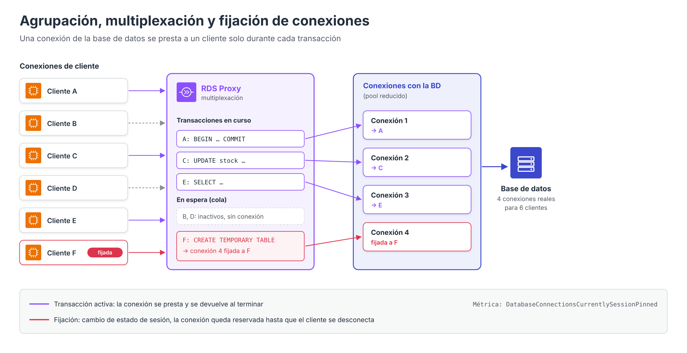
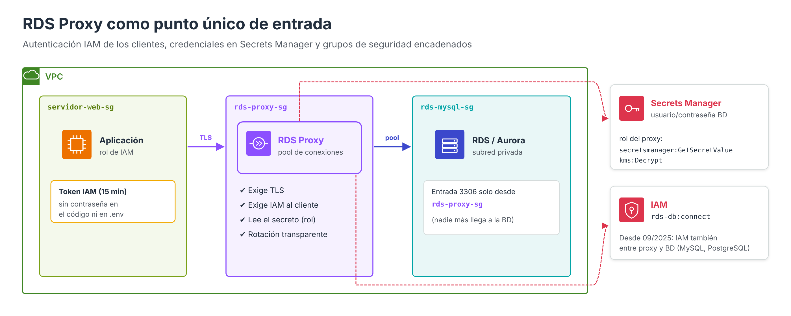

# Amazon RDS Proxy



En el apartado de redes se presentó brevemente **Amazon RDS Proxy** como una capa intermedia que reutiliza conexiones. Este apartado profundiza en el problema que resuelve, su funcionamiento interno (agrupación, multiplexación y fijación de conexiones), su papel en la alta disponibilidad y en la seguridad, y los parámetros que el administrador debe configurar.

---

## El problema: el coste de las conexiones

En un motor relacional, **cada conexión es un recurso caro**. Al abrirla, el servidor debe negociar TLS, autenticar al usuario y reservar memoria y, en el caso de PostgreSQL, crear un proceso del sistema operativo. Mientras permanece abierta, consume memoria aunque no ejecute ninguna consulta.

Este coste se vuelve crítico en arquitecturas modernas:

- **Aplicaciones con escalado automático**: si un grupo de Auto Scaling pasa de 4 a 40 servidores web y cada uno mantiene un *pool* de 20 conexiones, la base de datos pasa de 80 a 800 conexiones.
- **Funciones sin servidor (AWS Lambda)**: cada ejecución concurrente puede abrir su propia conexión, y ante un pico de tráfico se producen cientos o miles de aperturas en pocos segundos.
- **Aplicaciones que abren y cierran conexiones por petición**, como muchas aplicaciones PHP: el tiempo de establecimiento de la conexión puede superar al de la propia consulta.

El resultado típico es que la base de datos alcanza su límite `max_connections`, rechaza nuevas conexiones (`Too many connections`) o dedica buena parte de su CPU y memoria a gestionar conexiones en lugar de ejecutar consultas.

---

## Qué es RDS Proxy

**Amazon RDS Proxy** es un **proxy de base de datos totalmente gestionado y de alta disponibilidad** que se sitúa entre las aplicaciones y la base de datos. Las aplicaciones se conectan al **punto de enlace del proxy** como si fuera la base de datos, usando el mismo protocolo, puerto y controladores, por lo que en la mayoría de los casos **no es necesario modificar el código**: basta con cambiar el nombre del servidor en la configuración.

### Motores compatibles

| Familia | Motores |
| --- | --- |
| Amazon RDS | MySQL, MariaDB, PostgreSQL y SQL Server |
| Amazon Aurora | Aurora MySQL, Aurora PostgreSQL (incluido Aurora Serverless) |

La disponibilidad concreta depende de la versión del motor y de la región.

### Componentes

| Componente | Descripción |
| --- | --- |
| **Proxy** | Recurso que se crea en la VPC de la base de datos, en al menos dos subredes de distintas zonas de disponibilidad |
| **Grupo de destino** (*target group*) | Base de datos asociada al proxy: una instancia RDS, un clúster Multi-AZ o un clúster Aurora. Cada proxy tiene un único destino, aunque varios proxies pueden apuntar al mismo |
| **Punto de enlace predeterminado** | Nombre DNS de lectura y escritura (`mi-proxy.proxy-xxxx.us-east-1.rds.amazonaws.com`) |
| **Puntos de enlace adicionales** | Hasta 20 por proxy: de solo lectura (hacia las réplicas) o en otra VPC de la misma región |
| **Autenticación** | Secretos de AWS Secrets Manager (hasta 200 por proxy) o autenticación de IAM |
| **Grupo de seguridad** | Controla qué clientes pueden conectarse al proxy |

El proxy **no es accesible públicamente**: solo puede utilizarse desde la VPC en la que se crea, desde VPC conectadas o mediante puntos de enlace en otras VPC.

---

## Funcionamiento: agrupación y multiplexación



RDS Proxy mantiene un **conjunto de conexiones abiertas con la base de datos** (*connection pool*) y las comparte entre los clientes:

1. **Agrupación de conexiones** (*connection pooling*): las conexiones con la base de datos se abren una vez y se reutilizan. Cuando un cliente se conecta al proxy, no se crea una conexión nueva con la base de datos; el proxy autentica al cliente y le asigna una conexión ya existente.
2. **Multiplexación por transacción** (*multiplexing*): una conexión de la base de datos **solo se asigna a un cliente mientras dura una transacción**. Al terminar la transacción, la conexión vuelve al grupo y puede atender a otro cliente, aunque el primero siga conectado al proxy. De este modo, **cientos o miles de conexiones de clientes** pueden atenderse con **unas decenas de conexiones reales**.
3. **Cola y protección de la base de datos**: si todas las conexiones del grupo están ocupadas, las nuevas peticiones esperan en cola durante un tiempo máximo (*connection borrow timeout*) en lugar de saturar la base de datos. Superado ese tiempo, se rechazan.

| Sin RDS Proxy | Con RDS Proxy |
| --- | --- |
| Cada cliente abre su propia conexión con la base de datos | Los clientes se conectan al proxy; el proxy reutiliza un grupo reducido de conexiones |
| Los picos de tráfico se traducen en picos de conexiones | Los picos se absorben en la cola del proxy |
| Las conexiones inactivas ocupan memoria en la base de datos | Las conexiones inactivas solo existen entre el cliente y el proxy |
| Cada apertura implica TLS y autenticación en la base de datos | El proxy asume ese trabajo |

### Fijación de conexiones (*pinning*)

La multiplexación solo es segura si la conexión no conserva **estado de sesión** que pueda afectar a otro cliente. Cuando el proxy detecta una operación que modifica ese estado, **fija** (*pins*) la conexión de la base de datos a ese cliente hasta que se desconecte. Una conexión fijada no puede reutilizarse, por lo que un exceso de fijaciones anula la ventaja del proxy.

| Motor | Operaciones que provocan fijación (principales) |
| --- | --- |
| MySQL / MariaDB | `LOCK TABLES`, `GET_LOCK()`, sentencias `SET` de variables (con excepciones), tablas temporales, sentencias preparadas, comentarios ejecutables `/*! … */` |
| PostgreSQL | `SET` y `set_config`, `PREPARE`/`EXECUTE`, tablas o secuencias temporales, cursores, `LISTEN`, `DISCARD ALL`, `nextval`/`setval`, bloqueos consultivos de sesión |
| Todos | Sentencias de más de 16 KB |

Medidas para reducir la fijación:

- Vigilar la métrica de CloudWatch **`DatabaseConnectionsCurrentlySessionPinned`**.
- Trasladar los `SET` comunes a todas las conexiones a la **consulta de inicialización** del proxy (por ejemplo, `SET time_zone = '+00:00'; SET NAMES utf8mb4;`).
- En MySQL y MariaDB, activar los **filtros de fijación de sesión** (*session pinning filters*) cuando se sepa que ciertos cambios de variables no afectan a la aplicación.
- Evitar en el código, cuando no sean necesarias, las tablas temporales, los bloqueos con nombre o las sentencias preparadas del lado del servidor.

---

## Alta disponibilidad y conmutación por error

RDS Proxy mejora la disponibilidad percibida por las aplicaciones:

- El propio proxy es un servicio **redundante en varias zonas de disponibilidad**.
- Durante una **conmutación por error** de una instancia Multi-AZ o de un clúster Aurora, el proxy **mantiene abiertas las conexiones de los clientes**, detecta la nueva instancia primaria y redirige el tráfico hacia ella. Las aplicaciones no dependen de la propagación del cambio DNS del punto de enlace de la base de datos ni de su caché.
- Según AWS, el uso de RDS Proxy puede **reducir el tiempo de conmutación por error de Aurora hasta en un 66 %**.
- Las transacciones en curso en el momento del fallo se pierden y la aplicación debe reintentarlas, pero las conexiones inactivas sobreviven al cambio.

### Puntos de enlace de solo lectura

Por defecto, el punto de enlace del proxy envía todo el tráfico a la instancia de escritura. Para aprovechar las **réplicas de Aurora** o los *standby* legibles de un **clúster Multi-AZ**, se crea un **punto de enlace de solo lectura** del proxy, que reparte las conexiones entre los lectores disponibles y, si uno falla, traslada las sesiones multiplexadas a otro sin interrumpir la aplicación.

---

## RDS Proxy y la seguridad

Además de su función de rendimiento, RDS Proxy es una pieza de seguridad, como se adelantó en el apartado [Securización y control de acceso](RDS-Seguridad.md#rds-proxy-como-punto-de-control):

| Capacidad | Descripción |
| --- | --- |
| **Credenciales en Secrets Manager** | El proxy obtiene usuario y contraseña de la base de datos de un secreto. Las aplicaciones no necesitan conocer esas credenciales si se autentican con IAM |
| **Autenticación IAM de los clientes** | Puede exigirse que los clientes se conecten al proxy con un **token de IAM** (como en la autenticación IAM de RDS), aunque la base de datos utilice contraseñas |
| **IAM de extremo a extremo** | Desde septiembre de 2025, en MySQL y PostgreSQL, el proxy puede autenticarse **también contra la base de datos mediante IAM**, sin almacenar credenciales en Secrets Manager |
| **TLS obligatorio** | La opción *Require Transport Layer Security* rechaza las conexiones de clientes sin cifrar |
| **Punto único de entrada** | Si el grupo de seguridad de la base de datos solo admite tráfico desde el grupo de seguridad del proxy, todo acceso queda canalizado y registrado a través de él |
| **Rotación transparente** | Al rotar la contraseña en Secrets Manager, el proxy utiliza la nueva sin que las aplicaciones lo perciban |



La configuración de grupos de seguridad recomendada es la siguiente:

| Grupo de seguridad | Regla de entrada | Origen |
| --- | --- | --- |
| `rds-proxy-sg` (asociado al proxy) | TCP 3306 (o 5432) | `servidor-web-sg` |
| `rds-mysql-sg` (asociado a la base de datos) | TCP 3306 (o 5432) | `rds-proxy-sg` |

El proxy necesita además un **rol de IAM** que le permita leer los secretos (`secretsmanager:GetSecretValue`) y, si están cifrados con una clave administrada por el cliente, descifrarlos (`kms:Decrypt`).

---

## Parámetros de configuración principales

| Parámetro | Valor predeterminado | Significado |
| --- | --- | --- |
| **Conexiones máximas** (`MaxConnectionsPercent`) | 100 % | Porcentaje de `max_connections` de la base de datos que el proxy puede utilizar. Conviene reducirlo si otras aplicaciones o administradores se conectan directamente |
| **Conexiones inactivas máximas** (`MaxIdleConnectionsPercent`) | Proporcional al anterior | Conexiones que el proxy mantiene abiertas sin uso para atender picos |
| **Tiempo de espera de préstamo** (`ConnectionBorrowTimeout`) | 120 segundos | Tiempo que una petición espera en cola una conexión libre antes de fallar |
| **Tiempo de inactividad del cliente** (`IdleClientTimeout`) | 30 minutos | Tiempo tras el que el proxy cierra una conexión de cliente sin actividad |
| **Consulta de inicialización** (`InitQuery`) | Vacía | Sentencias `SET` que se ejecutan al abrir cada conexión con la base de datos |
| **Filtros de fijación de sesión** | Ninguno | Excepciones a la fijación (solo MySQL y MariaDB) |
| **Exigir TLS** | Desactivado | Rechaza conexiones de clientes sin cifrar |
| **Autenticación IAM** | Desactivada | Exige tokens de IAM a los clientes |

### Creación con la AWS CLI

```bash
aws rds create-db-proxy \
  --db-proxy-name tienda-proxy \
  --engine-family MYSQL \
  --auth '[{"AuthScheme":"SECRETS","SecretArn":"arn:aws:secretsmanager:us-east-1:111122223333:secret:tienda-db-XXXX","IAMAuth":"DISABLED"}]' \
  --role-arn arn:aws:iam::111122223333:role/rol-rds-proxy \
  --vpc-subnet-ids subnet-aaaa subnet-bbbb \
  --vpc-security-group-ids sg-proxy \
  --require-tls

aws rds register-db-proxy-targets \
  --db-proxy-name tienda-proxy \
  --db-instance-identifiers tienda-db-server
```

Una vez disponible, la aplicación solo cambia el nombre del servidor. En la práctica evaluable, la variable con el punto de enlace de RDS pasaría a contener `tienda-proxy.proxy-xxxx.us-east-1.rds.amazonaws.com`.

---

## Supervisión

RDS Proxy publica métricas en CloudWatch que permiten comprobar si está cumpliendo su función:

| Métrica | Qué indica |
| --- | --- |
| `ClientConnections` | Conexiones de clientes abiertas con el proxy |
| `DatabaseConnections` | Conexiones reales del proxy con la base de datos |
| `DatabaseConnectionsCurrentlySessionPinned` | Conexiones fijadas: si es alta, la multiplexación no es efectiva |
| `DatabaseConnectionsBorrowLatency` | Tiempo que tardan las peticiones en obtener una conexión del grupo |
| `QueryRequests` | Consultas recibidas por el proxy |

Una relación elevada entre `ClientConnections` y `DatabaseConnections` indica que la multiplexación funciona; si ambas cifras son similares, conviene revisar las causas de fijación.

---

## Cuándo utilizar RDS Proxy

| Escenario | ¿RDS Proxy? |
| --- | --- |
| Funciones AWS Lambda que acceden a RDS o Aurora | Muy recomendable |
| Aplicaciones con escalado automático y muchas conexiones concurrentes | Recomendable |
| Aplicaciones que abren y cierran conexiones con mucha frecuencia (PHP sin *pool* persistente) | Recomendable |
| Requisitos estrictos de disponibilidad ante conmutaciones por error | Recomendable |
| Centralizar credenciales y exigir IAM y TLS | Recomendable |
| Aplicación con pocas conexiones persistentes y estables | Aporta poco y añade coste |
| Uso intensivo de sentencias preparadas, tablas temporales o variables de sesión | Ventaja reducida por la fijación |

!!! note "Coste"
    RDS Proxy se factura por hora en función de la **capacidad de la base de datos de destino** (vCPU de las instancias o ACU en Aurora Serverless), con independencia del número de conexiones. Cada punto de enlace adicional implica además un punto de enlace de AWS PrivateLink con su propio coste. En entornos formativos conviene eliminarlo al terminar las prácticas.

---

## Referencias

- AWS. *Amazon RDS Proxy* — [Guía del usuario de RDS](https://docs.aws.amazon.com/AmazonRDS/latest/UserGuide/rds-proxy.html)
- AWS. *Amazon RDS Proxy for Aurora* — [Guía del usuario de Aurora](https://docs.aws.amazon.com/AmazonRDS/latest/AuroraUserGuide/rds-proxy.html)
- AWS. *RDS Proxy concepts and terminology* — [Conceptos: agrupación, multiplexación y conmutación por error](https://docs.aws.amazon.com/AmazonRDS/latest/UserGuide/rds-proxy.howitworks.html)
- AWS. *Avoiding pinning an RDS Proxy* — [Fijación de conexiones](https://docs.aws.amazon.com/AmazonRDS/latest/UserGuide/rds-proxy-pinning.html)
- AWS. *Working with Amazon RDS Proxy endpoints* — [Puntos de enlace del proxy](https://docs.aws.amazon.com/AmazonRDS/latest/UserGuide/rds-proxy-endpoints.html)
- AWS. *Setting up network prerequisites and database credentials for RDS Proxy* — [Requisitos de red y credenciales](https://docs.aws.amazon.com/AmazonRDS/latest/UserGuide/rds-proxy-setup.html)
- AWS. *Amazon RDS Proxy announces support for end-to-end IAM authentication* (12/09/2025) — [Anuncio](https://aws.amazon.com/about-aws/whats-new/2025/09/amazon-rds-proxy-end-to-end-iam-authentication)
- AWS. *Monitoring RDS Proxy metrics with Amazon CloudWatch* — [Métricas](https://docs.aws.amazon.com/AmazonRDS/latest/UserGuide/rds-proxy.monitoring.html)
- AWS. *AWS CLI Command Reference: create-db-proxy* — [create-db-proxy](https://awscli.amazonaws.com/v2/documentation/api/latest/reference/rds/create-db-proxy.html)
- AWS. *Amazon Aurora FAQ: availability and durability* (reducción del tiempo de conmutación) — [Preguntas frecuentes](https://docs.aws.amazon.com/rds/latest/auroraextendedcontent/aurora-faq-availability-and-durability.html)
- AWS. *Amazon RDS Proxy pricing* — [Precios](https://aws.amazon.com/rds/proxy/pricing/)
