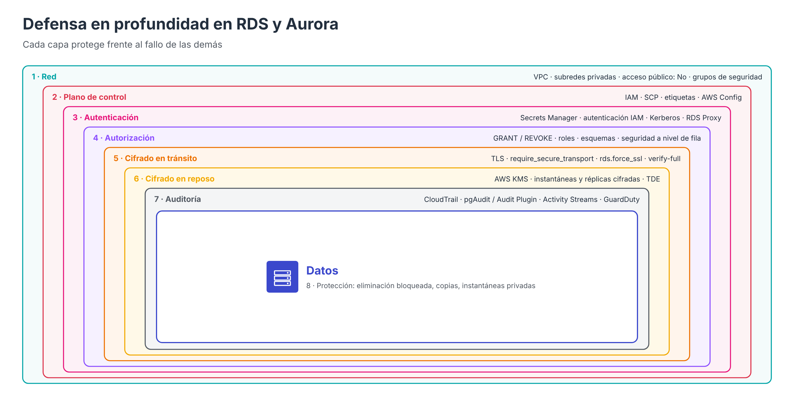
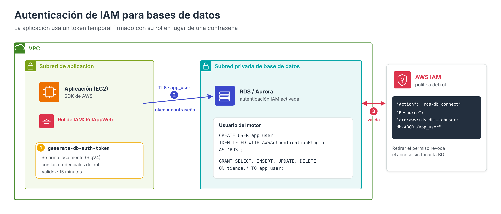

# Securización y control de acceso en RDS y Aurora



En los apartados de creación se presentaron, de forma introductoria, las decisiones de seguridad que se toman al desplegar una instancia: credenciales, red, grupos de seguridad, certificados y cifrado. Este apartado las aborda **en profundidad y de forma integrada**, aplicadas tanto a RDS como a Aurora, y añade los mecanismos de control de acceso que no forman parte del asistente de creación.

A diferencia de DynamoDB, cuya protección se apoya principalmente en IAM porque se accede a través de una API pública, **una base de datos RDS o Aurora reside en la VPC y se accede a ella mediante el protocolo nativo del motor**. Por ello su seguridad combina dos mundos que conviene distinguir con claridad:

- **El plano de control**: quién puede crear, modificar, detener, copiar o eliminar instancias, clústeres e instantáneas. Lo gobierna **IAM**.
- **El plano de datos**: quién puede conectarse a la base de datos y qué puede hacer con los datos. Lo gobiernan **la red, la autenticación del motor y los privilegios SQL**, con IAM como mecanismo de autenticación opcional.

---

## Modelo de seguridad por capas

| Capa                           | Pregunta que responde                                          | Mecanismos                                                                          |
| ------------------------------ | -------------------------------------------------------------- | ----------------------------------------------------------------------------------- |
| **1. Red**                     | ¿Desde dónde se puede llegar a la base de datos?               | VPC, subredes privadas, acceso público desactivado, grupos de seguridad, ACL de red |
| **2. Plano de control**        | ¿Quién puede administrar los recursos RDS?                     | Políticas de IAM, SCP, etiquetas, AWS Config                                        |
| **3. Autenticación**           | ¿Quién es quien se conecta?                                    | Usuarios del motor, Secrets Manager, autenticación IAM, Kerberos                    |
| **4. Autorización**            | ¿Qué puede hacer dentro de la base de datos?                   | `GRANT`/`REVOKE`, roles, esquemas, seguridad a nivel de fila                        |
| **5. Cifrado en reposo**       | ¿Qué ocurre si alguien accede al almacenamiento o a una copia? | AWS KMS (y TDE en Oracle y SQL Server)                                              |
| **6. Cifrado en tránsito**     | ¿Puede alguien leer o suplantar la comunicación?               | TLS, certificados de la CA de RDS, parámetros que lo exigen                         |
| **7. Auditoría y detección**   | ¿Qué ha pasado y quién lo ha hecho?                            | CloudTrail, registros de auditoría, Database Activity Streams, GuardDuty            |
| **8. Protección de los datos** | ¿Se pueden perder o filtrar los datos?                         | Protección contra eliminación, copias de seguridad, control de instantáneas         |

Ninguna capa es suficiente por sí sola. El objetivo es que el fallo de una de ellas (una regla de red demasiado amplia, una contraseña filtrada) no sea suficiente para comprometer la información.

---

## 1. Aislamiento de red

### Subredes privadas y acceso público

La medida más eficaz es que la base de datos **no sea alcanzable desde Internet**. Para ello:

1. La instancia o el clúster se despliegan en un **grupo de subredes formado por subredes privadas**, sin ruta hacia un Internet Gateway.
2. La opción **Accesible públicamente** (*Publicly accessible*) se establece en **No**. Con esta opción, el punto de enlace DNS resuelve únicamente a la dirección IP privada.

Si la opción estuviera en **Sí**, el punto de enlace resolvería a una IP pública fuera de la VPC; aun así, la conexión solo prosperaría si la instancia está en una subred con ruta a Internet **y** el grupo de seguridad lo permite. Es decir, el acceso público requiere un error en **tres** configuraciones a la vez, pero basta con evitar una de ellas para impedirlo. La práctica recomendada es no tener ninguna.

### Grupos de seguridad

El grupo de seguridad asociado a la base de datos debe admitir **únicamente el puerto del motor** y **únicamente desde los orígenes necesarios**, preferiblemente referenciando **otros grupos de seguridad** en lugar de rangos de direcciones IP:

| Tipo         | Puerto | Origen              | Comentario                                                               |
| ------------ | ------ | ------------------- | ------------------------------------------------------------------------ |
| MySQL/Aurora | 3306   | `servidor-web-sg`   | Servidores de aplicación (técnica que usaremos en la práctica evaluable) |
| MySQL/Aurora | 3306   | `rds-proxy-sg`      | Si se usa RDS Proxy, solo el proxy accede a la base de datos             |
| MySQL/Aurora | 3306   | `administracion-sg` | Instancia de administración o bastión                                    |
| MySQL/Aurora | 3306   | `0.0.0.0/0`         | ❌ **Nunca**: expone el puerto a todo Internet                            |

Referenciar un grupo de seguridad tiene una ventaja importante: si se añaden o sustituyen servidores web (por ejemplo, en un grupo de Auto Scaling), siguen teniendo acceso sin modificar la regla, y ningún otro recurso de la VPC lo obtiene.

### Acceso administrativo sin exponer la base de datos

Para que un administrador se conecte desde su equipo a una base de datos privada existen alternativas que no requieren abrir la base de datos a Internet:

- **Instancia de salto (bastión)** en una subred pública, como la EC2 utilizada en las prácticas para importar el script SQL.
- **Reenvío de puertos con AWS Systems Manager Session Manager**, que crea un túnel cifrado hasta la base de datos a través de una instancia gestionada **sin abrir ningún puerto de entrada** ni gestionar claves SSH:

```bash
aws ssm start-session --target i-0123456789abcdef0 \
  --document-name AWS-StartPortForwardingSessionToRemoteHost \
  --parameters '{"host":["mibd.xxxx.us-east-1.rds.amazonaws.com"],"portNumber":["3306"],"localPortNumber":["13306"]}'
# Después, desde el equipo local: mysql -h 127.0.0.1 -P 13306 -u admin -p
```

- **VPN** de sitio a sitio o de cliente, o **AWS Direct Connect**, en entornos híbridos.

### Punto de enlace de VPC para la API de RDS

Las operaciones de administración (crear, modificar, describir) se realizan contra la **API de RDS**, que, como la de DynamoDB, es un servicio público. Si los recursos que administran RDS no tienen salida a Internet, puede crearse un **punto de enlace de VPC de tipo interfaz** para `com.amazonaws.<región>.rds`. Este punto de enlace afecta **solo al plano de control**: las conexiones SQL a la base de datos ya se realizan siempre dentro de la VPC.

---

## 2. Control de acceso al plano de control con IAM

Las acciones de administración de RDS tienen el prefijo `rds:` (`rds:CreateDBInstance`, `rds:ModifyDBCluster`, `rds:DeleteDBInstance`, `rds:CreateDBSnapshot`, `rds:ModifyDBSnapshotAttribute`, etc.). IAM permite aplicar sobre ellas el **principio de mínimo privilegio** y condiciones específicas del servicio.

!!! warning "IAM no protege los datos por sí solo"
    Un usuario sin ningún permiso IAM sobre RDS puede **leer y modificar los datos** si conoce un usuario y una contraseña del motor y tiene conectividad de red. Por el contrario, un usuario con `rds:*` puede **eliminar** la base de datos, **restablecer la contraseña del usuario maestro** (`ModifyDBInstance`) o **compartir una instantánea** con otra cuenta. Ambos planos deben protegerse.

### Ejemplo: separación por entornos y requisitos obligatorios

La siguiente política basada en identidad permite a un equipo de desarrollo gestionar las instancias etiquetadas como `entorno = desarrollo`, le impide eliminar las de producción y obliga a que cualquier instancia nueva esté cifrada y use clases pequeñas:

```json
{
  "Version": "2012-10-17",
  "Statement": [
    {
      "Sid": "ConsultarTodo",
      "Effect": "Allow",
      "Action": ["rds:Describe*", "rds:ListTagsForResource"],
      "Resource": "*"
    },
    {
      "Sid": "GestionarSoloDesarrollo",
      "Effect": "Allow",
      "Action": ["rds:RebootDBInstance", "rds:StartDBInstance", "rds:StopDBInstance", "rds:ModifyDBInstance"],
      "Resource": "arn:aws:rds:us-east-1:111122223333:db:*",
      "Condition": { "StringEquals": { "rds:db-tag/entorno": "desarrollo" } }
    },
    {
      "Sid": "CrearSoloCifradasYPequenas",
      "Effect": "Allow",
      "Action": "rds:CreateDBInstance",
      "Resource": "*",
      "Condition": {
        "Bool": { "rds:StorageEncrypted": "true" },
        "StringLike": { "rds:DatabaseClass": ["db.t4g.*", "db.t3.*"] }
      }
    },
    {
      "Sid": "NuncaBorrarProduccion",
      "Effect": "Deny",
      "Action": ["rds:DeleteDBInstance", "rds:DeleteDBCluster"],
      "Resource": "*",
      "Condition": { "StringEquals": { "rds:db-tag/entorno": "produccion" } }
    }
  ]
}
```

En organizaciones con varias cuentas, restricciones como «no se permiten instancias sin cifrar» o «nadie puede eliminar bases de datos de producción» se aplican mejor como **políticas de control de servicios (SCP)** de AWS Organizations, que afectan a todas las identidades de la cuenta, incluidas las administradoras.

!!! info "Entorno AWS Academy"
    En el Learner Lab no es posible crear políticas de IAM, por lo que estos ejemplos tienen carácter ilustrativo. Los mecanismos del plano de datos (red, usuarios del motor, privilegios, TLS) sí pueden aplicarse íntegramente.

---

## 3. Autenticación en la base de datos

RDS y Aurora admiten tres mecanismos de autenticación, que pueden convivir en la misma base de datos para usuarios distintos:

| Mecanismo                | Credencial                                       | Motores                                             | Uso típico                                                |
| ------------------------ | ------------------------------------------------ | --------------------------------------------------- | --------------------------------------------------------- |
| **Contraseña del motor** | Usuario y contraseña almacenados en el motor     | Todos                                               | Opción universal; recomendable con Secrets Manager        |
| **Autenticación de IAM** | Token temporal firmado con credenciales de IAM   | MySQL, MariaDB, PostgreSQL y Aurora                 | Aplicaciones en AWS con roles de IAM, sin contraseñas     |
| **Kerberos**             | Tique Kerberos de un directorio Active Directory | SQL Server, Oracle, PostgreSQL, MySQL, Db2 y Aurora | Organizaciones con identidades corporativas centralizadas |

### El usuario maestro y AWS Secrets Manager

El usuario maestro tiene los máximos privilegios disponibles y **no debe utilizarse en las aplicaciones**. Su contraseña debe gestionarse preferiblemente con la integración nativa de **Secrets Manager** (opción *Administrado en AWS Secrets Manager* o parámetro `--manage-master-user-password`):

- RDS genera una contraseña robusta y la guarda en un secreto que **nadie tiene que conocer ni escribir**.
- La contraseña se **rota automáticamente** (cada 7 días por defecto, configurable).
- El acceso al secreto se controla con IAM (`secretsmanager:GetSecretValue`) y queda registrado en CloudTrail.
- El secreto se cifra con una clave de KMS que puede ser administrada por el cliente.

Para los **usuarios de aplicación**, Secrets Manager permite igualmente almacenar las credenciales y rotarlas mediante funciones Lambda, de modo que las aplicaciones obtengan la contraseña en tiempo de ejecución en lugar de guardarla en un fichero de configuración como `.env`.

### Autenticación de IAM para bases de datos



Con la autenticación de IAM, la aplicación **no utiliza contraseña**. En su lugar:

1. La aplicación, que se ejecuta con un **rol de IAM** (por ejemplo, el perfil de instancia de una EC2), solicita al SDK un **token de autenticación**. El token se genera **localmente**, firmando la petición con las credenciales del rol (SigV4); no requiere llamar a ningún servicio.
2. La aplicación se conecta a la base de datos usando el token como contraseña, **obligatoriamente mediante TLS**.
3. RDS valida la firma y comprueba que la identidad tiene permiso `rds-db:connect` sobre ese usuario de base de datos.

Pasos de configuración:

**a) Activar la autenticación de IAM** en la instancia o el clúster (opción *Autenticación de contraseña y de IAM de la base de datos* o `--enable-iam-database-authentication`).

**b) Crear el usuario en el motor** indicando que se autentica con IAM:

```sql
-- MySQL / MariaDB / Aurora MySQL
CREATE USER app_user IDENTIFIED WITH AWSAuthenticationPlugin AS 'RDS';
GRANT SELECT, INSERT, UPDATE, DELETE ON tienda.* TO app_user;

-- PostgreSQL / Aurora PostgreSQL
CREATE USER app_user;
GRANT rds_iam TO app_user;
GRANT CONNECT ON DATABASE tienda TO app_user;
```

**c) Conceder al rol de IAM** el permiso `rds-db:connect` sobre ese usuario. El recurso incluye el **identificador de recurso** de la instancia (`db-…`) o del clúster (`cluster-…`), que se consulta en la pestaña *Configuración*:

```json
{
  "Version": "2012-10-17",
  "Statement": [
    {
      "Effect": "Allow",
      "Action": "rds-db:connect",
      "Resource": "arn:aws:rds-db:us-east-1:111122223333:dbuser:db-ABCDEFGHIJKLMNOP0123456789/app_user"
    }
  ]
}
```

**d) Generar el token y conectar**:

```bash
TOKEN=$(aws rds generate-db-auth-token \
  --hostname mibd.xxxx.us-east-1.rds.amazonaws.com --port 3306 \
  --username app_user --region us-east-1)

mysql -h mibd.xxxx.us-east-1.rds.amazonaws.com -P 3306 -u app_user \
  --password="$TOKEN" --enable-cleartext-plugin \
  --ssl-mode=VERIFY_IDENTITY --ssl-ca=global-bundle.pem
```

Ventajas y limitaciones:

| Ventajas                                                         | Limitaciones                                                                    |
| ---------------------------------------------------------------- | ------------------------------------------------------------------------------- |
| No hay contraseñas que almacenar, rotar ni filtrar               | El token caduca a los **15 minutos** (solo afecta a nuevas conexiones)          |
| Credenciales temporales del rol, renovadas automáticamente       | Requiere memoria adicional en la instancia (300–1 000 MiB)                      |
| Control centralizado: retirar el permiso de IAM revoca el acceso | No admite las claves de condición de red (`aws:SourceIp`, `aws:SourceVpce`…)    |
| Conexión siempre cifrada                                         | Las generaciones de tokens no quedan registradas en CloudTrail                  |
|                                                                  | En PostgreSQL, un usuario con `rds_iam` ya no puede autenticarse con contraseña |

AWS recomienda este mecanismo cuando el número de **conexiones nuevas por segundo** es moderado; para aplicaciones con muchas conexiones cortas, se combina con **RDS Proxy**.

### RDS Proxy como punto de control

Además de agrupar conexiones (como se vio en el apartado de redes), RDS Proxy aporta seguridad:

- El proxy obtiene las credenciales de la base de datos de **Secrets Manager**; las aplicaciones no necesitan conocerlas.
- Puede **exigir autenticación de IAM** a los clientes aunque la base de datos utilice contraseñas.
- Puede **exigir TLS** en todas las conexiones de los clientes.
- Si el grupo de seguridad de la base de datos solo admite al proxy, este se convierte en la **única puerta de entrada**.

### RDS Data API (Aurora)

Aurora ofrece una **API HTTPS** (*RDS Data API*) que permite ejecutar sentencias SQL sin abrir conexiones del protocolo nativo. Cada llamada se autoriza con IAM y utiliza las credenciales almacenadas en Secrets Manager, lo que resulta útil para funciones Lambda y aplicaciones sin estado.

---

## 4. Autorización dentro del motor

Una vez autenticado, lo que un usuario puede hacer lo determinan exclusivamente los **privilegios del motor**. IAM no interviene en este nivel.

### Principios

- **Un usuario por aplicación** (y, si es posible, por función: lectura, escritura, migraciones), nunca el usuario maestro.
- **Privilegios mínimos**: solo las operaciones y los objetos necesarios.
- **Uso de roles** para agrupar privilegios y asignarlos a usuarios.
- **Restricción del origen** del usuario, cuando el motor lo permita.
- **Exigir TLS por usuario** en los usuarios sensibles.

### MySQL, MariaDB y Aurora MySQL

```sql
-- Rol con los privilegios de la aplicación
CREATE ROLE 'rol_tienda_rw';
GRANT SELECT, INSERT, UPDATE, DELETE ON tienda.* TO 'rol_tienda_rw';

-- Usuario limitado a la red de los servidores web y obligado a usar TLS
CREATE USER 'tienda_user'@'10.0.%' IDENTIFIED BY '********' REQUIRE SSL;
GRANT 'rol_tienda_rw' TO 'tienda_user'@'10.0.%';
SET DEFAULT ROLE 'rol_tienda_rw' TO 'tienda_user'@'10.0.%';

-- Usuario de solo lectura para informes
CREATE USER 'informes'@'10.0.%' IDENTIFIED BY '********' REQUIRE SSL;
GRANT SELECT ON tienda.* TO 'informes'@'10.0.%';

SHOW GRANTS FOR 'tienda_user'@'10.0.%';
```

### PostgreSQL y Aurora PostgreSQL

```sql
-- Impedir que cualquier usuario cree objetos en el esquema public
REVOKE CREATE ON SCHEMA public FROM PUBLIC;
REVOKE ALL ON DATABASE tienda FROM PUBLIC;

-- Rol de aplicación sin capacidad de inicio de sesión
CREATE ROLE rol_tienda_rw NOLOGIN;
GRANT CONNECT ON DATABASE tienda TO rol_tienda_rw;
GRANT USAGE ON SCHEMA public TO rol_tienda_rw;
GRANT SELECT, INSERT, UPDATE, DELETE ON ALL TABLES IN SCHEMA public TO rol_tienda_rw;
ALTER DEFAULT PRIVILEGES IN SCHEMA public
  GRANT SELECT, INSERT, UPDATE, DELETE ON TABLES TO rol_tienda_rw;

-- Usuario que hereda el rol
CREATE USER tienda_user WITH PASSWORD '********' IN ROLE rol_tienda_rw;
```

PostgreSQL ofrece además **seguridad a nivel de fila** (*Row-Level Security*), que permite que cada usuario vea únicamente las filas que le corresponden mediante políticas definidas en la propia tabla, una idea análoga a la condición `dynamodb:LeadingKeys` estudiada en DynamoDB.

---

## 5. Cifrado en reposo

El cifrado en reposo de RDS y Aurora utiliza **AWS KMS** y protege de forma transparente:

- El almacenamiento de la instancia o el volumen del clúster.
- Las copias de seguridad automáticas y las instantáneas.
- Las réplicas de lectura y los registros.

Aspectos que deben tenerse en cuenta:

| Aspecto                                         | Comportamiento                                                                               |
| ----------------------------------------------- | -------------------------------------------------------------------------------------------- |
| Momento de la decisión                          | Se elige **al crear** la instancia o el clúster; no puede desactivarse después               |
| Cifrar una base de datos existente sin cifrar   | Crear una instantánea → **copiarla activando el cifrado** → restaurarla como instancia nueva |
| Réplicas en otra región                         | Requieren una clave de KMS en la región de destino                                           |
| Compartir instantáneas cifradas con otra cuenta | Solo es posible con una **clave administrada por el cliente**, compartiendo también la clave |
| Revocar el acceso                               | Deshabilitar la clave administrada por el cliente deja la base de datos inaccesible          |

Oracle y SQL Server admiten, además, **cifrado transparente de datos (TDE)** a nivel del motor mediante grupos de opciones.

---

## 6. Cifrado en tránsito

Las conexiones entre las aplicaciones y la base de datos deben cifrarse con **TLS** y, preferiblemente, **verificar la identidad del servidor**. RDS firma los certificados de cada instancia con su propia autoridad de certificación (por ejemplo, `rds-ca-rsa2048-g1`), y AWS publica el paquete de certificados raíz `global-bundle.pem` que los clientes deben utilizar para la verificación, como se hizo en la práctica evaluable.

### Exigir TLS en el servidor

| Motor                          | Parámetro (grupo de parámetros)                         | Valor                                          |
| ------------------------------ | ------------------------------------------------------- | ---------------------------------------------- |
| MySQL / Aurora MySQL 3         | `require_secure_transport`                              | `ON`                                           |
| Aurora MySQL 8.4               | Exigido por defecto en clústeres nuevos (TLS 1.2 y 1.3) | —                                              |
| MariaDB                        | `require_secure_transport`                              | `ON`                                           |
| PostgreSQL / Aurora PostgreSQL | `rds.force_ssl`                                         | `1` (valor predeterminado desde PostgreSQL 15) |
| SQL Server                     | `rds.force_ssl`                                         | `1`                                            |

En MySQL y MariaDB también puede exigirse por usuario con `REQUIRE SSL`, como se mostró en el apartado de autorización.

### Verificar el servidor desde el cliente

Cifrar no es lo mismo que **verificar**. Un cliente que cifra pero no verifica el certificado es vulnerable a ataques de intermediario (*man-in-the-middle*):

| Cliente | Solo cifra            | Cifra y verifica la identidad del servidor              |
| ------- | --------------------- | ------------------------------------------------------- |
| `mysql` | `--ssl-mode=REQUIRED` | `--ssl-mode=VERIFY_IDENTITY --ssl-ca=global-bundle.pem` |
| `psql`  | `sslmode=require`     | `sslmode=verify-full sslrootcert=global-bundle.pem`     |

En el laboratorio puede bastar con `--ssl-mode=REQUIRED`, pero en producción debe utilizarse la verificación completa. La [chuleta de comandos](Chuleta.md#clientes-de-base-de-datos) recoge ambas formas de conexión.

!!! note "Rotación de la autoridad de certificación"
    Los certificados de la CA de RDS tienen fecha de caducidad. Cuando AWS publica una nueva CA, el administrador debe **actualizar el certificado de la instancia** (opción *Autoridad de certificación* al modificarla) y **distribuir el nuevo paquete** a los clientes que verifican el servidor.

---

## 7. Auditoría y detección

| Herramienta                                          | Qué registra                                                                                                              | Observaciones                                                                                                                                                       |
| ---------------------------------------------------- | ------------------------------------------------------------------------------------------------------------------------- | ------------------------------------------------------------------------------------------------------------------------------------------------------------------- |
| **AWS CloudTrail**                                   | Llamadas a la API de RDS (plano de control): quién creó, modificó, eliminó o compartió recursos                           | Activo por defecto                                                                                                                                                  |
| **Registros del motor exportados a CloudWatch Logs** | Errores, consultas lentas, conexiones y, con auditoría, sentencias ejecutadas                                             | MySQL/MariaDB: *MariaDB Audit Plugin* (grupo de opciones); Aurora MySQL: auditoría avanzada (`server_audit_logging`); PostgreSQL: extensión `pgAudit`               |
| **Database Activity Streams**                        | Flujo casi en tiempo real de la actividad de la base de datos hacia Amazon Kinesis                                        | Disponible en Aurora y en RDS for Oracle y SQL Server; **cifrado y fuera del control de los administradores de la base de datos**, lo que permite separar funciones |
| **Amazon GuardDuty – RDS Protection**                | Analiza la actividad de inicio de sesión (y, en PostgreSQL, la actividad de datos) para detectar comportamientos anómalos | Detecta, por ejemplo, ataques de fuerza bruta o accesos desde direcciones maliciosas                                                                                |
| **AWS Config y Security Hub**                        | Evalúan continuamente la configuración                                                                                    | Reglas como `rds-instance-public-access-check`, `rds-storage-encrypted` o `rds-snapshots-public-prohibited`                                                         |

---

## 8. Protección de los datos y de las instantáneas

- **Protección contra eliminación**: impide borrar la instancia o el clúster hasta que se desactive (descrita en el apartado de monitorización y copias de seguridad).
- **Copias de seguridad automáticas** con un periodo de retención adecuado y, para requisitos de cumplimiento, **AWS Backup** con almacenes bloqueados (*Vault Lock*), que impiden borrar copias incluso a los administradores.
- **Instantáneas compartidas**: las instantáneas manuales pueden compartirse con otras cuentas e incluso hacerse **públicas** (solo si no están cifradas). Una instantánea pública permite a cualquier cuenta de AWS restaurar la base de datos completa, por lo que la acción `rds:ModifyDBSnapshotAttribute` debe restringirse y vigilarse.

---

## Lista de comprobación

| Control                                                  | RDS                        | Aurora | En la práctica evaluable           |
| -------------------------------------------------------- | -------------------------- | ------ | ---------------------------------- |
| Subredes privadas en varias AZ                           | ✔                          | ✔      | Grupo de subredes de base de datos |
| Accesible públicamente: No                               | ✔                          | ✔      | ✔                                  |
| Grupo de seguridad que referencia el SG de la aplicación | ✔                          | ✔      | `rds-mysql-sg` ← `servidor-web-sg` |
| Usuario maestro en Secrets Manager                       | ✔                          | ✔      | Opcional                           |
| Usuario de aplicación con privilegios mínimos            | ✔                          | ✔      | `tienda_user`                      |
| Autenticación de IAM (opcional)                          | MySQL, MariaDB, PostgreSQL | ✔      | —                                  |
| Cifrado en reposo con KMS                                | ✔                          | ✔      | ✔                                  |
| TLS exigido en el servidor y verificado en el cliente    | ✔                          | ✔      | `--ssl-verify-server-cert`         |
| Auditoría exportada a CloudWatch Logs                    | ✔                          | ✔      | Opcional                           |
| Protección contra eliminación                            | ✔                          | ✔      | Recomendado                        |

---

## Comparativa con DynamoDB

| Aspecto                     | RDS / Aurora                               | DynamoDB                                   |
| --------------------------- | ------------------------------------------ | ------------------------------------------ |
| Acceso a los datos          | Protocolo del motor dentro de la VPC       | API HTTPS pública                          |
| Perímetro principal         | **Red** (subredes, grupos de seguridad)    | **Identidad** (IAM)                        |
| Autenticación               | Usuarios del motor, IAM opcional, Kerberos | Exclusivamente IAM                         |
| Autorización de datos       | `GRANT`/`REVOKE` en el motor               | Políticas de IAM y de recursos             |
| Restringir el origen de red | Grupos de seguridad                        | Puntos de enlace de VPC + `aws:SourceVpce` |
| Cifrado en reposo           | Opcional, elegido al crear                 | Siempre activo                             |

---

## Referencias

- AWS. *Security in Amazon RDS* — [Seguridad en RDS](https://docs.aws.amazon.com/AmazonRDS/latest/UserGuide/UsingWithRDS.html)
- AWS. *Security in Amazon Aurora* — [Seguridad en Aurora](https://docs.aws.amazon.com/AmazonRDS/latest/AuroraUserGuide/UsingWithRDS.html)
- AWS. *Working with a DB instance in a VPC* — [Instancias en una VPC y acceso público](https://docs.aws.amazon.com/AmazonRDS/latest/UserGuide/USER_VPC.WorkingWithRDSInstanceinaVPC.html)
- AWS. *Controlling access with security groups* — [Grupos de seguridad](https://docs.aws.amazon.com/AmazonRDS/latest/UserGuide/Overview.RDSSecurityGroups.html)
- AWS. *Amazon RDS API and interface VPC endpoints (AWS PrivateLink)* — [Punto de enlace para la API de RDS](https://docs.aws.amazon.com/AmazonRDS/latest/UserGuide/vpc-interface-endpoints.html)
- AWS. *Session Manager: port forwarding to remote hosts* — [Reenvío de puertos](https://docs.aws.amazon.com/systems-manager/latest/userguide/session-manager-working-with-sessions-start.html)
- AWS. *Identity-based policy examples for Amazon RDS* — [Ejemplos de políticas de IAM](https://docs.aws.amazon.com/AmazonRDS/latest/UserGuide/security_iam_id-based-policy-examples.html)
- AWS. *Policy condition keys for Amazon RDS* — [Claves de condición de RDS](https://docs.aws.amazon.com/service-authorization/latest/reference/list_amazonrds.html)
- AWS. *Password management with Amazon RDS and AWS Secrets Manager* — [Usuario maestro en Secrets Manager](https://docs.aws.amazon.com/AmazonRDS/latest/UserGuide/rds-secrets-manager.html)
- AWS. *IAM database authentication for MariaDB, MySQL, and PostgreSQL* — [Autenticación de IAM](https://docs.aws.amazon.com/AmazonRDS/latest/UserGuide/UsingWithRDS.IAMDBAuth.html)
- AWS. *Kerberos authentication* — [Kerberos](https://docs.aws.amazon.com/AmazonRDS/latest/UserGuide/database-authentication.html)
- AWS. *Amazon RDS Proxy* — [RDS Proxy](https://docs.aws.amazon.com/AmazonRDS/latest/UserGuide/rds-proxy.html)
- AWS. *Using the Amazon RDS Data API* — [Data API](https://docs.aws.amazon.com/AmazonRDS/latest/AuroraUserGuide/data-api.html)
- AWS. *Encrypting Amazon RDS resources* — [Cifrado en reposo](https://docs.aws.amazon.com/AmazonRDS/latest/UserGuide/Overview.Encryption.html)
- AWS. *Using SSL/TLS to encrypt a connection to a DB instance or cluster* — [Cifrado en tránsito](https://docs.aws.amazon.com/AmazonRDS/latest/UserGuide/UsingWithRDS.SSL.html)
- AWS. *Using SSL with a PostgreSQL DB instance* — [`rds.force_ssl`](https://docs.aws.amazon.com/AmazonRDS/latest/UserGuide/PostgreSQL.Concepts.General.SSL.html)
- AWS. *Monitoring Amazon Aurora with Database Activity Streams* — [Database Activity Streams](https://docs.aws.amazon.com/AmazonRDS/latest/AuroraUserGuide/DBActivityStreams.html)
- AWS. *GuardDuty RDS Protection* — [GuardDuty RDS Protection](https://docs.aws.amazon.com/guardduty/latest/ug/rds-protection.html)
- AWS. *Amazon RDS controls for Security Hub* — [Controles de Security Hub](https://docs.aws.amazon.com/securityhub/latest/userguide/rds-controls.html)
- AWS. *Sharing a DB snapshot* — [Compartir instantáneas](https://docs.aws.amazon.com/AmazonRDS/latest/UserGuide/USER_ShareSnapshot.html)
