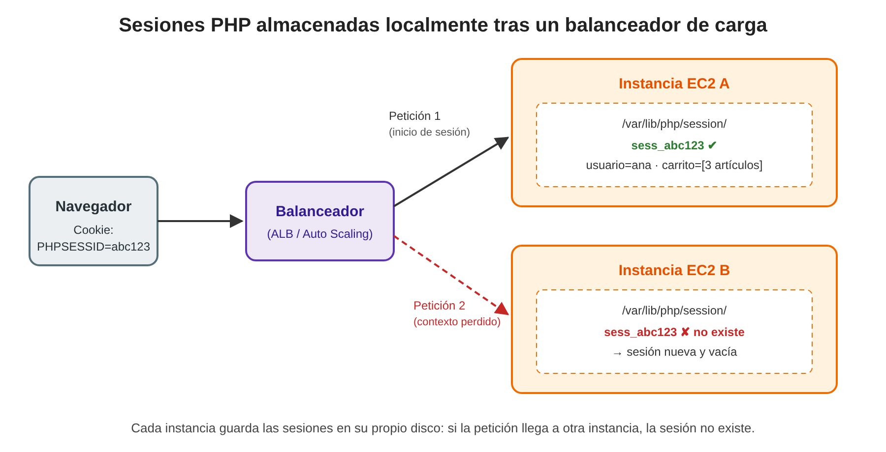
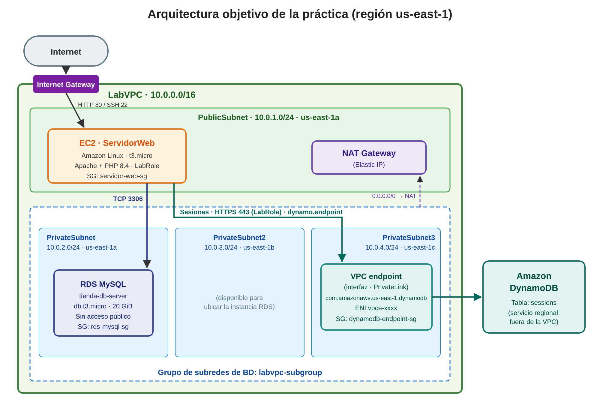
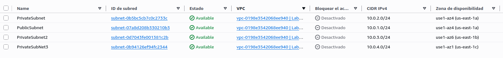
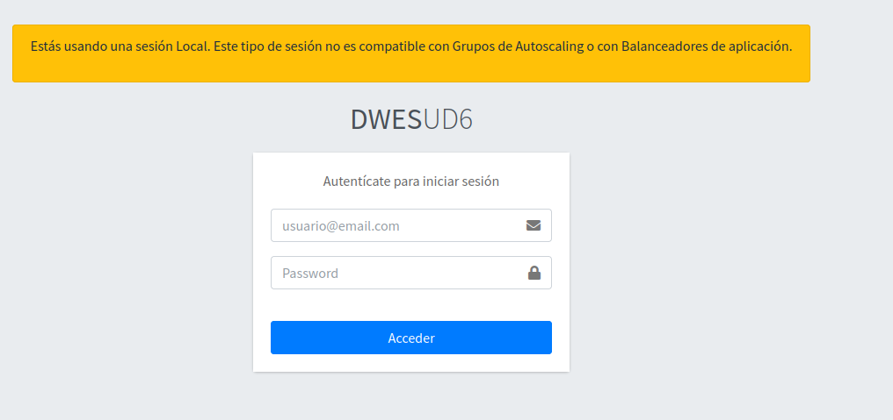
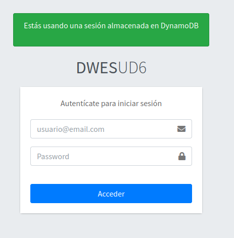

# Práctica: Aplicación web PHP con Amazon RDS for MySQL y gestión de sesiones en Amazon DynamoDB

|                              |                                                                        |
| ---------------------------- | ---------------------------------------------------------------------- |
| **Curso de especialización** | Recursos y Servicios en la Nube                                        |
| **Módulo profesional**       | Administración de bases de datos y almacenamiento en la nube           |
| **Plataforma**               | AWS Academy Learner Lab (región `us-east-1`)                           |
| **Servicios implicados**     | Amazon VPC, Amazon EC2, Amazon RDS for MySQL, Amazon DynamoDB, AWS IAM |

---

## 1. Introducción

En la presente práctica se desplegará una aplicación web desarrollada en PHP cuya capa de persistencia se distribuye entre dos servicios gestionados de AWS con propósitos claramente diferenciados:

- **Amazon RDS for MySQL**, que albergará la base de datos relacional de la aplicación (catálogo, usuarios, pedidos, etc.).
- **Amazon DynamoDB**, que actuará como almacén centralizado de las **sesiones de usuario**.

La aplicación se ejecutará sobre instancias **Amazon EC2** concebidas para formar parte de un grupo de servidores web, de modo que la arquitectura resultante pueda escalar horizontalmente detrás de un balanceador de carga o de un grupo de Auto Scaling sin que los usuarios pierdan su contexto de navegación.

## 2. Planteamiento del problema: las sesiones locales en entornos escalables

### 2.1. Funcionamiento de las sesiones en PHP

El protocolo HTTP carece de estado: cada petición es independiente de las anteriores. Para mantener información asociada a un usuario a lo largo de su navegación (identidad autenticada, contenido del carrito de la compra, preferencias, mensajes *flash*, *tokens* CSRF, etc.), PHP emplea el mecanismo de **sesiones**:

1. Al invocar `session_start()`, PHP genera un identificador de sesión aleatorio y lo envía al navegador mediante una *cookie* (por defecto, `PHPSESSID`).
2. Los datos de la sesión (`$_SESSION`) **se almacenan en el servidor**. Con la configuración por defecto (`session.save_handler = files`), se guardan como ficheros en el disco local de la máquina, en la ruta indicada por `session.save_path` (por ejemplo, `/var/lib/php/session/sess_<id>`).
3. En cada petición posterior, el navegador reenvía la *cookie* y PHP recupera del disco local el fichero correspondiente a ese identificador.

Este diseño resulta completamente válido mientras la aplicación se ejecute en **un único servidor**.

### 2.2. El problema al escalar horizontalmente

Cuando la aplicación se despliega en varias instancias EC2 detrás de un **Application Load Balancer (ALB)** o dentro de un **grupo de Auto Scaling**, el balanceador reparte las peticiones entre las instancias disponibles sin garantizar, por defecto, que un mismo usuario sea atendido siempre por la misma máquina.

La consecuencia es la que se ilustra en la Figura 1:

- La **petición 1** (por ejemplo, el inicio de sesión) llega a la *instancia A*, que crea el fichero `sess_abc123` en **su propio disco**.
- La **petición 2** del mismo usuario es encaminada a la *instancia B*. El navegador envía correctamente la *cookie* `PHPSESSID=abc123`, pero la instancia B no dispone de ese fichero: PHP crea una sesión nueva y vacía y **el contexto del usuario se pierde** (el usuario aparece como no autenticado, el carrito queda vacío, los formularios fallan por *token* CSRF inválido, etc.).



*Figura 1. Pérdida del contexto de sesión cuando las sesiones se almacenan en el disco local de cada instancia.*

El problema se agrava en un grupo de **Auto Scaling**, ya que las instancias son efímeras por naturaleza:

- En una operación de **reducción de escala** (*scale-in*) o al sustituir una instancia considerada no saludable, la instancia se termina y **todas las sesiones almacenadas en su disco desaparecen** con ella.
- Las instancias de nueva creación arrancan sin ninguna sesión previa.

### 2.3. Alternativas de solución

| Alternativa                                     | Descripción                                                                                                                          | Limitaciones                                                                                                                              |
| ----------------------------------------------- | ------------------------------------------------------------------------------------------------------------------------------------ | ----------------------------------------------------------------------------------------------------------------------------------------- |
| **Sesiones persistentes** (*sticky sessions*)   | El balanceador asocia cada cliente a una instancia concreta mediante una *cookie* de afinidad.                                       | Reparto de carga desigual; las sesiones se siguen perdiendo si la instancia se termina; contradice el principio de servidores sin estado. |
| **Sistema de ficheros compartido** (Amazon EFS) | Todas las instancias montan el mismo directorio de sesiones.                                                                         | Mayor latencia, problemas de bloqueo de ficheros y coste añadido.                                                                         |
| **Almacén de sesiones centralizado**            | Las sesiones se guardan en un servicio externo a las instancias (Amazon DynamoDB, Amazon ElastiCache, una base de datos relacional). | Requiere configurar un manejador de sesiones (*session handler*) en la aplicación.                                                        |

La solución adoptada en esta práctica es la tercera: externalizar las sesiones en **Amazon DynamoDB**. De este modo, las instancias EC2 pasan a ser **sin estado** (*stateless*) y cualquiera de ellas puede atender cualquier petición. DynamoDB resulta especialmente adecuado para esta tarea por los siguientes motivos:

- Es un servicio **completamente gestionado y sin servidor**, sin instancias que administrar ni dimensionar.
- Ofrece **latencias de milisegundos de un solo dígito** en accesos por clave, que es exactamente el patrón de una sesión (lectura y escritura por identificador).
- Permite definir un atributo **TTL** (*Time To Live*) para que las sesiones caducadas se eliminen automáticamente.
- El **AWS SDK para PHP** incorpora un manejador de sesiones para DynamoDB (`Aws\DynamoDb\SessionHandler`) que sustituye de forma transparente al almacenamiento en ficheros, sin necesidad de modificar el uso de `$_SESSION` en el código.
- El acceso se autoriza mediante el **rol de IAM** asociado a la instancia (`LabRole`), sin incrustar credenciales en la aplicación.

Por su parte, los datos de negocio, de naturaleza relacional, residirán en **Amazon RDS for MySQL**, alojado en subredes privadas y sin acceso público.

## 3. Objetivos

Al finalizar la práctica, el alumnado será capaz de:

1. Justificar la necesidad de externalizar el estado de sesión en arquitecturas escalables horizontalmente.
2. Ampliar una VPC con subredes privadas distribuidas en varias zonas de disponibilidad y configurar su enrutamiento a través de un NAT Gateway.
3. Desplegar una instancia EC2 con un servidor web y una aplicación PHP mediante un script de datos de usuario (*user data*).
4. Crear un grupo de subredes de base de datos y una instancia de Amazon RDS for MySQL en subredes privadas.
5. Restringir el acceso a la base de datos mediante grupos de seguridad que referencian a otros grupos de seguridad.
6. Configurar Amazon DynamoDB como almacén de sesiones de una aplicación PHP.

## 4. Arquitectura objetivo

La Figura 2 muestra la arquitectura que se construirá en los apartados siguientes.



*Figura 2. Arquitectura objetivo de la práctica.*

Elementos principales:

- **LabVPC** (`10.0.0.0/16`) con una subred pública y tres subredes privadas repartidas en tres zonas de disponibilidad.
- Instancia **EC2 `ServidorWeb`** en la subred pública, con Apache y PHP 8.4, que ejecuta la aplicación.
- Instancia **RDS MySQL `tienda-db-server`** en el grupo de subredes privadas `labvpc-subgroup`, accesible únicamente desde los servidores web.
- **Tabla de DynamoDB `sessions`** para las sesiones, servicio regional al que la instancia accede mediante el rol `LabRole`.
- **Punto de enlace de VPC de tipo interfaz** (*interface VPC endpoint*, basado en AWS PrivateLink) para DynamoDB, ubicado en `PrivateSubnet3`. A través de él, el tráfico entre los servidores web y DynamoDB viaja por la red privada de AWS sin atravesar Internet.

## 5. Requisitos previos

- Haber iniciado el laboratorio en **AWS Academy Learner Lab** (indicador en verde) y acceder a la consola de AWS.
- Trabajar en todo momento en la región **Norte de Virginia (`us-east-1`)**.
- Disponer de los ficheros proporcionados por el profesorado:
  - `inicializar-entorno.sh`: creación de la VPC base.
  - `user-data-ec2.sh`: script de aprovisionamiento de la instancia EC2.
  - `00-ud5.sql`: volcado de la base de datos `tienda` utilizada por la aplicación.
- Descargar la clave privada del laboratorio (`labsuser.pem`) desde **AWS Details → Download PEM** en la página del Learner Lab, necesaria para conectarse por SSH y transferir ficheros a la instancia EC2.

---

## 6. Desarrollo de la práctica

### Paso 1. Creación de la VPC base

El script [inicializar-entorno.sh](https://rgcenteno.github.io/ABDAN-PracticasUD3/#script-que-crea-vpc-con-subred-publica-y-subred-privada) crea, mediante la AWS CLI, la infraestructura de red de partida:

| Recurso                  | Nombre / Valor                                                       |
| ------------------------ | -------------------------------------------------------------------- |
| VPC                      | `LabVPC` – `10.0.0.0/16` (resolución y nombres DNS habilitados)      |
| Subred pública           | `PublicSubnet` – `10.0.1.0/24` (asignación automática de IP pública) |
| Subred privada           | `PrivateSubnet` – `10.0.2.0/24`                                      |
| Internet Gateway         | Asociado a `LabVPC`                                                  |
| Tabla de rutas pública   | `0.0.0.0/0` → Internet Gateway, asociada a `PublicSubnet`            |
| Elastic IP y NAT Gateway | NAT Gateway ubicado en `PublicSubnet`                                |
| Tabla de rutas privada   | `0.0.0.0/0` → NAT Gateway, asociada a `PrivateSubnet`                |

Ambas subredes se crean en la **primera zona de disponibilidad** de la región (`us-east-1a`).

**Procedimiento:**

1. Abra **AWS CloudShell** desde la barra superior de la consola de AWS.

2. Suba el fichero mediante **Acciones → Cargar archivo** y seleccione `inicializar-entorno.sh`.

3. Conceda permisos de ejecución y ejecute el script:

   ```bash
   chmod +x inicializar-entorno.sh
   ./inicializar-entorno.sh
   ```

4. Espere a que finalice. La creación del NAT Gateway puede prolongarse varios minutos. Al terminar, el script muestra un resumen con los identificadores de los recursos creados:

```text
==========================================
VPC              : vpc-xxxxxxxxxxxxxxxxx
IGW              : igw-xxxxxxxxxxxxxxxxx
Public Subnet    : subnet-xxxxxxxxxxxxxxxxx
Private Subnet   : subnet-xxxxxxxxxxxxxxxxx
Public RT        : rtb-xxxxxxxxxxxxxxxxx
Private RT       : rtb-xxxxxxxxxxxxxxxxx
Elastic IP       : eipalloc-xxxxxxxxxxxxxxxxx
NAT Gateway      : nat-xxxxxxxxxxxxxxxxx
==========================================
```

5. Anote estos identificadores, en particular el de la **tabla de rutas privada** (`Private RT`), que se utilizará en el Paso 4.

> **Nota:** el NAT Gateway genera coste por hora de funcionamiento. Recuerde detener el laboratorio al finalizar cada sesión de trabajo.

### Paso 2. Grupo de seguridad de los servidores web

Desde **EC2 → Red y seguridad → Grupos de seguridad → Crear grupo de seguridad**, cree un grupo con la siguiente configuración:

| Parámetro                     | Valor                         |
| ----------------------------- | ----------------------------- |
| Nombre del grupo de seguridad | `servidor-web-sg`             |
| Descripción                   | `Acceso a los servidores web` |
| VPC                           | `LabVPC`                      |

**Reglas de entrada:**

| Tipo | Protocolo | Puerto | Origen                      | Descripción           |
| ---- | --------- | ------ | --------------------------- | --------------------- |
| SSH  | TCP       | 22     | `0.0.0.0/0` (Anywhere-IPv4) | Administración remota |

Las reglas de salida se mantienen con su valor por defecto (todo el tráfico permitido).

> **Nota:** para comprobar el funcionamiento de la aplicación desde un navegador será necesario permitir también el tráfico **HTTP (TCP 80)**. Esta regla se añadirá en el Paso 9.

### Paso 3. Lanzamiento de la instancia EC2 `ServidorWeb`

Desde **EC2 → Instancias → Lanzar instancias**, configure la instancia como se indica:

| Parámetro                                         | Valor                                                             |
| ------------------------------------------------- | ----------------------------------------------------------------- |
| Nombre                                            | `ServidorWeb`                                                     |
| AMI                                               | **Amazon Linux 2023** (valor por defecto de *Amazon Linux*)       |
| Tipo de instancia                                 | `t3.micro`                                                        |
| Par de claves                                     | `vockey`                                                          |
| VPC                                               | `LabVPC`                                                          |
| Subred                                            | `PublicSubnet`                                                    |
| Asignar automáticamente la IP pública             | Habilitar                                                         |
| Grupo de seguridad                                | Seleccionar existente: `servidor-web-sg`                          |
| Almacenamiento                                    | 8 GiB, `gp3`                                                      |
| Perfil de instancia de IAM (*Detalles avanzados*) | `LabInstanceProfile` (contiene el rol `LabRole`)                  |
| Datos de usuario (*Detalles avanzados*)           | Contenido íntegro de `[user-data-ec2.sh](files/user-data-ec2.sh)` |

> **Nota:** en AWS Academy, el rol `LabRole` se asigna a las instancias EC2 a través del perfil de instancia `LabInstanceProfile`, que es el nombre que aparece en el desplegable de la consola.

El script de datos de usuario se ejecuta una única vez, durante el primer arranque de la instancia, y realiza las siguientes tareas:

1. Actualiza el sistema operativo.
2. Instala Apache (`httpd`), Git y PHP 8.4 con las extensiones necesarias (entre ellas, `php8.4-mysqlnd` para la conexión con MySQL).
3. Clona el repositorio de la aplicación en `/var/www/app`.
4. Instala las dependencias de la aplicación con **Composer** (entre ellas, el AWS SDK para PHP, necesario para el manejador de sesiones de DynamoDB).
5. Crea un *VirtualHost* de Apache cuyo `DocumentRoot` es `/var/www/app/www/public`.
6. Habilita e inicia los servicios `php-fpm` y `httpd`.

**Verificación:**

1. Espere a que la instancia supere las **comprobaciones de estado** (2/2).

2. Conéctese por SSH (o mediante *EC2 Instance Connect*) y revise el registro de ejecución del script:

   ```bash
   sudo tail -n 50 /var/log/cloud-init-output.log
   ```

3. Compruebe que los servicios están activos y que la aplicación se ha descargado:

   ```bash
   systemctl status httpd php-fpm --no-pager
   ls -l /var/www/app/www/public
   php --version
   ```

### Paso 4. Ampliación de LabVPC con subredes privadas adicionales

Amazon RDS exige que un grupo de subredes de base de datos incluya subredes de, al menos, **dos zonas de disponibilidad**. Por ello, `LabVPC` debe ampliarse hasta quedar formada por **una subred pública y tres subredes privadas**, con la configuración exacta que se muestra a continuación:



*Figura 3. Configuración final de subredes de LabVPC.*

> **Atención:** en la captura, la tercera subred privada figura como `PrivateSubNet3`. El nombre que debe utilizarse es **`PrivateSubnet3`**, con la **n en minúscula**, tal como se indica en la tabla siguiente.

| Nombre           | CIDR IPv4     | Zona de disponibilidad | Tipo    | Estado inicial      |
| ---------------- | ------------- | ---------------------- | ------- | ------------------- |
| `PublicSubnet`   | `10.0.1.0/24` | `us-east-1a`           | Pública | Creada en el Paso 1 |
| `PrivateSubnet`  | `10.0.2.0/24` | `us-east-1a`           | Privada | Creada en el Paso 1 |
| `PrivateSubnet2` | `10.0.3.0/24` | `us-east-1b`           | Privada | **A crear**         |
| `PrivateSubnet3` | `10.0.4.0/24` | `us-east-1c`           | Privada | **A crear**         |

**4.1. Creación de las subredes**

1. Acceda a **VPC → Subredes → Crear subred**.
2. Seleccione la VPC `LabVPC`.
3. Añada las dos subredes con los valores de la tabla anterior (puede usar el botón **Agregar nueva subred** para crearlas en una única operación):
   - `PrivateSubnet2`: zona `us-east-1b`, bloque `10.0.3.0/24`.
   - `PrivateSubnet3`: zona `us-east-1c`, bloque `10.0.4.0/24`.
4. Pulse **Crear subred**.

> **Importante:** respete exactamente los nombres de las subredes (incluidas mayúsculas y minúsculas), sus bloques CIDR y sus zonas de disponibilidad.

**4.2. Enrutamiento de las nuevas subredes a través del NAT Gateway**

Una subred recién creada queda asociada implícitamente a la **tabla de rutas principal** de la VPC, que solo contiene la ruta local. Para que las nuevas subredes privadas dispongan de salida a Internet a través del NAT Gateway, deben asociarse a la tabla de rutas privada creada en el Paso 1:

1. Acceda a **VPC → Tablas de enrutamiento** y seleccione la tabla de rutas privada (identificador `Private RT` del Paso 1). Verifique en la pestaña **Rutas** que contiene la entrada:

   | Destino       | Destino (*target*)      |
   | ------------- | ----------------------- |
   | `10.0.0.0/16` | `local`                 |
   | `0.0.0.0/0`   | `nat-xxxxxxxxxxxxxxxxx` |

2. En la pestaña **Asociaciones de subred explícitas**, pulse **Editar asociaciones de subred**.

3. Marque `PrivateSubnet`, `PrivateSubnet2` y `PrivateSubnet3` y guarde los cambios.

**Verificación:** en **VPC → Subredes**, seleccione cada subred privada y compruebe, en la pestaña **Tabla de enrutamiento**, que dispone de la ruta `0.0.0.0/0 → nat-…`.

### Paso 5. Creación del grupo de subredes de base de datos

Un **grupo de subredes de base de datos** (*DB subnet group*) es el conjunto de subredes de una VPC en las que Amazon RDS puede ubicar las instancias de base de datos.

Desde **Aurora and RDS → Grupos de subredes → Crear grupo de subredes de base de datos**:

| Parámetro               | Valor                                                                                               |
| ----------------------- | --------------------------------------------------------------------------------------------------- |
| Nombre                  | `labvpc-subgroup`                                                                                   |
| Descripción             | `Subredes privadas de LabVPC para RDS`                                                              |
| VPC                     | `LabVPC`                                                                                            |
| Zonas de disponibilidad | `us-east-1a`, `us-east-1b`, `us-east-1c`                                                            |
| Subredes                | `10.0.2.0/24` (`PrivateSubnet`), `10.0.3.0/24` (`PrivateSubnet2`), `10.0.4.0/24` (`PrivateSubnet3`) |

> **Importante:** seleccione exclusivamente las tres subredes **privadas**. La subred pública `10.0.1.0/24`, que también pertenece a `us-east-1a`, **no** debe formar parte del grupo ya que, para securizar la base de datos, queremos que ésta no sea accesible desde internet.

### Paso 6. Grupo de seguridad de la base de datos

La base de datos solo debe aceptar conexiones procedentes de los servidores web. En lugar de autorizar direcciones IP concretas, se autorizará al **grupo de seguridad** de los servidores web, de forma que cualquier instancia que pertenezca a `servidor-web-sg` (incluidas las que se creen en el futuro dentro de un grupo de Auto Scaling) pueda conectarse.

Desde **EC2 → Grupos de seguridad → Crear grupo de seguridad**:

| Parámetro                     | Valor                                   |
| ----------------------------- | --------------------------------------- |
| Nombre del grupo de seguridad | `rds-mysql-sg`                          |
| Descripción                   | `Acceso MySQL desde los servidores web` |
| VPC                           | `LabVPC`                                |

**Reglas de entrada:**

| Tipo         | Protocolo | Puerto | Origen                               | Descripción                |
| ------------ | --------- | ------ | ------------------------------------ | -------------------------- |
| MySQL/Aurora | TCP       | 3306   | Grupo de seguridad `servidor-web-sg` | MySQL desde servidores web |

### Paso 7. Creación de la instancia de Amazon RDS for MySQL

Desde **Aurora and RDS → Bases de datos → Crear base de datos**, seleccione el método **Creación estándar** y configure los siguientes parámetros:

**Opciones del motor y plantilla**

| Parámetro                  | Valor                                                                                          |
| -------------------------- | ---------------------------------------------------------------------------------------------- |
| Tipo de motor              | MySQL                                                                                          |
| Edición                    | MySQL Community                                                                                |
| Versión del motor          | Versión por defecto                                                                            |
| Plantilla                  | **Desarrollo y pruebas**                                                                       |
| Opciones de implementación | **Implementación de instancia de base de datos de zona de disponibilidad única** (1 instancia) |

**Configuración**

| Parámetro                                      | Valor              |
| ---------------------------------------------- | ------------------ |
| Identificador de la instancia de base de datos | `tienda-db-server` |
| Nombre de usuario maestro                      | `admin`            |
| Administración de credenciales                 | Autoadministrado   |
| Usuario maestro                                | `admin`            |
| Contraseña maestra                             | `abdanPass`        |

**Configuración de la instancia y almacenamiento**

| Parámetro               | Valor                                      |
| ----------------------- | ------------------------------------------ |
| Clase de instancia      | Clases ampliables → `db.t3.micro`          |
| Tipo de almacenamiento  | SSD de uso general (gp), valor por defecto |
| Almacenamiento asignado | 20 GiB                                     |

**Conectividad**

| Parámetro                          | Valor                                                          |
| ---------------------------------- | -------------------------------------------------------------- |
| Recurso de computación             | No conectarse a un recurso informático EC2                     |
| Nube privada virtual (VPC)         | `LabVPC`                                                       |
| Grupo de subredes de base de datos | `labvpc-subgroup`                                              |
| Acceso público                     | **No**                                                         |
| Grupo de seguridad de VPC          | Elegir existente: `rds-mysql-sg` (eliminar el grupo `default`) |
| Zona de disponibilidad             | Sin preferencia                                                |
| Puerto de la base de datos         | 3306                                                           |

**Supervisión** (configuración orientada a minimizar el coste)

| Parámetro                                       | Valor             |
| ----------------------------------------------- | ----------------- |
| Database Insights                               | **Estándar**      |
| Período de retención de Performance Insights    | **7 días**        |
| Monitorización mejorada (*Enhanced Monitoring*) | **Deshabilitada** |

Revise el resumen de costes estimados y pulse **Crear base de datos**. La creación de la instancia puede tardar entre 10 y 15 minutos.

**Verificación:**

1. Espere a que el estado de `tienda-db-server` sea **Disponible**.

2. En la pestaña **Conectividad y seguridad**, anote el **punto de enlace** (*endpoint*) de la instancia, con el formato `tienda-db-server.xxxxxxxxxxxx.us-east-1.rds.amazonaws.com`. Compruebe que **Accesible públicamente** figura como `No` y que el grupo de seguridad asociado es `rds-mysql-sg`.

3. Descarga el fichero `bundle.pem`

```bash
curl -o global-bundle.pem https://truststore.pki.rds.amazonaws.com/global/global-bundle.pem
```

4. Desde la instancia `ServidorWeb`, compruebe la conectividad con la base de datos. Ejecuta estos comandos desde la carpeta en la que te descargaste el ficheor `bundle.pem`:

```bash
sudo dnf install -y mariadb105
mysql -h <endpoint-rds> -u admin -p --ssl --ssl-ca=./global-bundle.pem --ssl-verify-server-cert
```

   Introduzca la contraseña `abdanPass` y ejecute `SELECT VERSION();` para confirmar la conexión.

   Si te fijas, el comando de conexión varía respecto al que te propone AWS cuando entras en tienda-db-server > Conectividad y seguridad > MySQL (Linux). Esto es porque el cliente que usamos en la AMI EC2 instala MariaDB, y no es compatible con los argumentos `--ssl-mode=VERIFY_IDENTITY`

### Paso 8. Importación de la base de datos `tienda` en Amazon RDS

La instancia RDS se encuentra en subredes privadas y no es accesible públicamente, por lo que **la importación debe realizarse desde la instancia `ServidorWeb`**, que sí tiene permitido el acceso al puerto 3306. AWS CloudShell no puede utilizarse para este fin, ya que se ejecuta fuera de `LabVPC`.

**8.1. Acceder a la carpeta donde se encuentra el volcado de base de la base de datos**

Accede a la consola de la máquina EC2. Mi recomendación es que te conectes desde el terminal de tu equipo ya que es posible que necesites tener varias conexiones abiertas, una para configurar y otra para [ver el log de errores de apache](#recomendacion-supervision-de-los-errores-de-php-durante-la-practica).

Una vez conectada, copia el fichero de volcado 

```bash
cp /var/www/app/docker/mysql/dumps/00-tienda.sql ~/
```

**8.2. Importación del volcado**

Conéctese por SSH a `ServidorWeb` y ejecute:

```bash
mysql -h <endpoint-rds> -u admin -p --ssl --ssl-ca=./global-bundle.pem --ssl-verify-server-cert < ~/00-tienda.sql
```

El script elimina, si existe, y crea el esquema `tienda`, junto con sus tablas, datos y restricciones de integridad referencial.

**Verificación:**

```bash
mysql -h <endpoint-rds> -u admin -p --ssl --ssl-ca=./global-bundle.pem --ssl-verify-server-cert
```

Una vez conectado ejecuta los siguientes comandos sql:

```sql
USE tienda; 
SHOW TABLES; 
SELECT id_usuario, email, id_rol FROM usuario_sistema;
```

Deben aparecer, entre otras, las tablas `categoria`, `producto`, `proveedor`, `trabajadores`, `rol` y `usuario_sistema`. La última sentencia debería mostrar los usuarios de la aplicación, todos ellos con la contraseña `TestTest1`. Anota el email del usuario con `id_user = 1`.

**8.3. Creación de un usuario de base de datos para la aplicación**

Por el principio de **mínimo privilegio**, la aplicación no debe conectarse con el usuario maestro `admin`, que tiene control total sobre la instancia RDS. Se creará un usuario específico con privilegios exclusivamente sobre el esquema `tienda`.

Ejecute las siguientes sentencias:

```sql
CREATE USER 'tienda_user'@'%' IDENTIFIED BY 'TiendaPass1';
GRANT SELECT, INSERT, UPDATE, DELETE ON tienda.* TO 'tienda_user'@'%';
FLUSH PRIVILEGES;
```

**Verificación:**

```bash
mysql -h <endpoint-rds> -u tienda_user -p --ssl --ssl-ca=./global-bundle.pem --ssl-verify-server-cert -e "SHOW GRANTS; USE tienda; SELECT COUNT(*) FROM producto;"
```

El usuario debe poder consultar las tablas de `tienda`, pero no debe tener acceso a ningún otro esquema.

> **Nota:** el origen `'%'` permite la conexión desde cualquier equipo, pero la restricción efectiva la impone el grupo de seguridad `rds-mysql-sg`, que solo admite tráfico procedente de los servidores web.

---

> ### 🛠️ Recomendación: supervisión de los errores de PHP durante la práctica
>
> Aunque no es obligatorio, se recomienda **mantener abierta en una pestaña independiente del terminal una conexión SSH a la instancia `ServidorWeb`** que muestre en tiempo real los errores generados por PHP. Esto permite identificar con rapidez si un fallo de la aplicación se debe a la **conexión con la base de datos** o a algún **error en el acceso a DynamoDB**:
>
```sh
sudo tail -f /var/log/php-fpm/www-error.log
```
>
> Puede utilizarse la inteligencia artificial o cualquier otro recurso habitual de trabajo para, a partir de los mensajes de error obtenidos, ir subsanando las incidencias que se presenten.
>
> **Para realizar la práctica no es necesario modificar ningún código de la aplicación.** Únicamente debe editarse el fichero de variables de entorno `.env`, ubicado en `/var/www/app/www/.env`.

> ### ✏️ Edición de las variables de entorno de la aplicación
>
> Toda la configuración de la aplicación se realiza con el siguiente comando:
>
```sh
sudo nano /var/www/app/www/.env
```
>
> En `nano`, guarde los cambios con `Ctrl + O` (confirmando con `Intro`) y salga con `Ctrl + X`.

---

### Paso 9. Conexión de la aplicación con Amazon RDS (sesiones locales)

En este paso la aplicación se conectará a la base de datos, pero continuará almacenando las sesiones en el disco local de la instancia.

**9.1. Apertura del puerto HTTP**

Edite las reglas de entrada del grupo de seguridad `servidor-web-sg` y añada la siguiente regla:

| Tipo | Protocolo | Puerto | Origen                      | Descripción                |
| ---- | --------- | ------ | --------------------------- | -------------------------- |
| HTTP | TCP       | 80     | `0.0.0.0/0` (Anywhere-IPv4) | Acceso web a la aplicación |

**9.2. Configuración de la conexión a la base de datos**

1. Abra en otra pestaña del terminal la supervisión de errores descrita en la recomendación anterior.

2. Descargue el fichero global-bundle.pem en la carpeta `/var/www/app/www/`

```sh
sudo curl -o /var/www/app/www/global-bundle.pem https://truststore.pki.rds.amazonaws.com/global/global-bundle.pem
```

3. Edite el fichero de variables de entorno:

```bash
sudo nano /var/www/app/www/.env
```

4. Complete el bloque `CONFIGURACION DE MYSQL` con los datos de la instancia RDS y del usuario creado en el Paso 8.3:

```ini
# CONFIGURACION DE MYSQL
# Punto de enlace de la base de datos MySQL
db.host=""
# Nombre de la base de datos a la que nos conectamos
db.schema=""
# Usuario que hemos creado con los privilegios para conectarse sólo a la base de datos tienda
db.user=""
# Password de ese usuario
db.pass=""
db.charset='utf8mb4'
db.ssl_pem="/var/www/app/www/global-bundle.pem"
db.emulated='1'
```

   Sustituya `db.host` por el punto de enlace real anotado en el Paso 7. El resto de variables del bloque (`db.charset`, `db.ssl_pem`, `db.emulated`) **no deben modificarse**.

   > **Nota:** la variable `db.ssl_pem` apunta al paquete de certificados raíz de Amazon RDS (`global-bundle.pem`), incluido en el repositorio de la aplicación. Gracias a él, la conexión entre la aplicación y la base de datos viaja **cifrada mediante TLS** y el certificado del servidor RDS se valida. Puede comprobar su presencia con `ls -l /var/www/app/www/global-bundle.pem`.

5. Mantenga, de momento, el bloque `CONFIGURACION DE SESIONES` con su valor por defecto:

   ```ini
   session.type='local'
   ```

**Verificación:**

1. Acceda desde el navegador a `http://<IP-publica-ServidorWeb>`. Debe mostrarse la pantalla de inicio de sesión con un **aviso en color amarillo** que indica que se está utilizando una sesión local, no compatible con grupos de Auto Scaling ni con balanceadores de carga de aplicación (Figura 4).

   

   *Figura 4. Aplicación utilizando sesiones almacenadas localmente.*

2. Inicie sesión con el usuario `admin@test.org` y la contraseña `TestTest1`. Si el acceso es correcto, la conexión con Amazon RDS está funcionando. En caso contrario, revise en la pestaña de supervisión los errores de `www-error.log` (errores típicos: punto de enlace incorrecto, credenciales erróneas o regla de entrada ausente en `rds-mysql-sg`, que se manifiesta como un tiempo de espera agotado).

3. Compruebe, desde la sesión SSH, que la sesión se ha guardado como fichero en el disco local de la instancia:

```bash
sudo ls -l /var/lib/php/session/
```

   Este fichero, `sess_<identificador>`, es precisamente el que se perdería si la siguiente petición del usuario fuese atendida por otra instancia.

### Paso 10. Creación de la tabla de sesiones y del punto de enlace de VPC para DynamoDB

El manejador de sesiones de DynamoDB del AWS SDK para PHP (`Aws\DynamoDb\SessionHandler`) almacena cada sesión como un elemento de una tabla cuya clave de partición es el identificador de la sesión. El nombre de la tabla no es configurable desde el fichero `.env`, por lo que deberá crearse **exactamente** con el nombre indicado.

Desde **DynamoDB → Tablas → Crear tabla**:

| Parámetro                 | Valor                             |
| ------------------------- | --------------------------------- |
| Nombre de la tabla        | `sessions`                        |
| Clave de partición        | `id` (tipo **Cadena** / *String*) |
| Clave de ordenación       | Ninguna                           |
| Configuración de la tabla | Personalizar configuración        |
| Clase de tabla            | DynamoDB Standard                 |
| Modo de capacidad         | **Bajo demanda** (*On-demand*)    |

Mantenga el resto de parámetros con sus valores por defecto y pulse **Crear tabla**.

> **Nota:** el modo de capacidad **bajo demanda** solo factura las lecturas y escrituras efectivamente realizadas, lo que resulta idóneo para un entorno de prácticas con tráfico mínimo e irregular.

**10.1. Habilitación del TTL**

El manejador de sesiones registra en cada elemento el atributo `expires`, que contiene la fecha de caducidad de la sesión en formato *timestamp* UNIX. Activando el **TTL** sobre dicho atributo, DynamoDB eliminará automáticamente las sesiones caducadas sin necesidad de ejecutar procesos de limpieza (*garbage collection*) desde la aplicación.

1. Seleccione la tabla `sessions` y acceda a la pestaña **Configuración**.
2. En la sección **Período de vida (TTL)**, pulse **Activar**.
3. Indique como nombre de atributo de TTL: `expires`.

> **Nota:** el acceso de la instancia a DynamoDB se autoriza a través del rol `LabRole`, asociado en el Paso 3 mediante el perfil de instancia. No es necesario configurar claves de acceso en la aplicación.

**10.2. Grupo de seguridad del punto de enlace**

El punto de enlace de tipo interfaz se materializa como una interfaz de red elástica (ENI) dentro de la VPC y, como tal, requiere un grupo de seguridad que controle quién puede utilizarlo.

Desde **EC2 → Grupos de seguridad → Crear grupo de seguridad**:

| Parámetro                     | Valor                                                     |
| ----------------------------- | --------------------------------------------------------- |
| Nombre del grupo de seguridad | `dynamodb-endpoint-sg`                                    |
| Descripción                   | `Acceso al endpoint de DynamoDB desde los servidores web` |
| VPC                           | `LabVPC`                                                  |

**Reglas de entrada:**

| Tipo  | Protocolo | Puerto | Origen                               | Descripción                          |
| ----- | --------- | ------ | ------------------------------------ | ------------------------------------ |
| HTTPS | TCP       | 443    | Grupo de seguridad `servidor-web-sg` | API de DynamoDB desde servidores web |

**10.3. Creación del punto de enlace de VPC para DynamoDB**

Desde **VPC → Puntos de conexión → Crear punto de enlace**:

| Parámetro                                         | Valor                                                     |
| ------------------------------------------------- | --------------------------------------------------------- |
| Etiqueta de nombre                                | `dynamodb-endpoint`                                       |
| Tipo                                              | **Servicios de AWS**                                      |
| Servicio                                          | `com.amazonaws.us-east-1.dynamodb`, de tipo **Interface** |
| VPC                                               | `LabVPC`                                                  |
| Configuración adicional → Habilitar nombre de DNS | Desmarcado                                                |
| Subredes                                          | Zona `us-east-1c` → `PrivateSubnet3`                      |
| Tipo de dirección IP                              | IPv4                                                      |
| Grupos de seguridad                               | `dynamodb-endpoint-sg`                                    |
| Política                                          | Acceso completo                                           |

> **Importante:** el servicio `com.amazonaws.us-east-1.dynamodb` aparece dos veces en el listado, una de tipo **Gateway** y otra de tipo **Interface**. Seleccione la de tipo **Interface**: es la que genera un nombre DNS propio que la aplicación utilizará mediante la variable `dynamo.endpoint`.

Pulse **Crear punto de enlace** y espere a que su estado sea **Disponible** (puede tardar unos minutos).

**Verificación:**

1. Seleccione el punto de enlace y, en la pestaña **Detalles**, localice la sección **Nombres de DNS**. Anote el nombre regional, que tendrá un formato similar a:

   ```text
   vpce-0123456789abcdef0-abcd1234.dynamodb.us-east-1.vpce.amazonaws.com
   ```

   Si el nombre aparece precedido de `*.`, elimine dicho prefijo.

2. Desde la instancia `ServidorWeb`, compruebe que el nombre se resuelve a una dirección IP **privada** de la subred `10.0.4.0/24`:

   ```bash
   dig +short vpce-0123456789abcdef0-abcd1234.dynamodb.us-east-1.vpce.amazonaws.com
   ```

> **Nota:** los puntos de enlace de tipo interfaz se facturan por hora y por zona de disponibilidad. Por este motivo se crea en una única subred; en un entorno de producción se desplegaría en varias zonas para garantizar la alta disponibilidad.

### Paso 11. Almacenamiento de las sesiones en Amazon DynamoDB

1. Cierre la sesión iniciada en la aplicación.

2. Edite de nuevo el fichero de variables de entorno:

```sh
sudo nano /var/www/app/www/.env
```

3. Modifique el bloque `CONFIGURACION DE SESIONES`:

```ini
# CONFIGURACION DE SESIONES
#'local' para local, 'dynamo' para usar dynamodb
session.type='dynamo'
# Región donde alojamos la tabla dynamodb
dynamo.region=''
# Versión de dynamoDB. Dejamos latest por defecto
dynamo.version='latest'
# Si usamos un endpoint, se pondrá https://vpce-xxxx-yyyy.dynamodb.us-east-1.vpce.amazonaws.com
dynamo.endpoint='https://vpce-0123456789abcdef0-abcd1234.dynamodb.us-east-1.vpce.amazonaws.com'
# En caso de configurar conexión por key, secret. NO NECESARIO PARA ESTA PRÁCTICA ...
dynamo.key=''
dynamo.secret=''
```

   Sustituya el valor de `dynamo.endpoint` por el nombre DNS real anotado en el Paso 10.3, **precedido de `https://`**. Los cambios se limitan a `session.type`, `dynamo.region` y `dynamo.endpoint`:

   | Variable                       | Valor                                                    | Motivo                                                                                                                                     |
   | ------------------------------ | -------------------------------------------------------- | ------------------------------------------------------------------------------------------------------------------------------------------ |
   | `session.type`                 | `'dynamo'`                                               | Activa el manejador de sesiones de DynamoDB.                                                                                               |
   | `dynamo.region`                | `''`                                                     | Región en la que se ha creado la tabla `sessions`.                                                                                         |
   | `dynamo.version`               | `'latest'`                                               | Sin cambios.                                                                                                                               |
   | `dynamo.endpoint`              | `'https://vpce-….dynamodb.us-east-1.vpce.amazonaws.com'` | Obliga al SDK a enviar las peticiones al punto de enlace de VPC en lugar de al punto de enlace público `dynamodb.us-east-1.amazonaws.com`. |
   | `dynamo.key` / `dynamo.secret` | `''`                                                     | Vacíos: las credenciales se obtienen automáticamente del rol `LabRole` asociado a la instancia.                                            |

   > **Importante:** no introduzca claves de acceso en `dynamo.key` ni en `dynamo.secret`. Además de ser innecesarias, incrustar credenciales en ficheros de configuración constituye una mala práctica de seguridad.

4. Si los cambios no se reflejan de inmediato, reinicie el servicio PHP-FPM:

   ```bash
   sudo systemctl restart php-fpm
   ```

**Verificación:**

1. Recargue la aplicación en el navegador. El aviso debe aparecer ahora en **color verde**, indicando que se está utilizando una sesión almacenada en DynamoDB (Figura 5). Si se produce algún error, consulte la salida de `www-error.log` en la pestaña de supervisión.

   

   *Figura 5. Aplicación utilizando sesiones almacenadas en Amazon DynamoDB.*

2. Inicie sesión con `admin@test.org` / `TestTest1` y navegue por la aplicación.

3. En la consola, acceda a **DynamoDB → Explorar elementos → `sessions`**. Debe existir un elemento por cada sesión activa, con los atributos:

   - `id`: identificador de la sesión, precedido del nombre de la *cookie* de sesión (por ejemplo, `PHPSESSID_abc123…`).
   - `data`: contenido serializado de `$_SESSION`.
   - `expires`: fecha de caducidad de la sesión.

4. Compare el valor de la *cookie* de sesión del navegador (herramientas de desarrollo → **Aplicación/Almacenamiento → Cookies**) con el `id` del elemento almacenado en DynamoDB.

5. Inicie sesión con otro usuario (por ejemplo, `auditor@test.org`) desde una ventana de incógnito o desde otro navegador, y compruebe que aparece un segundo elemento en la tabla.

6. Cierre la sesión en la aplicación y verifique que el elemento correspondiente desaparece de la tabla.

Llegados a este punto, **el estado de la sesión ya no reside en la instancia EC2**: cualquier otra instancia configurada del mismo modo podría atender las peticiones de un usuario sin que este perciba la pérdida de su contexto, lo que hace viable situar la aplicación detrás de un balanceador de carga o en un grupo de Auto Scaling.

### Paso 12. Obligar a que la conexión a DynamoDB se haga desde el endpoint.

Fíjate que si comentas la configuración `dynamo.endpoint` poniendo un caracter de # antes, las sesiones remotas siguen funcionando. 

```ini
# CONFIGURACION DE SESIONES
#'local' para local, 'dynamo' para usar dynamodb
session.type='dynamo'
# Región donde alojamos la tabla dynamodb
dynamo.region='******'
# Versión de dynamoDB. Dejamos latest por defecto
dynamo.version='latest'
# Si usamos un endpoint, se pondrá https://vpce-xxxx-yyyy.dynamodb.us-east-1.vpce.amazonaws.com
# dynamo.endpoint='https://vpce-007720a7bbcff5b3b-6nrj7op1.dynamodb.us-east-1.vpce.amazonaws.com'
# En caso de configurar conexión por key, secret. NO NECESARIO PARA ESTA PRÁCTICA ya que se usará el rol de la máquina EC2 para obtener el acceso a DynamoDB
dynamo.key=''
dynamo.secret=''
```

Esto sucede porque nuestro servidor web se conecta a la tabla DynamoDB por el internet público en vez de usar nuestro endpoint. Además de esto queremos denegar el acceso a la tabla a todo aquel que no tenga asociado el Rol IAM LabRole. Es por ello que se solicita crear una política en la tabla DynamoDB que:

- Obligue a conectarnos a la tabla DynamoDB desde nuestro punto de enlace

- Deniegue la conexión a cualquiera que no tenga asociado un Rol `LabRole`

Al aplicar la política abre un terminal para [mostrar el log de errores de apache](#recomendacion-supervision-de-los-errores-de-php-durante-la-practica). Si has configurado correctamente la política y sigue comentado `dynamo.endpoint`, verás que al intentar iniciar sesión en la web aparecen los siguientes errores en el log:

```sh
PHP Warning:  Error writing session PHPSESSID_55vuu46b33lh60dmrkt6gj9rvn: Error executing "UpdateItem" on "https://dynamodb.us-east-1.amazonaws.com/"; AWS HTTP error:
AccessDeniedException (client): User: arn:aws:sts::640647244108:assumed-role/LabRole/i-0b0438ab72b7e69d1 is not authorized to perform: dynamodb:UpdateItem on resource: arn:aws:dynamodb:us-east-1:640647244108:table/sessions with an explicit deny in a resource-based policy in /var/www/app/www/vendor/aws/aws-sdk-php/src/DynamoDb/StandardSessionConnection.php on line 144
```

Vuelve a configurar el campo `dynamo.endpoint`. Ahora deberías poder iniciar sesión normalmente.

---

## 7. Cuestiones

Responda razonadamente en la memoria de la práctica:

1. ¿Por qué la instancia RDS se ha ubicado en subredes privadas y qué ventaja aporta autorizar el acceso al puerto 3306 mediante el grupo de seguridad `servidor-web-sg` en lugar de mediante una dirección IP?
2. ¿Por qué Amazon RDS exige que el grupo de subredes de base de datos abarque al menos dos zonas de disponibilidad, aunque la instancia se haya desplegado en una sola?
3. ¿Por qué no ha sido posible importar el volcado SQL directamente desde AWS CloudShell?
4. Explique qué ocurriría con las sesiones de los usuarios si la aplicación se desplegase en un grupo de Auto Scaling con sesiones locales y se produjese una reducción de escala.
5. ¿Qué inconvenientes presentan las *sticky sessions* del balanceador frente al almacenamiento de sesiones en DynamoDB?
6. ¿Qué función cumple el TTL en la tabla de sesiones? ¿Qué ocurriría si no se activase?
7. ¿Cómo obtiene la aplicación permisos para leer y escribir en DynamoDB sin que se haya configurado ninguna clave de acceso en el fichero `.env`?
8. ¿Por qué se ha creado el usuario `tienda_user` en lugar de utilizar el usuario maestro `admin` en la aplicación? ¿Qué riesgos evita?
9. ¿Qué función cumple la variable `db.ssl_pem` y qué ocurriría con la confidencialidad de los datos si la conexión con RDS no estuviese cifrada?
10. ¿Qué ventajas aporta acceder a DynamoDB a través de un punto de enlace de VPC frente al punto de enlace público? ¿Qué diferencias existen entre un punto de enlace de tipo **Gateway** y uno de tipo **Interface** para DynamoDB (coste, configuración de tablas de rutas y uso de `dynamo.endpoint`)?

## 8. Evidencias a entregar

Incluya en la memoria de la práctica capturas de pantalla que acrediten:

1. La salida completa del script `inicializar-entorno.sh` en CloudShell.
2. Las reglas de entrada de los grupos de seguridad `servidor-web-sg` (SSH y HTTP) y `rds-mysql-sg`.
3. Los detalles de la instancia `ServidorWeb` (tipo, subred, IP pública, perfil de IAM) y la salida de `cloud-init-output.log`.
4. El listado de subredes de `LabVPC`, equivalente a la Figura 3.
5. Las asociaciones de subred y las rutas de la tabla de rutas privada.
6. El grupo de subredes `labvpc-subgroup` con sus tres subredes.
7. La pestaña **Conectividad y seguridad** de `tienda-db-server`.
8. La importación del volcado y el resultado de la consulta de verificación sobre `usuario_sistema`.
9. La creación del usuario `tienda_user` y la salida de `SHOW GRANTS` con dicho usuario.
10. El bloque `CONFIGURACION DE MYSQL` del fichero `.env` (puede ocultarse la contraseña).
11. La aplicación con el aviso de **sesión local** (amarillo) y el fichero de sesión en `/var/lib/php/session/`.
12. La configuración de la tabla `sessions` (clave de partición, modo de capacidad y TTL).
13. Las reglas de entrada de `dynamodb-endpoint-sg`, los detalles del punto de enlace `dynamodb-endpoint` (tipo, subred, nombres de DNS) y la resolución del nombre con `dig`.
14. El bloque `CONFIGURACION DE SESIONES` del fichero `.env`.
15. La aplicación con el aviso de **sesión en DynamoDB** (verde) y los elementos de sesión en **Explorar elementos**, con al menos dos sesiones activas (Hacer la captura antes de habilitar la política solicitada ya que esta pantalla dejará de funcionar una vez aplicada).
16. La desaparición del elemento de sesión tras cerrar la sesión en la aplicación (Hacer la captura antes de habilitar la política solicitada ya que esta pantalla dejará de funcionar una vez aplicada).
17. Fichero `politica.json` con el texto de la política configurada en la tabla DynamoDB.

## 9. Finalización del laboratorio

Al terminar cada sesión de trabajo, pulse **End Lab** en AWS Academy para detener los recursos. Tenga en cuenta que el **NAT Gateway**, el **punto de enlace de VPC de tipo interfaz** y la **instancia RDS** son los recursos que más presupuesto consumen; si la práctica se da por concluida, elimínelos para preservar el crédito del laboratorio.
